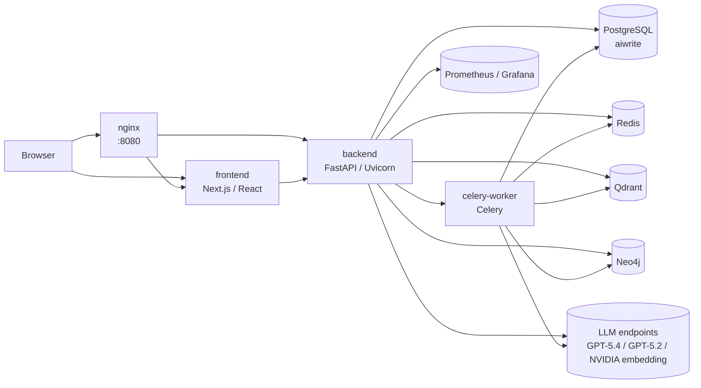
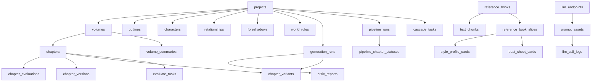
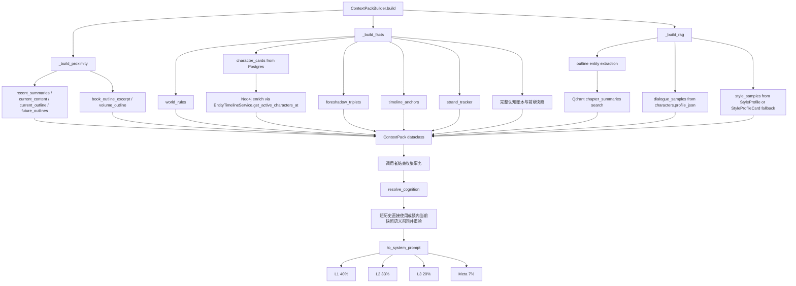

# AI-Write Project Structure

## 弧规划认知来源与实际输入（2026-10-09，未部署）

| 位置 | 职责与边界 |
|---|---|
| `backend/app/services/planning_cognition_sources.py` | 真实末尾边界读取全部完成章有效决定，空决定也保留完整覆盖凭据 |
| `backend/app/services/planning_cognition_material.py` | 来源v1、完整原件与逐次选择回执校验；同步校验内复用不可变观察值，坏选择仍可审阅 |
| `backend/app/services/planning_cognition_retrieval.py` | 事务外逐次选材；12,000字符完整原句预算、长历史沿用现有语义召回 |
| `backend/app/services/arc_planning_sources.py` / `arc_planning_journal.py` / `arc_planning_execution.py` | 来源v5/journal v2、完整实际输入、修复查询、原预算及选择后短事务复验 |
| `backend/app/services/character_cognition.py` / `cognition_validation.py` | 追加完整snapshot，原snapshot_hash算法不变；SQLite/PG统一UUID对象绑定 |
| `backend/app/services/cognition_context.py` / `cognition_retrieval.py` | 共用不可变观察渲染与带排名的选择结果，旧字符串检索接口继续可用 |
| `frontend/src/components/arc/ArcPlanningInputs.tsx` | 完整原件和每次实际输入按需展开，状态/历史列表不附长文 |
| `backend/tests/test_arc_cognition_*.py` / `test_planning_cognition_material.py` | 44项离线、2项真实PG；实际修复/恢复、作者校订、500万字、失败和损坏记录 |

宽重点269通过/33跳过，补测23通过，优化后重点170通过/4跳过；全目录4517通过/760服务跳过/2本机排除/2既有警告（412.48秒）。24个Python AST、类型/20页构建与冻结本地双视角复核完成。2项新PG与8项前端行为未执行，无新迁移，a1001958未应用；位置/未完线索/更广事实及文学验收继续，见[本批报告](docs/evaluation/arc-cognition-20261009.md)。

## 正文来源证明复用模块（2026-10-09，未部署）

| 位置 | 职责与边界 |
|---|---|
| `backend/app/services/source_proof_cache.py` | 共用有界、线程安全LRU；只保存不透明证明摘要 |
| `backend/app/services/entity_source_validation.py` | 当前实体及元信息逐次检查，缺少确切正文/引文证明时分批全文校验，不缓存可变载荷 |
| `backend/app/services/entity_sources.py` | 保留公开来源入口，元信息读取可先排除当前/未来章；未知指纹继续全文回读 |
| `backend/app/services/cognition_validation.py` | 复用缓存类，认知实例和验证算法独立且保持原合同 |
| `backend/tests/test_entity_source_proofs.py` / `test_entity_source_proofs_scale.py` | 冷/热读取、改稿/来源/引文/未保存编辑边界，555万字符和实际弧阶段调用 |
| `backend/tests/support/body_hashes.py` / `test_chapter_content_hash_migration.py` | SQLite指纹模拟与新增真实PG用例；后者未执行，二者证据不得混用 |

新增40项离线与1项真实PG；重点212通过/20跳过、规模2通过、补测1通过，全目录4473通过/758服务跳过/2本机排除/2既有警告（335.97秒）。8个Python AST和冻结本地双视角复核完成。1006章/5547650字符冷读6批、热读0正文、改单章5539字符；无前端/新迁移，a1001958未应用。认知、线索、更广事实及文学验收继续，见[本批报告](docs/evaluation/entity-source-proofs-20261009.md)。

## 弧规划人物来源模块（2026-10-09，未部署）

| 位置 | 职责与边界 |
|---|---|
| `backend/app/services/planning_character_sources.py` | 真实末卷/全书位置边界，Volume/Chapter 锁，当前图谱人物来源；不读 PG 人物投影 |
| `backend/app/services/planning_character_material.py` | 完整档案、逐字段状态、关系方向与原句、位置的持久形状校验及统一文字；同名不同节点须核对 |
| `backend/app/services/entity_context.py` / `entity_timeline.py` | 共用快照可含档案与有来源的位置；先验证位置来源再取最后有效章，同章多项保留，取消全局 2000 条截断 |
| `backend/app/services/character_project_guard.py` / `api/neo4j_settings.py` | 正式人物图谱写入持 Project SHARE；投影前释放，错误/取消排空回滚 |
| `backend/app/services/arc_planning_sources.py` / `arc_planning_contract.py` | source v4 增加 character_context v1，book_context 仍 v2；所有实际阶段、详情共用完整材料，旧协议原件不补造来源 |
| `backend/tests/test_arc_character_material.py` / `test_planning_character_sources.py` / `test_character_project_guard.py` | 实际离线调用、来源边界、角色与位置歧义、恢复预算、写入保护、554 万字符验证 |
| `backend/tests/test_arc_character_pg.py` / `test_planning_character_graph.py` | 3 项真实 PG 竞争与 2 项 PG+Neo4j，用例保留但未执行 |

新增86项离线；最终重点209通过/52跳过，补测93通过，全目录4433通过/757服务跳过/2本机排除/2既有警告（321.80秒）。23个Python AST与冻结本地复核完成；无前端/新迁移，a1001958未应用。引用正文重复校验仍回读原文，认知/线索/更广事实和连续章文学验收继续，见[本批报告](docs/evaluation/arc-characters-20261009.md)。

## 人物身份输入与称谓观察模块（2026-10-09，未部署）

| 位置 | 职责与边界 |
|---|---|
| `backend/app/services/fact_contract.py` | 当前确认书纲文字先投影；来源/正文摘要、同称谓多名及需上下文核对的观察；旧档案不补回当前书纲没有明确的槽位 |
| `backend/app/services/outline_readiness.py` | 共用有效内容判断明确排除空白字符串，继续检查后续有效字段 |
| `backend/tests/test_fact_contract.py` / `test_fact_contract_sources.py` | 作者改名、坏当前来源、实际选择SQL、同称谓多名与登记来源合同 |
| `backend/tests/test_generation_task_execution_core.py` | 实际任务报告/原稿保存及同会话未保存编辑保护；其他模型评审仍为离线替身 |
| `backend/tests/test_outline_readiness.py` | 空白字段和后续真实文字的就绪边界 |

新增48项离线，重点157通过；全目录4347通过/752服务跳过/2本机排除/2既有警告（308.16秒），6个Python AST和两轮冻结本地双视角复核完成。无前端/迁移新增，a1001958未应用；人物现状/关系/认知/正文事实进入弧规划继续。报告与实际验证边界见[本批报告](docs/evaluation/identity-input-20261009.md)。

## 当前世界规则来源模块（2026-10-09，未部署）

新增54项离线通过；重点257通过/15跳过，复核补测79通过/15跳过；全目录4299通过/752服务跳过/2本机排除/2既有警告（311.33秒）。31个Python AST、类型/20页构建和两轮冻结本地双视角复核完成。4项新PG+Neo4j与11项新前端行为未执行。

| 位置 | 职责与边界 |
|---|---|
| `backend/app/services/world_rule_sources.py` | 当前完整图谱读取、所选书纲依据核对和Project锁；不回退PG副本 |
| `backend/app/services/world_rule_material.py` | 来源分类、完整提示投影、实际节点版本与旧节点展示身份 |
| `backend/app/services/world_rule_writes.py` | 作者规则创建/修改/删除；原键/原版本、作品锁与单个图谱事务 |
| `backend/app/services/outline_settings_source.py` / `outline_settings_graph.py` / `outline_settings_delivery.py` | 完整书纲材料指纹及持久提取恢复使用当前完整来源 |
| `backend/app/services/planning_book_sources.py` / `planning_book_material.py` / `arc_planning_*.py` | 新图谱来源贯穿全部弧阶段，旧有效来源保持原输入，变化停止、暂时失败可恢复 |
| `backend/app/services/context_pack.py` / `api/settings.py` | 实际写作采集与列表共用当前规则；`memory.py`兼容入口同步接线，无已知外部调用者 |
| `backend/app/api/neo4j_settings.py` / `tasks/entity_tasks.py` | 当前图谱写入后可失败的PG投影；不再按相似度覆盖规则 |
| `frontend/src/components/panels/SettingsPanel.tsx` | 来源提示、完整编辑稿、显式更新基准及删除后读取确认 |
| `backend/tests/test_world_rule_sources*.py` / `backend/tests/support/world_rules.py` | 离线来源/文本/恢复边界与独立真实PG+Neo4j用例；假图谱不证明Cypher |
| `frontend/src/__tests__/worldRuleEditor.test.tsx` | 冲突、重读、删除与未知回执行为用例；未执行Vitest |

新规划source version=3、book_context version=2；有效旧version=1/2保留原材料。未新增迁移；真实服务、浏览器行为与文学验收分别待完成，验证与冻结复核见[本批报告](docs/evaluation/world-rule-sources-20261009.md)。下列既有批次段落保留各自完成时的边界。

> 2026-10-09 弧规划全书材料：完整立意/书纲/PG登记规则进入全部阶段与来源，两端可查看原件；旧请求保留。18项新增离线通过，4项新增PG和2项新增前端行为未执行；最终全目录4246通过/748服务跳过/2本机排除/2既有警告（307.61秒），12个Python AST、类型/20页构建及三轮冻结本地复核通过。无新迁移，a1001958未应用、未部署；规则副本与图谱来源核对及人物/正文事实接入继续。详见[本批报告](docs/evaluation/arc-book-material-20261009.md)。

## 弧规划全书材料模块（2026-10-09）

| 位置 | 职责与边界 |
|---|---|
| `backend/app/services/planning_book_sources.py` | 读取项目原字段、按当前权威选取的完整书纲和PG规则；锁候选ID和规则，历史书纲不读全文 |
| `backend/app/services/planning_book_material.py` | 纯来源校验和完整文字投影；作者文字优先，明确设定/计划不证明正文已发生 |
| `backend/app/services/arc_planning_sources.py` / `arc_planning_contract.py` | 新来源version=2，保留旧version=1读取，变化后停止续接 |
| `backend/app/services/arc_planning_journal.py` / `arc_outline.py` | 元信息、章节批次、修复和恢复沿用同一完整全书材料 |
| `frontend/src/components/arc/ArcPlanningPanel.tsx` / `frontend/src/lib/arcPlanning.ts` | source及持久detail实际全文核对，轻量状态/历史不附长文 |
| `backend/tests/test_arc_book_material.py` / `test_arc_planning_pg.py` | 18项离线与4项新增未执行PG竞争；PG组现共11项 |
| `frontend/src/__tests__/arcPlanning*.ts*` / `fixtures/arcPlanning.contract.json` | 最新离线ASGI合同；新增2项行为未执行，本组25项仍待执行 |

当前世界规则仍为PG读投影；本模块未核对当前Neo4j或原提取书纲版本，人物/关系/认知/正文事实继续接线。

> 2026-10-09 弧规划恢复：独立固定请求与阶段持久化、作品物理锁恢复和完整创建回执接入两端。72项新增离线通过；全目录4228通过/744服务跳过/2本机排除/2既有警告（296.60秒），32个Python AST、前端类型/20页构建及两轮冻结本地双视角复核通过。7项真实PG和23项前端行为未执行；a1001958未在真实PG应用、未部署。详见[本批报告](docs/evaluation/arc-planning-recovery-20261009.md)。

## 弧规划请求与恢复模块（2026-10-09）

| 位置 | 职责与边界 |
|---|---|
| `models/arc_planning.py` / `alembic/versions/a1001958_arc_planning_requests.py` | 完整请求/来源/阶段/回执、同书活动唯一索引；删卷留存，PG降级表锁与非空保护 |
| `services/arc_planning_contract.py` / `arc_planning_journal.py` | 原请求与来源校验、阶段顺序、完整输入/有限尝试、已接受输出及预算核对 |
| `services/arc_planning_sources.py` / `arc_planning_requests.py` | 当前前弧文字/作者进度、实际目录来源、短事务受理/取消/恢复命令 |
| `services/arc_planning_execution.py` / `arc_materialization.py` | 共用物理执行锁、预占后调用/原执行保存、完整分卷/章稿/大纲/回执同事务 |
| `services/prompt_execution_snapshot.py` / `prompt_registry.py` | 无凭据注册提示和逻辑路由快照；既有Registry调用，不承诺固定CPA上游 |
| `services/arc_planning_dispatch.py` / `tasks/arc_tasks.py` | Beat有界补投原请求，独立于五类GenerationTask，实际锁内才核查 |
| `api/arc_planning.py` / `services/arc_planning_views.py` | 受理、来源、轻量状态/游标历史、完整详情及作者命令 |
| `frontend/src/lib/arcPlanning.ts` / `components/arc/arcPlanningSession.ts` | HTTP身份/原材料校验、sessionStorage暂存、同编号恢复、迟到响应隔离 |
| `frontend/src/components/arc/ArcPlanningPanel.tsx` | 两端共用填写材料、规划/停止/恢复、全部章纲/原输出审阅及下载 |
| `backend/tests/test_arc_planning_*.py` / `test_prompt_execution_snapshot.py` | 72项新增离线与7项未执行真实PG；ASGI合同、500万字查询及回滚竞争 |
| `frontend/src/__tests__/arcPlanning*.ts*` / `fixtures/arcPlanning.contract.json` | 真实离线ASGI合同与23项未执行前端行为用例 |

上表省略的Python路径均相对`backend/app/`（迁移相对`backend/`）。当前输入包含本次作者、前弧及全书基础材料；人物/正文事实与图谱规则来源接入另行继续，源码迁移单头为`a1001958`。

> 2026-10-09 作者弧材料：新增纯作者材料投影，实际写作和API brief共用；原开场按ID传递、当前文字全文去重、必需预算保真。新增12项离线，重点204通过/12服务跳过，全目录4156通过/737服务跳过/2本机排除/2既有警告（269.01秒）；6个Python AST、迁移单头与冻结本地双视角复核通过。无前端/迁移新增、未部署；a1001957和真实PG Builder仍未执行。详见[本批报告](docs/evaluation/arc-author-material-20261009.md)。

## 作者原始弧材料投影（2026-10-09）

| 位置 | 职责 |
|---|---|
| `backend/app/services/arc_author_material.py` | 原作者材料与当前文字权威的纯投影、原开场身份、完整描述扩展和无效输入校验 |
| `backend/app/services/arc_progress_material.py` | 当前来源/章节核对后返回正文材料和全文去重标记；保留文字调用兼容 |
| `backend/app/services/context_pack.py` / `arc_loop.py` | 实际必需预算及API brief共用投影，当前文字不再重复出现在可选卷纲块 |
| `backend/tests/test_arc_author_material.py` | SQLite来源、完整输入/身份/修订/去重/预算的12项离线用例 |
| `docs/evaluation/editorial-revision-20261009/` | 渡口姐弟的离线编辑示范及原稿对照；不是实际模型新产出 |

> 2026-10-09 作者弧进度：新增稳定卷章来源、作者逐稿确认与追加回执，接入桌面/移动、历史目录和实际ContextPack。重点257通过/12服务跳过；全目录4144通过/737服务跳过/2本机排除/2既有警告（269.19秒），23个Python AST、前端类型与20页构建通过，两轮冻结本地双视角复核完成。89项新增离线通过；6项真实PG、41项前端行为未执行，迁移单头a1001957未在真实PG应用，未部署。详见[本批报告](docs/evaluation/arc-progress-20261009.md)。

## 作者弧进度与保存稿模块（2026-10-09）

| 位置 | 职责与边界 |
|---|---|
| `backend/app/models/arc_progress.py` / `alembic/versions/a1001957_arc_progress_writes.py` | 固定请求、每卷序号、完整原稿/原来源/结果及摘要；只关联Project外键，删章卷保留历史 |
| `backend/app/services/arc_progress_contract.py` | 请求与回执校验、计划/结束来源、初始进度；旧无身份方向只留历史 |
| `backend/app/services/arc_progress_reader.py` | 选择当前弧纲和本弧最多40章、验证当前确认回执、标识变化/移出和稳定待写ID；列表不读历史原稿 |
| `backend/app/services/arc_progress_writes.py` | 作品锁内六类作者决定、逐字比较保存稿、同事务历史/进度；准备函数不提交 |
| `backend/app/services/arc_progress_material.py` / `context_pack.py` | 实际前章作者说明与目标章方向接入必需完整材料；来源变化明确停止 |
| `backend/app/api/arc_progress.py` / `api/arc.py` | 稳定分卷进度GET/POST、历史目录/分页/详情；旧三写接口428，brief/下一弧核对正式进度 |
| `frontend/src/lib/arcProgress.ts` / `components/arc/arcProgressSession.ts` | 严格HTTP合同、完整原请求暂存/重试与持久详情确认；历史回执不能覆盖当前进度 |
| `frontend/src/components/arc/ArcProgressPanel.tsx` / `ArcManuscriptReview.tsx` / `ArcProgressHistory.tsx` | 桌面/移动共用完整保存稿审读、作者操作、删卷历史和全文下载，按实际ID回编辑器 |
| `backend/tests/test_arc_progress*.py` / `tests/support/arc_progress.py` | SQLite事务/ASGI合同/规模/历史/方向时序/迁移；6项真实PG与Builder联调未执行 |
| `frontend/src/__tests__/arcProgress*.ts` / `arcManuscriptReview.test.tsx` / `fixtures/arcProgress.*` | 真实SQLite/ASGI合成合同、未知请求/迟到响应和保存稿门禁；41项行为用例未执行 |

作者进度表由`a1001957`引入，当前迁移单头为`a1001958`。`result_json.progress`是正式作者进度来源，旧`Outline._arc`只保留规划与历史报告。作者确认不修改Chapter正文/status，不代表模型文学质量已通过。

> 2026-10-09 弧完整规划：新增有界规划与来源选择模块，规范chapter_summaries、稳定卷章身份和作者材料保留；章节草稿随完整计划一次保存。已报告进度后的重排停止续写，不借计数猜章；长书当前查询只取当前卷纲全文。首轮冻结本地复核修复后重点263通过/6服务跳过，14个Python AST通过；全目录4055通过/731服务跳过/2本机排除/2既有警告（251.37秒），两轮冻结本地双视角复核完成，新增98项离线。无新迁移/前端变更，未部署，文学效果未验收。详见[本批报告](docs/evaluation/arc-planning-20261009.md)。

## 弧规划与章节材料模块（2026-10-09）

| 位置 | 职责与边界 |
|---|---|
| `backend/app/services/arc_outline.py` | 4–40原请求、元信息/五章批次、完整材料与严格输出校验、每阶段一次完整修复；失败不报半截成功 |
| `backend/app/services/prompts/arc_planning.py` | 当前弧整体/章节展开角色；人物选择、已有长线、合理创造、场面详略与规划事实分离 |
| `backend/app/services/arc_sources.py` | 稳定分卷及确认版本选择、完整来源快照；先读选择元信息，只取当前卷纲全文，不读取章稿 |
| `backend/app/services/arc_loop.py` | 兼容旧状态序列化、作者文字权威与稳定章节完整brief；正式进度由arc_progress_reader投影，API不能猜旧beats身份 |
| `backend/app/api/arc.py` | start/next-arc兼容入口转入持久弧请求；原内部完整保存辅助函数共用arc_materialization，正式作者进度/brief继续原合同 |
| `backend/app/services/prompt_registry.py` / `prompt_recommendations.py` | 独立弧阶段资产，初次种子继承outline_volume端点/模型/温度/预算；不覆盖已配置资产 |
| `backend/tests/test_arc_planning.py` / `test_arc_validation.py` | 真实Registry交付、完整批次、全部原材料、异常JSON/结束/取消/预算与路由替身验证 |
| `backend/tests/test_arc_persistence.py` / `test_chapter_order_maintenance.py` | 实际SQLite保存/回滚/版本选择/原章重排/长书读取；不代替真实PG竞争验收 |

> 2026-10-09 分场规划校验：新增`scene_plan_contract.py`，字段/结构化台账/篇幅校验从编排分离；Registry提供严格JSON与调用方负责修复的选项，保持原导入兼容。原始文字、错误阶段与完整旧规划参与一次修复；弧纲拒绝解析失败后误报可用。最终重点210通过，新增67项离线；全目录3957通过/731服务跳过/2本机排除/2既有警告（238.55秒），9个Python AST及两轮冻结本地双视角复核完成。无新迁移/前端变更，a1001956未应用，未部署；文学效果未验收。详见[本批报告](docs/evaluation/scene-planning-validation-20261009.md)。

## 分场规划校验与修复模块（2026-10-09）

| 文件 | 职责 |
| --- | --- |
| `backend/app/services/scene_plan_contract.py` | SceneBrief、非空文字/台账类型、别名一致性、自然场数边界和原章预算85%–115%；不判文学好坏 |
| `backend/app/services/scene_orchestrator.py` | 最多两轮规划，完整旧输出/作者材料参与修复，每轮固定硬超时；兼容导出SceneBrief及既有辅助函数，正文保留全章此前原文 |
| `backend/app/services/prompt_registry.py` | 所有结构化调用拒绝显式异常结束；分场选择严格JSON并关闭内层重试，返回解析失败阶段；其他任务保留原本地JSON修复默认 |
| `backend/app/services/narrative_contract.py`、`prompts/scene_writing.py` | v4_15共享合同与默认Prompt：按人物选择、关键动作及实际结果安排详略，允许静场和合理省略 |
| `backend/app/services/arc_loop.py` | 消费Registry失败时返回不可用，阻止start/next-arc继续保存空弧纲；本批未完成全部弧纲schema治理 |

无数据库迁移。两轮指逻辑调用，Provider内部原重试/降级仍可能产生多个HTTP请求。模型声明的分场预算不等于最终正文长度；合法JSON、字段完整和保留台账也不能认证人物动机或事实正确。现有注册Prompt不自动覆盖。

> 2026-10-09 旧Run阶段记账：新请求冻结候选数量，初稿/候选/评审有界尝试，改写调用前预占原预算；正文/报告/交付同事务，恢复先核对未知交付，旧缺历史不补猜。三轮冻结本地复核修复坏检查点读取500及初稿漏查孤立评审；重点310通过/15服务跳过，新增54项离线及3项PG，PG未执行，13个Python AST通过。全目录3890通过/731服务跳过/2本机排除/2既有警告（248.75秒）；无新迁移/前端变更，a1001956未应用、未部署，CPA连续章文学验收仍待完成。详见[本批报告](docs/evaluation/generation-run-attempts-20261009.md)。

## 旧 Run 调用记账模块（2026-10-09）

| 文件 | 职责 |
| --- | --- |
| `backend/app/services/generation_run_attempts.py` | 新请求的版本化有界尝试、预算预占、交付摘要及中断核查；只由已持作品锁的运行器使用 |
| `backend/app/services/generation_run_views.py` | API与运行器共用的安全只读投影，保留损坏原值，不补猜历史 |
| `backend/app/services/generation_runner.py` | 调用前提交尝试，报告/检查点/交付同事务；固定候选配置和显式有限恢复 |
| `backend/tests/support/generation_run_fixture.py` | 测试专用的明确新版历史夹具，禁止用于生产旧记录升级 |

复用已有JSON检查点，不新增迁移。`rewrite_count`含未确认的改写尝试；最大配置最多83个逻辑阶段尝试。普通重复POST只读，未知交付、坏历史与阶段预算耗尽待审。模型HTTP、全部上下文冻结、真实服务与文学质量不由该journal证明。


> 2026-10-09 新增`generation_task_sources`、`generation_task_recovery`、`generation_task_dispatch`及a1001956；来源/进度类型/派发时间/历史进入任务模型，明确Celery恢复入口和周期控制队列，参考骨架改为窄列读取。两轮冻结本地复核修复旧pending记录及空流误判；最终重点346通过/34服务跳过，全目录3836通过/728服务跳过/2本机排除，19个Python AST通过。新增101项离线及7项PG用例，PG未执行；a1001956未应用，无前端改动、未部署。旧Run中断预算和CPA连续章文学验收仍待完成。详见 [本批报告](docs/evaluation/independent-task-recovery-20261009.md)。

> 2026-10-09 独立任务执行：独立正文/四类大纲已统一作品锁、执行UUID/首次参数/心跳；正文保存证明与正文同事务，正常和异常保存绑定原物理连接。三轮冻结本地双视角复核修复子任务误入、来源拒绝与取消交错及连续取消清理。最终重点304通过/39服务跳过，全目录3735通过/721服务跳过/2本机排除，18个Python AST通过。新增63项离线与11项真实PG用例，PG未执行；a1001955未应用，无前端变更、未部署。过期接管/有限恢复/补投及CPA连续章文学验收仍待完成。详见 [本批报告](docs/evaluation/independent-task-execution-20261009.md)。

> 2026-10-09 旧Run固定请求：新增`generation_run_submissions`模型/服务与a1001954，原请求、章稿/分卷来源与初始Run同事务；重复POST只读原记录，删章留存请求，恢复锁内核对来源及预算。两轮冻结本地复核补修GET提交交错和降级并发窗口。最终重点256通过/26服务跳过，全目录3672通过/710服务跳过/2本机排除；11个Python AST通过。81项新离线与7项真实PG用例，PG未执行，无前端变更、a1001954未应用、未部署。详见 [本批报告](docs/evaluation/generation-run-submissions-20261009.md)。

> 2026-10-09 批次中断恢复：独立PG会话锁、版本/心跳、接管凭证、同事务正文证明及最多3次逐章尝试已接入。已交付保留，无交付且来源不变才恢复；部分稿/作者修订/清单损坏待审并停止后续。Beat按原请求有界补投，旧执行的ORM/Core写入受保护。两轮冻结本地复核修复派生摘要误判、父子锁顺序和核查历史覆盖；最终重点228通过/69服务跳过，全目录3591通过/703服务跳过/2本机排除，22个Python AST通过。7项新增真实PG未执行；a1001953未应用、无前端变更、未部署。独立异步/旧Run与固定CPA连续章文学验收仍待完成。详见 [本批报告](docs/evaluation/batch-recovery-20261009.md)。

> 2026-10-09 批量请求：新增`generation_batches`/`generation_batch_items`及a1001952；`batch_submissions`统一完整原稿/固定编号、持久清单、认领和进度，`BatchGenerator`按所属凭证顺序调用原单章链。新增GET进度并升级原SSE，断开保留完成记录、取消未开始子任务。最终重点119通过/17服务跳过，全目录3533通过/696服务跳过/2本机排除，13个Python AST及冻结本地双视角复核通过。5项新真实PG未执行，无前端改动，a1001952未应用、未部署。详见 [本批报告](docs/evaluation/batch-submissions-20261009.md)。

> 2026-10-09 卷纲工作流：新增`volume_outline_writes`模型/服务/API与a1001951，提供完整来源、固定请求、文字/结构保存及分页历史；新候选核对稳定目标/全文，旧卷纲接口补原稿与提交确认。新增`volume_order`单事务相邻交换；前端共用卷纲会话/编辑器/历史/选取规则并接入两端。最终重点221通过/23服务跳过，全目录3497通过/691服务跳过/2本机排除；18个Python AST、类型/20页构建和两轮冻结本地复核通过。35项新增前端行为及5项真实PG未执行，a1001951未应用、未部署。详见 [本批报告](docs/evaluation/volume-outlines-20261009.md)。

> 2026-10-09 异步提交：客户端固定UUID、原请求摘要、完整原稿前提、提交来源与pending认领已接入；普通/参考小说共用提交后派发，批量先固定全组选章。桌面/移动保留原请求并防止迟到列表降级终态。最终重点118通过/33服务跳过，全目录3415通过/686服务跳过/2本机排除；13个Python AST、类型/20页构建与三轮冻结本地双视角复核完成。5项真实PG及前端行为未执行；无新迁移，a1001950未应用、未部署。进程恢复、卷纲正式采用与固定CPA连续章文学验收仍待完成。详见 [本批报告](docs/evaluation/async-submissions-20261009.md)。

> 2026-10-09 旧兼容正文：新旧保存入口共用原稿检查、作品/章节锁、完整旧稿备份及提交确认；正文与标题/细纲/摘要/章号组合仍同事务，提交后才通知提取。旧正文PUT缺前提返回428，新增嵌套保存回执。重点115通过，全目录3333通过/681服务跳过/2本机排除，8个Python文件AST及冻结本地双视角复核完成。真实PG竞争扩为6项未执行，无前端/迁移变更，a1001950未应用、未部署。异步入队基准/幂等、卷纲正式采用与CPA连续章文学验收仍待完成。详见 [本批报告](docs/evaluation/legacy-manuscript-20261009.md)。

> 2026-10-09 移动正文：复用按章会话/完整保存回执，切章暂存，后台任务不回填编辑区，终态只读核对原章节；新增任务作品/章节/卷号来源与活动查询，128条分页和200字符列表进度。复核补正确卷号、卷纲候选说明及大纲查看。重点62通过，全目录3313通过/677服务跳过/2本机排除；3个Python文件AST、前端类型/20页构建和两轮冻结本地双视角复核完成。34项前端行为未执行；无新迁移，a1001950未应用、未部署。旧兼容写入口、卷纲正式采用及CPA连续章文学验收仍待完成。详见 [本批报告](docs/evaluation/mobile-manuscript-20261009.md)。

> 2026-10-09 桌面正文：新增 `api/chapter_manuscripts.py` 完整原稿保护及提交回执，`chapterManuscripts.ts` 对齐合同；`chapterDraftSession`、`useChapterDraft`、`ChapterSaveStatus` 管理按章串行保存/暂存/全文核对，`chapterGeneration` 隔离生成并只读核对保存稿。重点91通过/2服务跳过，全目录3290通过/677服务跳过/2本机排除；4个Python文件AST、前端类型/20页构建与两轮冻结本地复核完成。41项前端行为及2项真实PG未执行；无新迁移，a1001950未应用、未部署。详见 docs/evaluation/desktop-manuscript-20261009.md。

> 2026-10-09 版本恢复：新增 `version_application.py` 与当前保存稿端点，恢复锁内逐字比较并完整备份，版本写入先锁章节父行。新增 `chapterVersions.ts`、`VersionDiffView`，重写版本面板以使用实际合同；仅比较标记与实际正文分开。重点70通过/4服务跳过，全目录3271通过/675服务跳过/2本机排除；6个Python文件AST、前端类型/20页构建及三轮冻结本地复核完成。4项真实PG和12项前端行为用例未执行；无新迁移、未部署，a1001950未应用。详见 docs/evaluation/version-application-20261009.md。

> 2026-10-08 旧生成执行：新增`generation_execution.py`持锁连接与重连保护；start在锁内验证/创建/执行，resume重读当前状态，API返回已保存快照。提交不明禁止旧任务改状态，清理排空后释放，复核修复连续取消窗口。最终重点175通过/7服务跳过，全目录3241通过/671服务跳过/2本机排除，8个Python文件AST与两轮冻结本地复核完成。新增5项真实PG用例未执行；无新迁移/前端变更，a1001950未应用、未部署。详见 docs/evaluation/generation-execution-20261008.md。

> 2026-10-08 候选应用：新增`chapter_content.py`共用正文保护、`variant_application.py`负责锁内原稿比较与完整备份；API区分只选/应用、版本冲突及提交未确认。候选保存/刷新/选择共用章节父锁。最终重点164通过/16服务跳过，全目录3202通过/666服务跳过/2本机排除，7个Python文件AST与两轮冻结本地复核完成。新增2项真实PG用例未执行；无新增迁移/前端改动，累计a1001950未应用，未部署。详见 docs/evaluation/variant-application-20261008.md。

> 2026-10-08 评审完整性：新增`review_contract.py`、`critic_reports.review_json`及a1001950；旧运行器/图分支/候选API共用本稿完整性判断，逐稿checkpoint，恢复重新核对当前来源和整组候选。相同保存稿只更新报告，候选ID/作者选择保留。CheckerManager、`qualityReview.ts`和CheckerDashboard统一状态/名称、隔离迟到响应、完整展示引文。最终重点145通过，全目录3182通过、664服务跳过、2本机排除；20个Python文件AST、前端类型/构建和三轮冻结本地复核完成。9项前端行为用例未执行，迁移未执行、未部署。详见 docs/evaluation/review-completeness-20261008.md。

> 2026-10-08 活跃认知索引治理：新增`cognition_index_lock.py`，检索准备和清理按书互斥；`cognition_index_maintenance`核对完整来源、逻辑编码器与确切载荷后分批回收，未知数据/回收站保留。周期任务只读一次目录，向每书任务和续批传集合清单。最终后端3072通过、664服务跳过、2项本机排除；重点145通过/3跳过，12个Python文件AST与两轮冻结本地复核完成。无新迁移/前端变更，a1001949未应用、未部署。详见 docs/evaluation/cognition-index-cleanup-20261008.md。

> 2026-10-08 认知语义召回：新增`embedding_space.py`、`cognition_retrieval.py`、`cognition_index_maintenance.py`，完整快照、不可变片段、事件分组与结束前重验接入正文/分场/修订/评审。当前候选逐次准备，旧运行器也传递完整有界提示并停止认知失败后的继续生成。最终后端3019通过、661服务跳过、2项本机排除；43个Python文件AST与三轮冻结本地复核完成。无新迁移/前端变更，a1001949未执行、未部署；真实服务与CPA文学验收待完成。详见 docs/evaluation/cognition-retrieval-20261008.md。

> 2026-10-08 认知来源读取：新增`chapters.content_hash`、轻量来源回执与`cognition_validation`有界原句证明缓存；全体前章与实际作者决定仍重新核对。1005章/5071235字符实测冷读一遍、热读0字、改一章读5063字；非法完成章位置不再漏掉。最终后端2920通过、661服务跳过、2项本机排除；重点205通过，8个Python文件AST及冻结本地双视角复核完成。a1001949未在真实PG执行、未部署，无前端变更。详见 docs/evaluation/cognition-source-validation-20261008.md。

> 2026-10-08 作者认知校订：新增`cognition_revisions`、`source_mode`与当前决定指针，`cognition_edits`保存校订/恢复自动及原模型快照；共用读取校验作者决定，提示区分得知/未知/确信或误信/怀疑。桌面移动共用编辑器、历史及草稿/原请求保护。最终后端2880通过、654服务跳过、2项本机排除；重点165通过，前端类型与构建通过，新增17项前端行为用例未执行。a1001948未在真实PG执行、未部署，两轮冻结本地复核完成。详见 docs/evaluation/cognition-author-edits-20261008.md。

> 2026-10-08 作者认知模块：新增`cognition_requests`、`cognition_backfills`与ChapterCognition.cycle_id；`cognition_reader`共用完整来源/结果校验，`cognition_requests`绑定作者回执，`cognition_backfill`分批交接，`api/cognition.py`与桌面/移动面板接入。最终后端2837通过、651服务跳过、2项本机排除；重点180通过，前端类型检查与生产构建通过，新增15项前端用例未执行。a1001947未在真实PG执行、未部署，已完成两轮冻结本地复核。详见 docs/evaluation/cognition-author-workflow-20261008.md。

> 2026-10-08 人物认知工作流：新增cognition_context.py提供带完整原句的历史节选，character_cognition.load_prompt_context统一写作与评审入口；当前来源未完成/损坏、必要节选超预算时阻断。ChapterCognition新增delivery_id/attempt_count，Celery透传原任务ID并保留最多4次执行预算。重点122通过、34服务跳过；全目录2794通过、648服务跳过、2项本机排除。a1001946未在真实PG执行、未部署，首轮冻结复核发现的租约失效调用和偏斜历史遍历问题已修复，复核记录见本批报告。详见 docs/evaluation/cognition-workflow-20261008.md。

> 2026-10-08 长书关系输入：先提取完整本章，再按实际变化的人物对读取来源核实的旧关系，完整证据分批核查并持久保存进度。修复迟到周期任务重启模型重试及核查中删章误报失败。最终后端2739通过、646服务跳过、2项本机排除，重点215通过；两轮冻结本地复核完成。0/300/5000条无关关系不增加本章模型输入，5000条相关记录完整分313批。新增a1001945尚未在真实PG执行、未部署；真实服务、长书费用/写量及CPA连续章文学验收仍待完成。详见 docs/evaluation/relationship-input-workflow-20261008.md。

> 2026-10-08 关系变化结束范围：抽取显式引用有来源的旧关系，只结束确切记录，保留并行身份、完整引文及待核对范围；作者改动不被旧引用覆盖。图谱/PG投影版本升为3，旧缓存重放不补猜目标。冻结复核修复逐章重复扫描，5000条关系折叠从2.55秒降至0.20秒。最终后端2653通过、644服务跳过、2项本机排除，重点180通过；两轮本地冻结复核完成。无新SQL迁移、无前端改动、未部署，累计a1001944未执行；长书实际预算、真实服务及CPA连续章文学验收待完成。详见 docs/evaluation/relationship-change-scope-20261008.md。

> 2026-10-08 作者关系写入：新增原版本/固定请求校验、图谱原子回执、确切正文与大纲来源抑制、当前值投影及60秒恢复。作者改动单独标为设定，类型改名保留PG行ID与分卷历史，删除前留存完整原记录；旧无来源入口和人物删除接入共用锁。界面保留待确认请求并共用草稿。冻结复核修复逐条查询及迟到读取重新初始化旧稿，1005条未变作者关系从3021次SQL降为6次。最终后端2600通过、642服务跳过、2项本机排除，重点166通过；前端类型检查与生产构建通过，新增组件测试因执行入口未确认而未运行。无新增SQL迁移、未部署，累计a1001944未执行；真实服务和CPA连续章文学验收待完成。详见 docs/evaluation/relationship-author-writes-20261008.md。

> 2026-10-08 关系上下文：新增 `relationship_context.py` 统一来源核对后的关系折叠与有向渲染，`ContextPack` 独立保存关系及档案别名候选，并纳入必需预算；必要图谱失败阻断主生成。最终后端2547通过、636服务跳过、2项本机排除，冻结本地双视角复核完成。无新迁移、无前端改动、未部署；真实服务、作者关系来源治理及CPA文学验收待完成。详见 docs/evaluation/relationship-context-20261008.md。

> 2026-10-08 人物状态模块：新增services/character_context.py，统一角色卡的完整JSON状态、逐字段来源、位置选择及Prompt渲染；context_pack.py继续兼容导出CharacterCard，PG/图谱共用组装逻辑。必要位置/状态/认知失败不伪装为空历史，认知提示使用有时间的节选语义。最终后端2514通过、633服务跳过、2项本机排除，冻结本地双视角复核完成；无新迁移/前端变更、未部署。详见 docs/evaluation/character-state-context-20261008.md。

> 2026-10-08 线索重扫模块：新增`foreshadow_discovery_run_items`与`foreshadow_review_requests`，Run新增扫描revision/调用模型名，Job记录重扫模式和实际Run。`services/foreshadow_review_requests.py`绑定请求，`foreshadow_discovery_reader.py`共用来源读取及历史完整性校验；`discovery-runs`与候选run筛选接入现有API。前端新增`ForeshadowDiscoveryHistory`与`lib/foreshadowReviewRequests.ts`，按材料保留未知请求。后端2483、前端314项及生产构建通过；633服务跳过、2项本机排除，a1001944未在真实PG执行、未部署。详见 docs/evaluation/foreshadow-rescan-20261008.md。

> 2026-10-08 大纲顺序模块：新增`services/outline_order.py`，提供稳定归属、原stub核对、机器位置维护及作者结构编辑绑定；接入`chapter_order`、卷章保存/生成、扩写与ContextPack。`chapter_outline_save`提供当前章纲及实际前章快照；计划读取和Prompt投影遵守作者文本权威，OutlineEditor隐藏内部字段并提示不可用旧计划。最终后端2446、前端300项通过及生产构建通过；628项服务跳过、2项本机排除，无新迁移、未部署。详见 docs/evaluation/outline-order-identity-20261008.md。

> 2026-10-08 章节顺序模块：新增`services/chapter_order.py`（结构锁、轻量顺序快照、版本及全书重编号）和`api/chapter_order.py`（提交边界/原子相邻交换）；接入卷章CRUD、生成落库、弧和异步空卷创建。`frontend/src/lib/chapterOrder.ts`与OutlineTree共用保存位置及双方版本；整书恢复清单/进度投影同步调整。后端2420通过、前端298通过及生产构建通过；626项服务跳过、2项本机排除，无新迁移、未部署。详见 docs/evaluation/chapter-order-maintenance-20261008.md。

> 2026-10-08 后端测试入口：`tests/support/offline.py` 负责外部服务标记与pytest配置后的意外I/O检查；`prompt_cache_state.py` 负责每个测试的缓存/后台任务清理。CI新增独立阻断式离线作业，保留真实服务作业。最终2366通过、623跳过、2项本机排除；无产品/迁移变更、未部署。详见 docs/evaluation/offline-regression-profile-20261008.md。

> 2026-10-08 伏笔来源模块：新增foreshadow_scope（持久化位置及实际顺序）、foreshadow_plans（当前大纲计划直读）、foreshadow_sources（作者登记与正文证据复核）；foreshadow_lifecycle成为共享只读上下文入口。API新增/plans，前端ForeshadowPlanList与记录来源提示；不再由大纲保存/旧ETL复制伏笔事实。后端492项、前端全量282项及生产构建通过，无新迁移、未部署。详见 docs/evaluation/foreshadow-chronology-20261008.md。

> 2026-10-08 正文线索登记：移除前4000字截断和模型直接写已埋；完整稿经持久任务生成候选/空结果回执，作者确认前重验来源，同稿重试不重置决定。补图谱整批投影来源保护。a1001942未执行；后端323项、前端全量277项及生产构建通过，未部署。详见 docs/evaluation/foreshadow-discovery-20261008.md。

> 2026-10-08 作者伏笔写入：CRUD新增原版本校验、固定请求编号、SQL请求绑定与图谱原子回执、当前值投影及后台同步恢复；失败保留草稿，迟到响应不清空新输入。新增a1001941未执行；162项后端、全量266项前端及生产构建通过，未部署。自动注册链/历史章号/真实联调仍待完成。详见 docs/evaluation/foreshadow-author-writes-20261008.md。

> 2026-10-08 伏笔证据入口：已埋线索可直接核查/确认，无须模型成熟度门槛；完整正文分批且逐项校验，移除评分驱动的强制收线提示和百分比。156项后端、31项前端及生产构建通过，未部署。此前“成熟度单边写入”判断已纠正：方法无调用者并已删除，历史分数保留兼容。详见 docs/evaluation/foreshadow-evidence-entry-20261008.md。

> 2026-10-08 图谱建议确认：新增持久请求、图谱原子决定回执、当前值投影、Celery恢复和确认同步界面，响应丢失/SQL失败不重放作者修改。a1001940未执行；后端108项、前端30项及生产构建通过，真实联调/部署待完成。此前成熟度判断已在后续证据入口核查中纠正。详见 docs/evaluation/foreshadow-graph-confirmation-20261008.md。


> 2026-10-08 核查历史留存：删除章节/卷/伏笔保留来源ID、证据和处理记录，来源不可用时禁确认；永久删除作品仍清理历史。a1001939未执行；后端78项、前端27项及生产构建通过，真实PG联调/部署待完成。详见 docs/evaluation/foreshadow-review-retention-20261008.md。


> 2026-10-08 建议处理记录：确认/忽略同事务记录首次时间及已验证登录账号，重试不覆盖，历史缺失不推测。新增a1001938未执行；后端80项、前端26项及生产构建通过，未部署，删除留存/图谱确认待完成。详见 docs/evaluation/foreshadow-review-decisions-20261008.md。


> 2026-10-08 伏笔建议历史：新增待审阅/已确认/已忽略筛选，已确认记录按确定的确认后状态核对且保留原证据，后续改稿仍提示变化。后端71项、前端25项及生产构建通过；未部署，完整操作审计/图谱同步待完成。详见 docs/evaluation/foreshadow-review-history-20261008.md。


> 2026-10-08 草稿主动核查：桌面/移动入口要求编辑区与保存稿逐字匹配；章节锁去重、共用通知序列，worker/重试显式支持草稿但实体默认策略不变。后端59项、前端23项及生产构建通过；真实联调、迁移与部署未完成。详见 docs/evaluation/manual-foreshadow-review-20261008.md。


> 2026-10-08 核查任务界面：每章最新已入队任务分页展示，活动任务轮询完成后刷新建议；失败重试锁定核对来源/最新revision后重置执行周期。后端48项、前端20项及生产构建通过；草稿主动核查/真实联调待完成，迁移未执行、未部署。详见 docs/evaluation/foreshadow-review-job-ui-20261008.md。

> 2026-10-08 兑现核查执行器：接入Celery/60秒恢复，来源revision与执行令牌保护，建议和任务同事务完成；模型异常不当无发现，最多3次执行，批量完成稿避免重复核查。最终102项离线/SQLite通过；真实worker联调/任务界面待完成，迁移未执行、未部署。详见 docs/evaluation/foreshadow-review-worker-20261008.md。

> 2026-10-08 兑现核查任务交接：新增foreshadow_review_jobs与a1001937，实体来源通知同事务入队，按章节+通知revision去重且不重置完成状态。35项离线/SQLite通过；消费者与恢复调度尚未实现，迁移未执行、未部署。详见 docs/evaluation/foreshadow-review-job-handoff-20261008.md。

> 2026-10-08 PG伏笔审阅确认：锁定并重验正文/伏笔后，同事务更新兑现与accepted，重试不重放事实写入；界面等待提交确认并刷新。后端53项、前端16项及生产构建通过；图谱来源确认仍未实现，迁移未执行、未部署。详见 docs/evaluation/foreshadow-review-acceptance-20261008.md。

> 2026-10-08 忽略兑现建议：新增作品范围条件更新接口，重复忽略幂等、已接受状态不可覆盖；提交成功才确认，界面等待响应后移除。后端44项、前端11项及生产构建通过；确认兑现待接入，迁移未执行、未部署。详见 docs/evaluation/foreshadow-review-dismissal-20261008.md。

> 2026-10-08 兑现建议列表：新增作品范围分页读取与来源新鲜度校验，面板展示原句/解释/来源标签并支持刷新重试分页；本地伏笔变化联动刷新。后端53项、前端8项及生产构建通过；确认/驳回待接入，迁移未执行、未部署。详见 docs/evaluation/foreshadow-review-list-20261008.md。

> 2026-10-08 兑现建议存储：新增foreshadow_reviews与a1001936，独立短事务重验来源后保存待审阅证据，来源版本去重不覆盖已处理记录；钩子已接入。最终75项离线/SQLite测试通过，迁移未执行、API/界面待接入、未部署。详见 docs/evaluation/foreshadow-review-persistence-20261008.md。

> 2026-10-08 兑现建议伏笔版本：记录描述/条件等内容摘要，全部模型调用结束后按作品和候选ID复查，删除或修改的伏笔不返回旧建议。最终65项离线通过，持久化/审阅采用事务待接入，未部署。详见 docs/evaluation/foreshadow-contract-provenance-20261008.md。

> 2026-10-08 兑现建议章节来源：核查前后按作品/卷/原章节ID比对正文、全书位置及版本，旧稿或核查期间变化拒绝；禁用只读查询autoflush。最终54项离线通过，持久化/采用事务与审阅界面待接入，未部署。详见 docs/evaluation/foreshadow-review-source-20261008.md。

> 2026-10-08 生成钩子章号：读取作品范围内的Chapter.global_idx，移除卷内回退；定位失败时生成前阻断、生成后仅跳过伏笔处理，两处查询加30秒上限。最终42项离线通过，旧章号迁移/真实联调待完成，未部署。详见 docs/evaluation/hook-persisted-chronology-20261008.md。

> 2026-10-08 正文兑现核查：移除模型直接标resolved与前3000字截断，改返回带原句/位置/来源摘要的未确认建议；严格布尔和截断保护。最终88项离线通过，建议持久化/作者审阅界面待接入，未部署。详见 docs/evaluation/foreshadow-resolution-evidence-20261008.md。

> 2026-10-08 伏笔兑现组合：PUT已兑现必须附章号，改回未兑现显式清除旧章号，拒绝单独改兑现章号；界面不以残留章号宣称收线。后端40项、前端4项及生产构建通过，真实存储/正文证据待验收，未部署。详见 docs/evaluation/foreshadow-resolution-pair-20261008.md。

> 2026-10-08 待启动伏笔显示：补 pending 分组，修复计入数量却不显示卡片的问题；现有计划卡片测试与类型检查通过，浏览器待验收，未部署。详见 docs/evaluation/pending-foreshadow-display-20261008.md。

> 2026-10-08 伏笔请求校验：必填属性禁止空白/显式清空，状态限定支持值，章号限定非负整数；31项离线通过。状态组合与真实存储验收待完成，未部署。详见 docs/evaluation/foreshadow-request-validation-20261008.md。

> 2026-10-08 伏笔管理来源：source=lifecycle记录可在PG行锁内编辑/删除/作者确认兑现，不再要求图谱节点；其他来源保留图谱流程。36项离线通过，真实事务/浏览器待验收，未部署。详见 docs/evaluation/lifecycle-foreshadow-actions-20261008.md。

> 2026-10-08 计划伏笔状态：新大纲伏笔标planned，提示/面板明确待正文落实，不计入已埋未收债务；修复默认章号重复偏移。最终29项后端、11项前端及生产构建通过，旧状态/来源迁移待处理，未部署。详见 docs/evaluation/planned-foreshadow-state-20261008.md。

> 2026-10-08 计划兑现边界：卷纲/章纲保存不再按描述模糊匹配自动标伏笔resolved，计划项留在原大纲；49项离线通过。旧误标、计划埋设状态和来源迁移仍待处理，未部署。详见 docs/evaluation/planned-payoff-not-completion-20261008.md。

> 2026-10-08 持久化记忆边界：人物状态/认知/历史读取使用Chapter.global_idx，旧偏移单独用于旧伏笔年龄；未知持久化位置停止构建。68项离线通过，旧伏笔迁移与实际删除/重排待验收，未部署。详见 docs/evaluation/persisted-memory-index-20261008.md。

> 2026-10-08 全书位置失败保护：移除解析器/build两层卷内章号回退，补作品归属与正整数校验；55项离线通过。旧伏笔偏移与持久化时间线仍待统一，未部署。详见 docs/evaluation/chronology-failure-boundary-20261008.md。

> 2026-10-07 共用别名统计：多人共用称呼不再归给排序首人，也不推进其最后提及章号；唯一别名与明确姓名照常计数。38项离线通过，旧落库统计需部署后重算，未部署。详见 docs/evaluation/shared-alias-roster-20261007.md。

> 2026-10-07 别名上下文：档案别名进入角色卡和本章/前章召回，共用别名保留各人物；提示允许有来源的称呼，不再一律禁止别名。57项离线通过，消歧与实际写作待验收，未部署。详见 docs/evaluation/character-alias-context-20261007.md。

> 2026-10-07 相关人物状态：卡片数量改软上限，本章与紧邻前章材料提及人物保留完整状态，历史高频只补位；名册不要求人人出场。26项通过，别名/同名召回与实测待验收，未部署。详见 docs/evaluation/participant-state-selection-20261007.md。

> 2026-10-07 必要事实加载：世界规则/角色卡/身份契约失败不再静默继续，损坏的后续档案不会让部分角色表被当成完整上下文。42项离线及编译通过，图谱回退和实际召回待验收，未部署。详见 docs/evaluation/required-fact-context-20261007.md。

> 2026-10-07 身份与状态预算：姓名契约不再让角色状态变为可省略项，契约限明身份范围并尊重作者修订，移除登记姓名80人截断。最终19项预算/契约测试通过；大型人物表检索与真实连贯性待完成，未部署。详见 docs/evaluation/identity-state-budget-20261007.md。

> 2026-10-07 姓名提取边界：行动句不再凭动作字猜姓名，明确声明/登记仍可校验，支持三字名与复姓；报告注明仅检查身份声明。32项通过，全文身份核对仍待完成，未部署。详见 docs/evaluation/declared-name-boundaries-20261007.md。

> 2026-10-07 多人物身份：档案只认明确且唯一标签，多人同类身份不再按姓名排序选唯一槽位；无规范槽位的多人身份仅警告。23项通过，姓名正则边界仍待修，未部署。详见 docs/evaluation/ambiguous-character-roles-20261007.md。

> 2026-10-07 事实契约来源：仅采用已确认全书大纲，按版本/时间/ID稳定选择；无确认稿不把草稿升为事实。最终8项查询/契约测试及编译通过，未部署。详见 docs/evaluation/confirmed-fact-contract-20261007.md。

> 2026-10-07 前文交接失败保护：proximity 外层非数据库异常不再静默继续，明确 context_unavailable；普通/流式/分场入口验证不调用模型盲写。45项离线及编译通过，真实连贯性未验收，未部署。详见 docs/evaluation/required-proximity-context-20261007.md。

> 2026-10-07 生成错误反馈：正文/大纲/修订不再公开异常原文，保留占用/版本变化/超时等错误码；界面明确修订未完成，不推断保存成功。后端30项、前端42项及类型检查通过，未部署。详见 docs/evaluation/generation-public-errors-20261007.md。

> 2026-10-07 SSE 客户端完整性：缺失结束标记/坏帧/终止错误明确失败，不把异常追加成正文；保留未保存残稿，修订不沿用旧保存确认。最终重点54项及生产构建通过，中间版本全量217项通过；未部署。详见 docs/evaluation/sse-client-integrity-20261007.md。

> 2026-10-07 中断残稿界面：区分中断与保存确认，saved 不把已中断章节标完成；确认缺失时保留编辑区片段。36 项前端测试及 tsc 通过，未部署。详见 docs/evaluation/partial-generation-ui-20261007.md。

> 2026-10-07 前台残稿不重写：分场生成已有片段后失败直接走现有草稿保存，不清空/重发或调用整章回退；零正文才回退，移除200字残稿门槛。22项离线通过，4项集成仅收集，未部署。详见 docs/evaluation/sse-partial-stop-20261007.md。

> 2026-10-07 worker流与残稿：四处模型迭代器显式关闭；初次场景生成收到文字后超时/失败不再重试拼接或整章回退，任务保留中断候选needs_review。46项离线/AST通过，真实worker保存/取消未验收，未部署。详见 docs/evaluation/worker-stream-close-20261007.md。

> 2026-10-07 大纲流关闭：骨架/并行阶段模型流及大纲API四处转发显式aclosing，关闭时取消并等待B/C任务；25项通过、1项数据库夹具权限错误，未部署。详见 docs/evaluation/outline-stream-close-20261007.md。

> 2026-10-07 章节生成API关闭：九处正文/修订/心跳转发显式aclosing，心跳关闭取消并等待内部任务；71项离线通过，AST夹具补关闭依赖，真实HTTP断连/持久化未验收，未部署。详见 docs/evaluation/generation-heartbeat-close-20261007.md。

> 2026-10-07 正文编排关闭：ChapterGenerator、单场景写作及多场景编排显式关闭下层流，首段后取消不继续下一场；71项离线通过，真实生成SSE/worker断连未验收，未部署。详见 docs/evaluation/chapter-stream-close-20261007.md。

> 2026-10-07 注册/分层模型流关闭：stream_by_route与tier流的有/无日志分支显式关闭供应商迭代器，取消不触发备用模型；56项离线通过，真实断连/日志落库未验收，未部署。详见 docs/evaluation/routed-stream-close-20261007.md。

> 2026-10-07 改写流关闭链：SSE/选段/风格服务及普通模型流路由显式aclosing，首段后关闭立即到达底层；带日志分支先关供应商再收尾日志。62项离线通过，真实断连与费用停止未验收，未部署。详见 docs/evaluation/edit-stream-close-20261007.md。

> 2026-10-07 选段改写错误反馈：空白/截断/预算/超时/普通失败映射固定中文与错误码，初始化纳入捕获，不返回异常原文；28项离线含实际SSE迭代通过，真实浏览器/端点未验收，未部署。详见 docs/evaluation/rewrite-errors-20261007.md。

> 2026-10-07 改写空结果：选段/普通风格/档案风格的同步与流式入口拒绝全空白，保留有效输出字节与原异常；真实SSE迭代确认空响应不发completed。51项离线通过（含路由刷新），真实端点/浏览器未验收，未部署。详见 docs/evaluation/edit-empty-response-20261007.md。

> 2026-10-07 润色候选来源：保存候选摘要，详情读取分别核对任务原稿/候选一致、变化或未知，明确仅任务文本范围；移动端标历史候选需与当前大纲核对。22项离线及tsc通过，实时章节/大纲来源与真实持久化未验收，未部署。详见 docs/evaluation/polish-provenance-20261007.md。

> 2026-10-07 风格Agent参考边界：档案比例改观察不作配额，缺项不补零，异常数值忽略；参考全文以资料消息传入，不伪造assistant学习记录、不截前三段开头；普通润色拒绝明确截断。21项离线通过，真实文学表现/长稿预算待验收，未部署。详见 docs/evaluation/style-agent-editorial-context-20261007.md。

> 2026-10-07 当前版本联合验证（代码d99ab4b）：前端完整22文件/200项通过，Webpack生产构建与类型检查通过、20页静态生成；近期18组后端重点测试178项通过。仅离线验证，数据库/迁移/部署/真实中文产出仍未验收。详见 docs/evaluation/combined-validation-20261007.md。

> 2026-10-07 选段采用保护：续写在选段后插入，其他操作替换选段；采用前核对章节/完整正文快照/区间，重选创建新会话；后端续写提示只输出新增文字。5项前端、6项后端及tsc通过，跨设备并发与浏览器未验收，未部署。详见 docs/evaluation/rewrite-application-20261007.md。

> 2026-10-07 选段改写上下文：桌面和服务端均移除前后500字截断，完整前后文标只读，24000提示字符超预算明确拒绝；普通返回拒绝明确截断。44项离线及tsc通过，续写采用/选择区版本保护与真实浏览器仍待修验，未部署。详见 docs/evaluation/inline-rewrite-context-20261007.md。

> 2026-10-07 共用润色默认提示：注册库与后台候选共用polish_prompt，移除固定感官/句式/生理反应配额；a1001935仅精确更新未修改旧默认，保留自定义和路由。37项离线含SQLite迁移语义通过，真实PG未执行/未部署。详见 docs/evaluation/polish-default-policy-20261007.md。

> 2026-10-07 后台润色候选：移除2000字硬切与统一口语化/正则改文，完整原稿单次润色、结束校验、来源摘要及待审/未变/跳过状态；失败不伪造润色稿。移动端默认原稿并标润色候选待复核。37项后端/tsc通过，长稿预算与真实文学质量待验收，未部署。详见 docs/evaluation/polish-candidate-20261007.md。

> 2026-10-07 改写停止终态：局部未落实/整章失败或空稿后直接needs_review，任务逐字保存原候选并返回，不再进入质量改写/章节写回/记忆提取；任务面板展开时按详情接口读完整候选。41项后端、16项前端及tsc通过，真实worker/浏览器未验收，未部署。详见 docs/evaluation/revision-stop-terminal-20261007.md。

> 2026-10-07 普通正文与改写重试完整性：ChapterGenerator普通返回前校验finish_reason；后台整章改写收到部分正文后失败不再重试追加第二份，保留last_regen_err进入既有待修流程。80项离线/AST分支通过，完整Celery/数据库/UI恢复未复验，未部署。详见 docs/evaluation/chapter-generation-completion-20261007.md。

> 2026-10-07 流式结束校验：OpenAI直接流保留最终finish_reason（usage尾块不覆盖），Anthropic读取最终消息并校验stop_reason，不把完成信息失败吞为指标异常；明确截断/过滤/工具结束抛固定错误。79项离线通过，真实CPA及上层故障保存未复验，未部署。详见 docs/evaluation/provider-stream-completion-20261007.md。

> 2026-10-07 评审恢复轮转：新增recovery_checked_at及部分索引，短事务SKIP LOCKED领取扫描批次，按上次检查时间排序；活跃worker不再持续占住队首，不改worker更新时间/状态。43项离线通过，3项PG仅收集。迁移a1001934须先于发布，未执行/部署，规模与真实投递仍待验收。详见 docs/evaluation/evaluation-recovery-rotation-20261007.md。

> 2026-10-07 评审任务恢复：每分钟扫描过期pending/running，任务锁内复核并记录投递窗口，释放锁后重投原ID；跳过活跃worker及终态，批次300秒/投递等待10秒。41项离线通过，1项PG仅收集；真实线程投递、队列公平性与故障验收待做，未部署。详见 docs/evaluation/evaluation-recovery-20261007.md。

> 2026-10-07 评审worker互斥：独立任务命名空间PG会话锁，重复消息直接跳过；读写会话绑定持锁物理连接，模型前结束事务，写回前检查锁；取消/获取锁异常均丢弃连接。31项离线/AST通过，1项PG仅收集，pending重投递待做，未部署。详见 docs/evaluation/evaluation-worker-lock-20261007.md。

> 2026-10-07 评审启动去重：章节行锁内查找pending/running任务，有则返回已有任务、不重复投递，完成后允许新评审；锁在模型/投递前释放。26项离线/AST通过，2项PG仅收集；补齐旧PG用例评审表夹具。pending投递恢复与worker互斥仍待做，未部署。详见 docs/evaluation/evaluation-start-dedup-20261007.md。

> 2026-10-07 同步手动评审事务：正文/嵌套细纲先复制，再rollback结束读取事务后调用模型；补项目调用归属，保存前重查章节，期间删除不落评审，改稿保留原来源。61项离线/AST通过，真实连接池/事务未验收，未部署。详见 docs/evaluation/manual-evaluation-transaction-20261007.md。

> 2026-10-07 其余评审来源绑定：Evaluator在模型前记录稿件摘要，四处ChapterEvaluation写入source_json；同步手动响应返回来源/失败状态，历史读取标记是否改稿。迁移a1001933先于发布，旧行NULL不回填。107项离线通过，1项PG仅收集，未迁移/部署。详见 docs/evaluation/saved-evaluation-source-20261007.md。

> 2026-10-07 后台评审稿件来源：模型前记录章节ID/正文/细纲内容摘要，结果读取核对changed/unchanged/unknown；UI明确旧稿/未知来源，仅称读取时正文细纲一致。55项后端、10项前端/tsc通过，真实持久化未验收，自动历史评审来源仍待补，未部署。详见 docs/evaluation/evaluation-source-20261007.md。

> 2026-10-07 后台评审上下文：运行评估接入共享前后章与项目/章节风格，模型前关闭读会话；关键上下文失败明确终止，任务章ID不匹配不写结果，回滚重读若已完成则保留。56项离线/AST通过，4项PG测试连接权限错误，未部署。详见 docs/evaluation/evaluation-task-context-20261007.md。

> 2026-10-07 自动评审作者要求：流式初评/末评及worker评审透传本次写作要求，区分创作目标与正文事实，禁止据要求指定评分；完整正文与结尾保持。65项离线/AST通过，手动评审历史要求来源仍待补，未实写/部署。详见 docs/evaluation/evaluation-author-intent-20261007.md。

> 2026-10-07 评审响应完整性：ChapterEvaluator在JSON解析前拒绝明确非正常结束，返回incomplete_response且不触发改写/验收；生成事件与评审面板显示原因、隐藏失败评分。77项后端、27项前端/tsc通过，真实端点与持久化集成未验收，未部署。详见 docs/evaluation/evaluation-finish-reason-20261007.md。

> 2026-10-07 多内容块正文提取：Anthropic普通响应按顺序拼接所有type=text块，忽略思考/工具/无类型块；坏文本块明确失败，不返回半篇。67项后端/AST通过，真实供应商未复验，未部署。详见 docs/evaluation/provider-text-blocks-20261007.md。

> 2026-10-07 改写响应完整性：GenerationResult新增可选finish_reason，保留OpenAI普通/内部流与Anthropic结束原因；定点改写拒收明确截断/过滤/工具调用等非正常结束，交由现有停止待审流程。103项后端/AST通过，旧端点缺元数据仍未知，未实跑CPA/部署。详见 docs/evaluation/revision-finish-reason-20261007.md。

> 2026-10-07 定点修订上下文：SSE/worker透传作者要求、细纲、前后章、风格及认知，提供本章区间外完整只读正文；用户提示超过24000字符停止该区间，不截作者要求；原样返回不记成功。94项离线/AST通过，真实模型与长篇实写未验收，未部署。详见 docs/evaluation/revision-context-20261007.md。

> 2026-10-07 定点失败不扩写全文：SSE/worker定点失败、无定位或无有效替换时停止本轮自动修订并保留候选，worker记录停止原因；UI不再把未知跳过原因说成评分达标。94项后端、19项前端/tsc通过，完整运行集成未验收，未部署。详见 docs/evaluation/revision-no-escalation-20261007.md。

> 2026-10-07 定点改写定位：引用必须唯一命中，重复/空白/非文本/明确未核实引用不猜位置；支持单换行、CRLF及完整跨段引用，区间外字节保留。62项相关回归/AST通过；上层未定位后整章回退仍待独立修正，未实写/部署。详见 docs/evaluation/revision-anchor-20261007.md。

> 2026-10-07 参考切片汇总：移除最长描述优先/随机平局投票，展示差异与片数；感官各项仅按有效样本均值，缺失不补零；样本禁忌/招牌不作为本章规则。查询created_at+id稳定排序。71项离线/AST通过，未新实写、未部署。详见 docs/evaluation/style-card-observations-20261007.md。

> 2026-10-07 参考风格统计修复：移除固定7000字/27字对白/江南归因/口语骂人及每章套语配额；只渲染有效样本统计，缺项不补零，统计不作合格线。单个风格合为一块，避免第四节被[:3]丢弃。69项通过、2项端到端因环境权限失败，AST通过，未实写复验/部署。详见 docs/evaluation/style-observations-20261007.md。

> 2026-10-07 人物恢复批次边界：保存/删除扫描到确认共用300秒协作式预算，保留单项目120秒；超时向任务层报错，外部取消原样传播，周期消息60秒过期。65项离线回归与AST通过，真实数据库取消/worker积压未验收，未部署。详见 docs/evaluation/recovery-deadline-20261007.md。

> 2026-10-07 前端离线字体：移除 next/font/google，界面采用含中文回退的系统字体栈；Webpack 生产构建（20页）与 tsc 通过，生成 CSS 无 Geist 悬空变量/Google 字体链接。默认 Turbopack 仍受沙箱端口限制，跨设备视觉与部署未验收。详见 docs/evaluation/offline-fonts-20261007.md。

> 2026-10-07 人物删除恢复：图中条件删除/状态/待办同事务，PG a1001932清理日志与投影同事务，旧删除重放不再清除同名新行；每分钟后台恢复，UI读回确认且保留失败列表。后端109项、前端188项/tsc通过，新增3项双库门禁未实跑，迁移未执行、未部署。身份版本、规模与实际故障验收继续。详见 docs/evaluation/character-deletion-20261007.md。

> 2026-10-07 人物恢复状态确认：新增只读图档案/pending接口和API业务错误码；编辑器只对明确后台待办轮询，完成后再核对PG，保留等待期间输入及刷新后的确认记录。新稿冲突停止，4xx不无限轮询。后端37项、前端185项/tsc通过；真实图用例仅收集，未部署。身份版本、删除恢复与规模验收继续。详见 docs/evaluation/character-recovery-ui-20261007.md。

> 2026-10-07 作者人物保存持久恢复：档案与pending token同图事务写入；严格PG成功后按token确认，每分钟后台按项目重放，不调用模型。旧任务锁内核对token，不清除/推迟新稿待办；失败退避。62项离线/AST通过，新增2项真实数据库门禁未实跑，未部署；前端恢复进度、删除与身份版本继续。详见 docs/evaluation/character-profile-recovery-20261007.md。

> 2026-10-07 资料投影顺序保护：公共 materializer 在图读取前取得独立项目事务锁，沿用同会话写入/提交；忙时立即503可重试，避免旧快照晚提交覆盖新投影。修复提交失败仍报告成功计数。86项离线/AST通过，新增3项真实PG门禁未实跑，未部署；作者保存持久恢复及双库版本一致性继续。详见 docs/evaluation/entity-materialization-order-20261007.md。

> 2026-10-07 人物保存条件写：Neo4j节点锁内比较原档案，旧稿409、同内容可重试，创建不覆盖同名新稿，删除后的旧编辑不复活人物。完整档案与expected_profile_json必填，PG同步严格报错；前端携基线并保留失败输入。后端53项、前端178项/tsc通过；新增2项真实图测试未实跑，未部署。独立版本/投影排序与持久恢复待完成。详见 docs/evaluation/character-profile-cas-20261007.md。

> 2026-10-07 人物编辑草稿保护：侧栏与人物页共用 CharacterProfileEditor，显式保存最新完整草稿、POST 后读回核对，保留保存期间输入；按项目/姓名隔离会话及草稿，旧基线冲突不直接覆盖。列表失败不伪装为空。前端176项/tsc通过，未部署；服务端CAS和持久保存恢复、真实浏览器验收待完成。详见 docs/evaluation/character-editor-20261007.md。

> 2026-10-07 人物卡作者优先：普通投影不再用自动提取/无来源旧图档案覆盖已有卡片（包括空卡片）；作者编辑写入 author_edit 来源，允许完整更新及清空。66项离线/AST通过，新增2个真实双库测试分支未实跑，未部署。并发作者版本与持久保存恢复仍待修。详见 docs/evaluation/character-profile-authority-20261007.md。

> 2026-10-07 设定提取持久恢复：迁移 a1001931 新增来源绑定的提取结果记录；写图前提交，失败按退避重试，同来源复用结果、来源变化停止写入。GET 状态支持刷新恢复，轮询不调用模型；后台锁内复核重试时间。后端40项离线、前端161项/tsc通过；新增4项真实数据库测试未实跑，未部署。详见 docs/evaluation/settings-recovery-20261007.md。

> 2026-10-07 设定提取UI反馈：确认书纲后显示提取中/实际新增数/失败重试；同请求去重，项目/书纲/内容变化隔离迟到响应，刷新不自动重复调用。前端157项/tsc通过，未部署；状态仅会话有效，持久化恢复和真实浏览器验收待完成。详见 docs/evaluation/settings-ui-20261007.md。


> 2026-10-07 设定提取失败分类：缺字段/坏JSON/部分失败/关系端点不一致不再转成空列表成功；API502且不写图，合法空结果仍支持，全失败仅一次合并回退。异步加载配置路由并补项目调用归属。32项离线/AST通过，未部署。持久化恢复与UI失败反馈待完成。详见 docs/evaluation/settings-failures-20261007.md。


> 2026-10-07 设定图写入修复（未完成验收）：新增outline_settings_graph，所有人物档案及规则关系单图事务，移除未提交PG人物写入后再跨会话投影；严格报告同步失败并保留既有PG卡片。来源项目锁改NO KEY UPDATE以允许投影FK检查。29项离线/AST通过，新增2项双库测试未运行，未部署。跨库失败自动恢复与历史资料治理仍待完成。详见 docs/evaluation/settings-graph-20261007.md。


> 2026-10-07 设定提取来源保护（未完成验收）：新增outline_settings_source，模型前释放读事务，写人物/图前锁定复核项目与书纲；期间改稿/取消确认/删除返回409且不写入。33项离线通过/AST通过，新增2项PG未运行，未部署。既有资料来源与跨PG/Neo4j一致性另待修。详见 docs/evaluation/settings-source-20261007.md。


> 2026-10-07 作者文字优先（未完成验收）：新增outline_authority，官方编辑记录文字修订，生成视图排除旧叙事结构并保留编号/预算；接入层级生成、细纲/卷纲正文上下文和场景规划。校验后扩写切回新结构且不合并旧人物状态。117项离线通过/3项排除，AST通过；新增1项PG未执行，未部署。历史未标记冲突、已提取资料及下游旧稿待审。详见 docs/evaluation/outline-authority-20261007.md。


> 2026-10-07 大纲编辑器保存保护（未完成验收）：串行保存/最新基线/迟到响应隔离，会话草稿恢复，扩写后基线更新；JSON细纲按结构保存。章节新增expected_outline_json锁内CAS；空书纲兼容，缺保存正文不报成功。前端146项、后端29项离线/tsc通过；2项新增PG未执行，未部署。raw_text与structured语义同步另待修。详见 docs/evaluation/outline-editor-save-20261007.md。


> 2026-10-07 卷纲编辑保护（未完成验收）：新增volume_outline_sync，仅同步无正文、草稿状态且仍等于旧摘要的细纲；按明确章号匹配，已编辑/扩写/有正文章节保留，raw_text单改不触碰章节。项目锁及同事务保存，取消吞错级联；编辑器显示保留/缺章提示。后端48项离线、前端137项/tsc通过；4项新增PG未跑，未部署。编辑器并发保存保护继续。详见 docs/evaluation/volume-outline-sync-20261007.md。


> 2026-10-07 整书流式保存保护（未完成验收）：新增book_outline_save项目/书纲源快照与锁内复核，旧稿保留，新候选版本递增且未确认；整书加入项目互斥，移除大纲detached save，阶段错误/空稿/无效分卷计划不报成功。62项离线回归、AST通过，7项PG新增未运行，未部署。共享模板源追踪/异步整书保存/卷纲级联另待审。详见 docs/evaluation/book-save-20261007.md。


> 2026-10-07 整书确认绑定（未完成验收）：桌面仅接受无错误 saved+completed 后读回的当前书纲；取消 UUID 兜底确认，刷新区分未确认，内联编辑保留结构并校验内容快照。API锁内旧稿冲突409；前端136项、后端10项离线、tsc通过。3项PG测试未执行，构建因Google Fonts网络下载失败；未部署。整书源快照/卷纲级联/其余编辑入口另待修。详见 docs/evaluation/book-confirmation-20261007.md。


> 2026-10-07 细纲保存保护（未完成验收）：流式Outline/章节细纲/标题改为同事务、源快照核验、项目互斥，已有正文和历史保留；实际扩写入口补项目/书纲/卷纲/前章来源复核。扩写改动前64项PG回归通过；之后环境网络权限变化导致PG连接Operation not permitted。现88项离线回归+3项快照单测通过；当前整批PG复验/全量/隔离部署待完成，运行仍c4b4a4b，生产未更新。详见 docs/evaluation/chapter-outline-save-20261007.md。

> 2026-10-07 正文同输入对照：Gemini追加编辑要求1117字仍编造工作经历/委托背景；精简场景材料Gemini1419字仍越视角，同消息哈希Luna1744字对话承接较好但重复和约束泄漏。逐段编辑为1607字第一章待审候选，970字原稿版本保留。第二/三章实写1527/1133字，存在开工状态及箱子去向错误；编辑后1592/1611字，三章4810字待审、旧稿版本保留、实际TXT导出逐字一致。临时Luna路由均已恢复。台账重复注入去重，73项针对性/2081全量通过，隔离c4b4a4b/235源文件一致；真实writer拼装零模型探针确认台账一次、前文与作者要求保留；不推广模型排名，生产未更新。详见 docs/evaluation/scene-literary-20261007.md。

> 2026-10-07 桌面分卷创建：修复后端分次落库及前端重复创建，改为源快照核验后一次保存卷纲/卷/章；预算按项目计划分配，空规划卷可补齐，向导仅凭 saved+completed 及服务端卷章核实后跳步。48项针对性后端、前端122项/tsc/build通过；本地独立复核修正取消保存越过项目锁问题。全量后端2081 passed（4 warnings，342.15秒），真实浏览器模拟SSE的空卷/首次建卷失败停留与成功跳步通过；并修复首卷创建强制退出向导。隔离b5f72a2/235源文件一致；真实ASGI/PG四请求零模型验证坏输出与并发修改保留、1卷3章各1800、重复请求不再生成通过。生产未更新。详见 docs/evaluation/volume-wizard-20261007.md。

> 2026-10-07 正文首轮与改写路由：Gemini 初稿960/最终970字符，默认流程253.09秒完成但编辑审读不合格，已原文保留转待审。查实定点改写绕过注册Gemini走Grok，结尾近乎转述评审建议；改为注册表路由并补评审/改写调用归属，默认篇幅门槛80%且不自动补字。105项针对性、全量2046 passed（4 warnings，323.99秒）通过；隔离3eebb5f/234源文件一致，真实改写命中Gemini（128.744秒），区间外原文不变、数据库待审稿保留；候选仍偏概括，未判合格。桌面SSE重复创建/预算另待修，生产未更新。详见 docs/evaluation/prose-route-20261007.md。

> 2026-10-07 章节细纲篇幅与收束：流式保留完整书纲，异步/流式均传有效正文预算；终章依据完整分卷计划，取消细纲字数/事件配额和必留钩子。异步保存预算以项目/章实际设置为准，重复章号拒绝。最终 56 项针对性通过；补重复章号检查前全量 2040 passed（4 warnings，326.75 秒）通过；隔离 8e9b247/234 源文件一致，真实 ASGI 零模型传参通过；三章真实细纲完成，各1800预算，终章明确完结。按编辑标准校正菜谱归属与第二章时间线，共5处；正文尚未生成，生产未更新。详见 docs/evaluation/chapter-scope-20261007.md。

> 2026-10-07 分卷题材与完结：真实修订前同题 114.29 秒完成三章，Claude 失败回退 Luna；物品去向保留，但重新加入争执和下一卷建议。修正五转折/字数字段配额、强制续卷及翻盘模板，保留有效节点和完整结构校验。59 项针对性、全量 2031 passed（4 warnings，326.32 秒）通过；隔离 bd8cbbb/234 源文件一致；同题 90.06 秒生成三章各1800预算，三转折/无争执/明确完结。发现菜谱所有者误写林禾，局部编辑卷纲为未确认版本2；细纲上下文与预算待修，生产未更新。详见 docs/evaluation/volume-literary-20261007.md。

> 2026-10-07 分卷再生成原子替换：移除模型前删除和 async_session_factory 局部遮蔽；携项目上下文生成，严格校验完整 JSON/卷号/章节，再在父行锁与源快照比较后同事务替换。快照含章节历史，项目互斥阻止双任务；弹窗仅凭 done 确认成功。15 项核心 PG/后端全量 2028 passed（4 warnings，330.60 秒），前端 114/tsc/build 通过，浏览器三种模拟 SSE 分支通过。隔离四服务已部署 b3a6a8f，234 个源文件一致；真实 ASGI/PG 三请求零模型探针通过：坏输出保留正文和历史、合法输出创建 3×1800 字预算章节、期间改稿拒绝覆盖。详见 docs/evaluation/volume-regeneration-safe-20261007.md。

> 2026-10-07 规则与预算运行验收：隔离 e5e579e/233 源文件一致；真实同题 129.50 秒完成，三阶段 Claude 失败后 Luna 返回，4505 字大纲/1 卷3章，新卷预算查实 5400。规则汇总仅一次，但原稿误加委托方及工具随租约失效；已保留原稿并做 10 处局部编辑，4601 字候选和 structured 同步保存为未确认版本2，明确旧书装箱带离、暂存周砚住处。继续细纲与再生成旧稿保护，生产未更新。详见 docs/evaluation/book-contract-budget-20261007.md。

> 2026-10-07 规则归属与卷预算：world_logic_contract 仅交给世界阶段汇总，骨架/人物阶段保留事实合同；允许补足与既定事实相容的日常连接和重要物品保管安排，无关规则可省略。异步新卷按计划章数加权分配全书目标字数并保留整数余数；已有卷预算/标题不覆盖。25 项针对性通过，全量 2013 passed（4 warnings，315.85 秒）。详见 docs/evaluation/book-contract-budget-20261007.md。

> 2026-10-07 同题大纲复测：隔离 da1a027/233 源文件一致；真实任务 106.61 秒完成，Claude 各阶段失败后 Luna 返回，正式大纲 5505 字、1 卷/3 章计划落库且未确认。背景和题材栏目改善，但 world_logic_contract 重复两次、无关规则占位、旧书关店后去向未交代；另查实新卷仍默认 200000 字，与全书 5400 字不符。上述问题继续修，生产未更新。详见 docs/evaluation/book-neutral-20261007.md。

> 2026-10-07 大纲标题兼容：872dd1e 已部署隔离四服务并核对 233 源文件；同题新任务因 Markdown 编号标题未被解析而失败，正确保留 2781 字骨架。修正阶段解析，仅规范标题前缀，正文保留；原输出零模型回放识别一/三/七/八/九及 1 卷/3 章计划，22 项针对性通过，全量 2010 passed（4 warnings，318.57 秒）。详见 docs/evaluation/book-neutral-20261007.md。

> 2026-10-07 大纲题材与规模：统一单次/阶段模板的九段内容，取消人物数、人人创伤、五行升级表及幻想设定栏目配额；阶段追加要求同步收敛。异步整书传项目规模及显式卷章数，短篇响应最低长度按目标篇幅缩减，仍检验段落正文和分卷计划。19 项针对性通过，全量 2007 passed（4 warnings，318.95 秒），真实同题复测待完成。详见 docs/evaluation/book-neutral-20261007.md。

> 2026-10-07 原文保留运行验收：隔离四服务 e93212e/233 源文件一致；8929 字真实模型输出零模型回放 5.606 秒/3 次提交，保存结果与重组原文逐字一致，分卷结构与失败保留仍通过，回放项目已清理。已取得原调用完整提示词，确认题材/篇幅问题在阶段模板及追加要求中；提示词修订和新整书实写继续，生产未更新。详见 docs/evaluation/prose-preserve-20261007.md。

> 2026-10-07 异步文本保留：移除随机逗号改句号及按“我会/如果你/当然”等开头删除整段的后处理。真实大纲原输出与旧保存稿比对发现 7 处标点被程序改动，包含破坏并列句衔接的拆句。22 项针对性通过，涵盖真实 PG 保存对白、第一人称、条件句和长句；全量 2004 passed（4 warnings，313.48 秒）。详见 docs/evaluation/prose-preserve-20261007.md。

> 2026-10-07 整书交接运行验证：隔离四服务切至 a837f8d，233 个 Python 源文件逐项一致。原模型输出 8929 字零模型回放 5.492 秒/3 次提交，正式大纲、1 卷/3 章规划与 structured 保存成功；随后中断返回 failed、恢复文字保留、原大纲不变，回放项目已清理。原实测误报任务已校验正文哈希后更正为 failed，8929 字未改动。生产未更新；题材/篇幅模板与异步机械改标点仍待修。详见 docs/evaluation/outline-handoff-20261007.md。

> 2026-10-07 整书落库交接：父母姓名只从明确命名声明提取，避免“常年在外/有亲近却/师父与徒”成为人名；流式 done 的 volume_plan 与 structured 传入正式保存，恢复卷记录创建。17 项针对性通过，原真实样例不再被该门禁误拦；全量 2005 passed（4 warnings，313.87 秒），ARM 回放待完成。详见 docs/evaluation/outline-handoff-20261007.md。

> 2026-10-07 大纲异常恢复：修正“收到部分文字即标完成”，非正文任务发生异常时保存恢复文本并标 failed，不再抹去失败提示。真实整书旧任务 1358 秒后被误标 completed，正式大纲为零；错误为正则把普通语句误当母亲姓名，待独立修复。真实 PG 覆盖流中断、终态提交失败回滚原大纲、正常替换三种情况；5 项针对性通过，全量 2002 passed（4 warnings，313.20 秒）。详见 docs/evaluation/outline-recovery-20261007.md。

> 2026-10-07 异步进度节流：整书实测暴露每 5 个小片段提交造成积压，改为每次成功提交后至少间隔 2 秒；最终保存仍立即提交。22 项针对性、后端全量 1999 passed（4 warnings，316.18 秒）通过。真实 PG 临时表 100 字探针由 21 次/10.125 秒降至 2 次/1.054 秒；这是提交开销对比，不是整书提速结论。原整书任务仍由旧镜像完成，新代码未部署，生产未更新。详见 docs/evaluation/progress-cadence-20261007.md。

> 2026-10-07 移动端正文保存：真实浏览器复现编辑后无 PUT、刷新丢稿；新增保存/未保存提示、切章确认、加载与迟到响应保护。API 可选 expected_content_text 在行锁内比较，旧稿 409，force 也不能绕过。11 项后端针对性、前端 111 项/tsc/build 通过；后端全量 1997 passed（4 warnings，316.09 秒），ARM 4303912/233 源文件一致；真实移动端保存刷新、外部改稿 409、草稿保留及切章确认通过，测试项目已清理；生产未更新。详见 docs/evaluation/mobile-save-20261007.md。

> 2026-10-07 评审面板：修复缺失 GET、POST 请求体及字段映射不匹配，接入异步评审/同任务轮询；新增最新历史读取兼容生成评分和手动任务。切章取消、故障不显示 0 分、刷新后再重试。7 项后端针对性、前端 107 项/tsc/build 通过，后端全量 1995 passed（4 warnings，317.35 秒）；ARM 610d563/233 源文件一致；Chromium 实际选章/历史读取/点击评审/同任务完成通过，24.78 秒、只创建 1 个任务，正文不变，生产未更新。详见 docs/evaluation/evaluation-panel-20261007.md。

> 2026-10-07 提取/压缩契约：真实 Luna 调用暴露人物分支缺字段定义、compact 不返回消费端必需 summary；补全人物 schema、压缩 builtin 和调用要求，异常摘要不写向量/不标记源已压缩。102 项针对性、全量 1994 passed（4 warnings，313.68 秒）通过；同题新旧配置均返回可用 summary，人物仍有师父性别误提取。ARM 19ca070 已部署，真实压缩/2048 维召回/改稿失效通过；隔离 T2 默认改 Luna，继承调用及真实异步 Gemini 失败→Luna 成功（25.19 秒）通过；9.4/零问题不作文学合格证据，生产未更新。详见 docs/evaluation/task-contracts-20261007.md。

> 2026-10-07 评审故障分类：调用失败/超时/格式错误/空正文分别返回安全原因，保留 parse_failed 不可信兼容标记及待审正文；SSE/实时进度不再把故障 0 分显示为有效评分。85 项针对性、后端全量 1989 passed（4 warnings，316.99 秒）、前端全量 101 项/tsc/build 通过；ARM 四服务 d5ffc6d、233 源文件一致，真实异步评审 19.18 秒返回 call_failed，正文未变；前端/生产未部署。详见 docs/evaluation/evaluation-failures-20261007.md。

> 2026-10-07 邻章原文上下文：紧邻前章当前正文独立进入必要预算，短章全文/长章有界结尾；83 项针对性、全量 1978 passed（4 warnings）通过。ARM 四服务 636b233、233 源文件一致；真实续章 98.233 秒/1413 字符，writer 包含修订新句，排除旧句与失效摘要，八点/六本/次日封存衔接保留。成稿仍需语言修订，评审调用失败且回退旧模型失效；默认写作路由已恢复，生产未更新。详见 docs/evaluation/previous-prose-20261007.md。

> 2026-10-07 生成目标项目检查：只读复现 A 书大纲检查携 B 书章节仍 ready=true 并泄露章名；共享 readiness 校验项目/卷匹配，清除异书元数据，API/队列/直接生成统一拒绝。33 项针对性、全量 1970 passed（4 warnings）通过；ARM fb29af7 已更新，跨书 ready=false、异步 422 且无新任务。第二章 1392 字基本衔接，但提示未提供改稿后前文，仅有失效摘要告警，邻章原文注入待修。生产未更新。详见 docs/evaluation/readiness-scope-20261007.md。

> 2026-10-07 完整候选与项目范围：Luna 场景写作 122.207 秒/1386 字符，视角较稳但清单状态矛盾被 10 分评审漏报；实际局部改写后其余正文逐字保留，标为待审，路由已恢复。只读实测发现跨项目章节 GET 返回 200；统一章节读写/列表/创建的项目归属校验，43 项针对性、全量 1962 passed（4 warnings）通过；ARM 2dd0bf9 已更新，233 源文件一致，同组错误 GET/PUT 返回 404、正确稿保留。生产未更新。详见 docs/evaluation/luna-workflow-scope-20261007/REVIEW.md。

> 2026-10-07 模型失败审计：六个路由入口在异常退出时仍提交日志，取消/流中断不再记成功；51 项针对性通过（含 22 项真实 PG 新用例），全量 1953 passed（4 warnings，297.64 秒）。ARM 四服务 7266957/a1001930、233 源文件一致，真实 PG 零模型探针确认失败先落库再回退。Terra 及 high 参数仍漏时间，未切默认；生产未更新。详见 docs/evaluation/failure-audit-20261007.md。

> 2026-10-07 摘要会话拆分：自管摘要按短读→模型→短写执行，完整来源 CAS 保留；SSE 在摘要前结束 dispatch 事务。72 项针对性通过，新增真实 PG 自管/借用改稿竞态、空返回与取消验证。全量 1931 passed（4 warnings，289.25 秒）；ARM 四服务已更新至 238f3e8/a1001930，233 源文件一致。真实复测 125.636 秒/1354 字符，摘要落库且旧配额消失；正文仍视角/道具错误，评审失败回退失效模型，needs_review；其他事务最长 11.18 秒。生产未上线。详见 docs/evaluation/summary-phases-20261007.md。

> 2026-10-07 完整章节与隐藏配额：ARM Gemini 链路 110.77 秒/1315 字符完成，事实安排保留但视角越界；评审 10 分漏报，逻辑检查误把锁柜当封存。同输入 Luna 视角较稳但动作/重复仍有问题，未换默认。移除 ContextPack 隐藏段落/对白配额及禁止直说动机入口；112 项针对性通过，修复尚未装入 ARM/生产。详见 docs/evaluation/context-guidance-20261007/REVIEW.md。

> 2026-10-07 认知历史运行验收：ARM 四服务更新至 9846a2b/a1001930，四份 233 个 Python 源文件一致。真实 CPA→Registry→认知提取两章落库完成（20.34/12.58 秒），历史边界与改稿失效通过，临时样例清理、Beat 恢复。提取仍有通知放置者被补写的精度问题，不宣称文学验收；生产未上线。详见 docs/evaluation/cognition-history-20261007/REVIEW.md。

> 2026-10-07 认知历史与真实模型：Gemini 漏核心信息差且第二题中转失败；CPA gpt-6-luna 两题及 ARM Registry 两题覆盖主要信息差，隔离认知任务暂绑该候选。真实输出暴露同义改写不能靠字符串相等合并；读取改为带章节的历史记录，未知不冒充当前状态，新记录优先占预算，逐条不截断。36 项针对性、最终全量 1922 passed（4 warnings，292.80 秒）；同候选章节评审仍漏报/误报，未替换评审模型，生产未上线。详见 docs/evaluation/cognition-history-20261007/REVIEW.md。

> 2026-10-07 认知执行隔离：a1001930 为每次提取增加 attempt_token，迟到成功/异常不能覆盖后继结果；作废检查与源锁同事务，改稿恢复后的旧执行如实返回 superseded，提交后清理异常不降级已完成。30 项针对性、最终全量 1918 passed（4 warnings，289.06 秒）；ARM 四服务已更新至 f249fb9/a1001930，233 源文件一致，零模型调用验证通过。认知任务仍继承失效 T2，真实可用性/质量与生产上线未完成。详见 docs/evaluation/cognition-fence-runtime-20261007.md。

> 2026-10-07 逐章认知账本：新增 a1001929，将认知变化绑定章节版本与原文依据；五处读入口按当前章之前的有效来源重建，不再注入无来源旧累计账本。完整正文、独立 Registry 任务、一次格式修复、总期限及取消处理；保存 outbox 原子创建耐久认知任务，失败/过期队列可重试。50 项针对性、前端 97 项及 tsc 通过；后端全量 1911 passed（4 warnings，286.63 秒）。未迁移 ARM/生产，旧数据重建及语义质量验收未完成。详见 docs/evaluation/cognition-sources-20261007.md。

> 2026-10-07 记忆卡来源与保留：首次片段分类不再读全书旧名册；保留前核验章节来源与逐字摘录，排除失效/未知卡片，保留一个较早有效锚点及近期片段，旧 first_appearance 标签不再无限保留或遮蔽近期卡。提示改为“早期片段”，不把提及断言为出场/知情。100 项针对性通过，最终全量 1888 passed（4 warnings，268.05 秒）；未装入 ARM/生产，认知账本仍待逐章来源改造。详见 docs/evaluation/memory-card-retention-20261007.md。

> 2026-10-07 历史人物提及记录：ContextPack 人物卡排序、名册、旧人回读及相关章节检索统一只统计当前章之前的 completed 正文，排除重复/未知全书章号，改稿和删章无需等待缓存重建。提及记录不再宣称人物实际出场或知情。新增 11 项真实 PG 边界/规模/相关章验证；最终全量 1885 passed（4 warnings，262.26 秒）。未装入 ARM/生产，认知账本与首次出现标签来源仍待处理。详见 docs/evaluation/historical-roster-20261007.md。

> 2026-10-07 ARM 评审预算更新：四个隔离服务已切至 budget-candidate（源码 0d54d55），每容器 231 个 Python 文件逐项一致，API 健康；真实 Registry→评审调用边界的零模型探针确认 8192 生效。CPA Gemini Pro 同题仍错稿 10 分漏报、正常稿误判保管钥匙越权；权限候选仅消除本例误报，仍漏报，未纳入默认。没有新正文或生产发布。详见 docs/evaluation/runtime-budget-20261007.md。

> 2026-10-07 CPA 监听恢复：使用已有管理凭据完成受控重启（0.637 秒），配置内容及有效配置不变，恢复两项 inotify 监听；原位写入注释后恢复，热加载日志、PID、inode、SHA 均验证通过。隔离 MiMo 探针：首条标准 API 凭据在重名/独立名下均 402，第二条 401；未证明重名碰撞，不改供应商名称或默认模型。预算修复仍待 ARM 更新，文学验收及生产上线未完成。详见 docs/evaluation/cpa-recovery-20261007.md。

> 2026-10-07 CPA 目录与评审预算：上游目录已换新版 DeepSeek/GLM/Kimi；隔离 CPA 实测仍超时或空返回，未换默认。修复评审硬编码 2400 覆盖 Registry 8192；41 项针对性、全量 1874 passed（4 warnings，263.61 秒；移除旧字面量断言）。CPA 原子替换配置会丢失文件监听，已隔离复现；共享配置恢复原 SHA，但监听仍待恢复、共享服务未重启，已询问管理密码。预算修复尚未装入 ARM 镜像，生产未上线。详见 docs/evaluation/cpa-catalog-budget-20261007/REVIEW.md。

> 2026-10-07 场景附加约束收敛：实际 Planner/Writer 拼装及应急模板移除无条件代价、见证、结果降级和强制悬念；空 hook 不再推断末场。105 项针对性、最终全量 1875 passed（4 warnings，259.35 秒）。MiMo/Claude 认证失败，GLM 接口失败，Flash 漏报时间/视角；未替换默认。ARM 隔离镜像已更新，但同题真实生成因 Gemini 空响应→旧 T2 410/503 在 74.18 秒失败，空稿仍 draft、无评审；修改后文学质量未验收，生产未上线。详见 docs/evaluation/scene-author-boundaries-20261007/REVIEW.md。

> 2026-10-07 跨进程路由刷新：托管路由 30 秒到期后在新调用前读取一致数据库快照，长期旧引用也刷新；失败/取消不发布，禁用端点不被环境配置重新启用。57 项针对性、全量 1873 passed（4 项既有 warnings，269.18 秒）；两个独立进程验证模型/Prompt 更新与禁用，ARM 零模型调用探针通过。隔离四服务已切换 router-refresh-candidate、健康正常；生产未部署，T2 失效替换与文学评审继续。详见 docs/evaluation/router-refresh-20261007/REVIEW.md。

> 2026-10-07 端点提交与加载竞态：端点 CRUD 提交成功后重置路由；加载中发生重置时丢弃旧候选重新读取，防止 None/旧配置返回。17 项针对性、全量 1857 passed（4 项既有 warnings，269.87 秒）。真实 CPA：Gemini 两种传输均漏时间/视角，Grok 4.5 超时，fast 有错稿误判未来封存为本章到期。未换默认模型，T2 下线配置及跨进程刷新仍待解决；生产未部署。详见 docs/evaluation/judge-routing-20261007/REVIEW.md。

> 2026-10-07 作者结果优先：蓝图v4.14与写作/评审/修订统一到期事件、事实连续与合理省略，去掉强制代价/留疑点/默认accept；修复正文默认模板及修订台账旁路。228项针对性、全量1853 passed。ARM隔离新正文v7/场景写作v3，同题两场93.64秒1524字，无机械改稿但仍八点→八点半及视角错误；评审与两次复测因上游/失效回退失败，needs_review。发现1次短prompt UPDATE待归因、闲置最长16.02秒。生产未上线。详见 docs/evaluation/author-outcomes-20261007/REVIEW.md。

> 2026-10-07 机械观察分离：形式/词频/正则线索不再触发改稿或候选排名；结构清理必须保留全部正文，空/截断/拒答及保存保护保留。同步移除默认行文配额与禁词注入，界面标明仅供复核。176项针对性、前端14项/tsc/build通过；两份真实CPA稿零调用原样回放。最终全量1837 passed（4项既有warnings），事实评审/完整蓝图及运行时仍待继续，生产未部署。详见 docs/evaluation/observational-mechanics-20261007/REVIEW.md。

> 2026-10-07 无评分证据评审实验：真实 CPA 三例中两例返回、一例上游及回退失败；找到布鞋变皮靴，但漏报路径/视角，并误判对照稿正常上车省略、拼接引文，未接入。已完成机械门禁跨层审计及后续验收设计，源码/运行镜像/默认模型未改，生产未上线。详见 docs/evaluation/evidence-audit-20261007/REVIEW.md。

> 2026-10-07 高分事实问题处理：新增共享条件，已有明确诊断且quote逐字核验的因果问题，即使low/高分也进入既有修订并保持待审核；审美建议、无定位标签、解析失败不因此改写。真实9.8分重复交接评审回放通过，初轮52项针对性/全量1816 passed。未重跑模型、未切换常驻镜像；漏报及机械形式门禁仍待修，生产未上线。详见 docs/evaluation/located-causal-review-20261007.md。


> 2026-10-07 自然分场：允许单场/短过渡，取消三场及800字下限；前场传完整正文，不把计划冒充事实。隔离Registry场景提示升v2、路由不变。62项针对性/全量1806 passed；ARM实测一场97.71秒，无收尾误冲突，最长闲置8.34秒。初稿1317→机械改写候选953字，draft；评审10分却漏鞋子变化、递钥匙路径及视角问题，仍文学不合格。生产未上线。详见 docs/evaluation/natural-scenes-20261007.md。


> 2026-10-06 摘要误冲突：派生摘要bulk回写保留正文updated_at，避免自身摘要被误认外部编辑；完整来源CAS不变，真实作者编辑仍拦截。SSE质量改写改自管题材/名册短读取，模型阶段无该读取事务。49+56项针对性、全量1803 passed；ARM零模型调用回放验证自身状态提交成功/外部编辑受保护。尚未完整CPA再跑，常驻隔离容器/生产未切换本批。详见 docs/evaluation/summary-fence-quality-20261006.md。


> 2026-10-06 生成读取边界：SSE/场景/单次生成支持自管上下文短会话；借用事务不回滚。68项针对性、全量1799 passed。ARM隔离CPA同题复测146秒/2430字符，最长闲置事务63.45→23.10秒，剩余定位质量改写/摘要；收尾StaleChapterWrite需修。评审9.8但正文重复交接、预约时间/清单位置矛盾，仍needs_review且文学不合格。纠正“Unicode损坏”误判。生产未上线。详见 docs/evaluation/generation-read-sessions-20261006.md。


> 2026-10-06 风格来源隔离：新画像默认资料库，历史 global 不再隐式套用；显式 default_global 按设置时间解析，前端不再自动选第一份启用画像，重建保留绑定。初轮60项风格测试、前端4项及tsc通过；真实隔离基线章只读解析风格为空。全量1788 passed（4项既有warnings），模型复测及生产上线未完成。详见 docs/evaluation/style-default-selection-20261006.md。


> 2026-10-06 ARM真实链路：隔离副本后端/Worker/控制Worker/Beat启动，API三场景→两轮机械改写→保存→评审→DONE完成，138.85秒但稿件仍draft且文学不合格。发现距离/长对白/往事/重复片段误判，改为观察、移除罚分与清零提示及篡改人物关系示例；81项针对性/全量1786 passed。同时发现63秒闲置事务及未选画像却继承全局仙侠风格，待修。生产未启动。详见 docs/evaluation/runtime-chain-20261006/REVIEW.md。

> 2026-10-06 Qdrant恢复与ARM镜像：原生快照隔离恢复后59集合/228201点完整ID+payload+vector指纹一致、配置/别名一致，45集合精确检索通过。代码目录异机恢复与配置校验通过。修复Dockerfile重复安装app：仅安装依赖并固定/app来源；ARM真实构建、/tmp导入app.main/34任务、pip check和前端构建通过。生产仍未启动，完整运行/文学验收待续。详见 docs/evaluation/deployment-rehearsal-20261006.md。

> 2026-10-06 部署前演练：服务器PG自定义备份668MiB、完整工作目录归档196MiB并校验；本机隔离恢复a1001920/872章，升级到a1001928、降回20、再升28均成功；66张已有表519852行原始列指纹两次一致，当前模型无缺失表/列。另完成Qdrant原生快照2483176448字节；向量恢复待验。原库未迁移，旧图存储及完整运行/文学验收继续。详见 docs/evaluation/deployment-rehearsal-20261006.md。

> 2026-10-06 CPA评估纠正：旧固定路由探针实际绕过CPA代理，且ds/自建当前被禁用；三个脚本新增禁用/重名/模型别名预检和直连元数据，15项脚本测试通过。真实CPA入口三题均返回，但仍改欠款结果、跳关键动作及越界知情，默认不变。已重新核对服务器为72ee915/a1001920/872章，仅PG运行；上线未完成。详见 docs/evaluation/cpa-gateway-20261006/REVIEW.md。

> 2026-10-06 中文创作边界：固定CPA配置路由完成15次请求；Gemini六篇初稿与三篇定向修订仍有金额、关键动作、视角及证据含义问题，候选未进默认。DeepSeek/Claude各三次调用失败，不作文学排名。补读《水滸傳》第二十二回，区分合理重复与机械禁令。脚本支持单候选；15输入/9输出凭据、AST及CLI核验通过。文学与上线未验收、未部署。详见 docs/evaluation/editorial-boundaries-20261006/REVIEW.md。

> 2026-10-06 500万字基准：2000章/10000状态实测发现旧物化超过asyncpg 32767参数上限；七类写入改有界批次、事务不拆，JSON/null语义比较避免无效更新。复测完整重建10000行6.82秒、重复5.37秒且0更新；PG读约0.90秒、图+来源读1.69–1.96秒，峰值156MiB。4项新真实PG测试，全量1781 passed（4项既有warnings）。单机合成基准不是生产SLA或文学验收，未部署。详见 docs/evaluation/entity-context-scale-20261006.md。

> 2026-10-06 逐章状态变化：a1001928区分chapter_delta与旧合并快照；新写入不复制前章字段，PG/Neo读取按有效来源逐字段累计并保留字段凭据，null不恢复旧值。图/PG格式版本驱动保留payload无模型升级，损坏缓存不自动重叫模型。10项新真实PG/Neo用例，全量1777 passed（4项既有warnings）。长篇读取成本、无凭据历史数据重建及文学/上线验收仍未完成。详见 docs/evaluation/character-state-deltas-20261006.md。

> 2026-10-06 实体读取来源：新增a1001927状态/位置来源列与批量核对，ContextPack/旧Memory/生成前hook/记忆卡拒绝直接来源失效、未知、重复章号及当前未来章；原文摘录逐字核验，死亡判断不再匹配普通词语子串。全量1767 passed（4项既有warnings）。跨章合并状态仍有继承字段来源混淆，须下一批拆解；旧数据重建、规模及上线未完成。详见 docs/evaluation/entity-read-provenance-20261006.md。

> 2026-10-06 实体失效清理：a1001926独立待办捕获章节/卷来源变化及级联删除，删章/转草稿/移作品后清理章节拥有事实；作品租约+图token保护新投影，PG失败/取消保留重试。新记忆卡绑定章节ID/来源并清理重编号旧卡。20项新真实PG/Neo边界用例；全量1741 passed（5项既有warnings）。读时来源、历史无来源数据与规模物化仍待治理，未部署。详见 docs/evaluation/entity-invalidation-20261006.md。

> 2026-10-06 保存事务待办：a1001925数据库触发器捕获completed章节及卷序/归属来源变化，正文与通知一起提交；每章revision合并，后台原子交接至提取记录，失败回滚，旧消费者不确认新稿。新增12项真实PG测试，完整1721 passed（5项既有warnings）；首次投递缺口已补，删章/草稿/跨作品旧事实失效仍待处理。迁移仅隔离测试schema验证，未部署。详见 docs/evaluation/entity-outbox-20261006.md。

> 2026-10-06 实体版本与重放：新增a1001924/ChapterEntityExtraction来源及payload记录；项目连接租约、投影token防迟到覆盖、单Neo4j事务替换章节拥有事实。模型后查源，投影阶段锁源；PG状态/位置更新与删除同步、提交错误传播，旧卡集合清理；Beat回收保留payload失败任务。23项真实PG/Neo协议用例，最终全量1709 passed（既有5 warnings）。首次投递outbox、删章失效、读取来源及旧图迁移仍未完，未部署。详见 docs/evaluation/entity-projection-20261006.md。

> 2026-10-06 实体提取边界：新增chapter_entities独立Registry任务，完整正文/五类数组/原文证据校验后才写图；非法结果一次修复仍失败则抛错，Celery严格传播图失败。模型提取与apply解耦，本章新人物状态不再写chapter0。真实Neo4j验证时间边界；全量1692 passed（既有5 warnings），复核后59项通过，前端tsc通过。固定geminiweb两组原文四次返回均未合格，尚有误读/漏项；旧marker版本/租约仍待改，未部署。详见 docs/evaluation/entity-extraction-20261006/REVIEW.md。

> 2026-10-06 汇总来源校验：新增aggregate_memory及a1001923，卷摘要绑定逐章来源/顺序和输出；整书梗概绑定连续有效卷前缀，读时排除失效及未来内容。统一Registry、移除800字机械截断，复用有效汇总，拒绝并发覆盖项目设置；同卷短提交锁防重复。全量1656 passed（既有5 warnings），复核补边界后100项通过。来源真实不等于文学合格，未部署。详见 docs/evaluation/aggregate-memory-20261006.md。

> 2026-10-06 摘要旁路收敛：Hook/Memory统一Registry与来源CAS，删除4000字截断及正文开头兜底；编辑同步只生成一次、提交后投影同份摘要，微小事实改动不跳过；卷纲不再覆盖事实摘要，同步API核对作品。实体仅抽取而未写图时如实报partial。全量1634 passed（既有5 warnings），复核补查后移卷保护后50项通过；未部署。详见 docs/evaluation/summary-routes-20261006.md。

> 2026-10-06 摘要文本保真：移除6000字首尾拼接、仅首段和220字截断；安全JSON解包保留中文/段落，非法输出最多一次带完整来源修复，仍失败不回填半截。全量1614 passed（既有5 warnings），恢复候选文案后26项通过。固定geminiweb共6次《阿Ｑ正傳》摘要对照：候选覆盖更多但仍有金额遗漏、短工→长工、虚构拒绝等，未进默认；事实质量未验收、未部署。详见 docs/evaluation/summary-integrity-20261006/REVIEW.md。

> 2026-10-06 参考书检索兼容：QdrantStore的参考剧情/风格/骨架/样本、通用查询和场景样本统一新旧SDK适配，保留书籍/场景/画像过滤。8项新用例含真实本地Qdrant→ContextPack系统提示词；针对性78 passed/2项既有PG用例跳过，完整回归1602 passed（既有5 warnings，无跳过）。仅证明接口与注入可用，不宣称文学质量通过，未部署。详见 docs/evaluation/reference-query-20261006.md。

> 2026-10-06 向量来源校验：摘要/片段携带章节ID与来源指纹，ContextPack/旧层级召回回查PG状态及版本；压缩器验证来源并保存逐章凭据。候选有界扩展后再取5/3条。Agent search_memory收敛分片/时间/来源过滤并固定任务作品章节身份、关闭客户端。91项针对性通过，完整回归1594 passed（既有5 warnings）；耐久投影/已有卷汇总/实体版本/参考书旧接口仍待处理，未部署。详见 docs/evaluation/vector-provenance-20261006.md。

> 2026-10-06 摘要上下文校验：新增SQL来源核对，前情/评审邻章/时间锚点/旧层级前情/剧情线/完结准备度/相关章回读不再用失效摘要；近五章缺口显式保留，草稿标身份。新卷摘要要求各章completed且来源有效。39项针对性通过，完整回归1582 passed（既有5 warnings）；旧向量与卷级汇总来源仍待处理，未部署。详见 docs/evaluation/summary-context-provenance-20261006.md。

> 2026-10-06 摘要来源复用：新增a1001922/summary_source_hash，绑定标题+正文+摘要输出；复用前同时核对DB快照，来源未知或改稿后须重生成。作者显式摘要和整书回滚携带来源；禁用首次读取autoflush并拒绝待提交目标。65项针对性通过，完整回归1571 passed（既有5 warnings）。直接摘要读取/向量来源校验/旁路/草稿状态尚未收敛，未部署。详见 docs/evaluation/summary-provenance-20261006.md。

> 2026-10-06 记忆时间边界：摘要/片段仅取持久化全书章号之前的数据，压缩器按全书序分页读取并记录来源范围；未知章号不冒充历史。旧层级卷摘要排除当前/未来卷；兼容新版Qdrant query_points。86项针对性通过，完整回归1559 passed（既有5 warnings）；草稿/版本/索引变更一致性仍待处理，未部署。详见 docs/evaluation/memory-chronology-20261006.md。

> 2026-10-06 RAG重建一致性：移除只flush先写向量的独立摘要旁路及正文前200字回填，复用来源校验后提交；force=False保留摘要重建向量，向量失败报partial且可复用摘要重试。只取ID并按卷/章序逐章读取，拒绝带未提交作者修改的会话。8项真实PG重建测试、全量1542 passed（既有5 warnings）；写入期间版本乱序/草稿事实边界仍待处理，未部署。

> 2026-10-06 摘要版本写回：模型调用前捕获正文/标题/摘要/状态/章节位置/更新时间，SQL条件UPDATE原子校验后才提交并投影；作者修改、删除或改回原稿时旧结果丢弃，overwrite不绕过保护。7项真实PG并发场景、相关21项通过，全量1534 passed（既有5 warnings）；提交后向量乱序/重放仍待版本治理，未部署。

> 2026-10-06 规划来源修复：默认关闭模板回退，失败不冒充规划成功；显式应急模式只用完整current_outline，不再取系统提示末2000字或每场截200字，无细纲则失败。场景47项通过，全量旧默认依赖测试修正后1527 passed（既有5 warnings）。应急分片非文学质量保证，生产环境显式覆盖须部署核对；未部署。

> 2026-10-06 场景完整性修复：超过20场不再保留前19+末场而丢中段，非对象条目不再跳过；原规划+原因带入一次重试，仍非法则明确失败，不因模板回退开关伪成功。43项场景回归、全量1523 passed（既有5 warnings）；模型重组后的语义完整性仍需文学验收，未部署。

> 2026-10-06 文学误拒绝与固定上游规划对照：space_watchlist仅观察，不因半寸/腋下等正常词扣分或返工，删除对应清零提示，保留具体动作缺陷检查。76项针对性、全量1519 passed（既有5 warnings）。固定geminiweb的6次规划/正文调用结束，规划改善部分数额却新增货物损失，正文仍需修订/重写；候选未进默认，未部署。

> 2026-10-06 CPA/Gemini边界修复：查明本机8317配置三条Gemini Worker上游；逐条同输入直测geminiweb/gemini2返回正文，gemini3两次返回HTTP200错误文本。新增provider_response_guard在普通/内部流/外部流拒绝已知错误签名，有限重试且首段不外泄，取消/关闭释放流。真实两模式复验exposed_chars=0；针对性38项、全量1516 passed（既有5 warnings）。未改CPA全局配置、未部署；固定上游文学质量继续验证。

> 2026-10-06 中文文学实测：两题材×两Prompt×四模型配置，共16次请求全部结束；12篇正文均需修订/重写，4次Gemini返回代理错误。Gemini场面与语言较有潜力，但有擅改金额/新增损失/代码残片，未改线上模型。证据见 docs/evaluation/editorial-prose-20261006/REVIEW.md；精简候选未进入默认。

> 2026-10-06 中文正文保真：移除质量门禁重写后的无上下文词表替换，避免腋下→臂弯、别碰→别过去、精确尺寸→模糊量词篡改情节。26项针对性及完整1500项后端测试通过，既有5 warnings；词表/比例误拒绝仍待处理。正文Prompt隔离对照及Gemini候选实测进行中，未部署。

> 2026-10-06 用户明确文学验收口径：以中文小说编辑式审读与实际原文对照为主，模型评分仅辅助。新增 docs/evaluation/CHINESE_FICTION_EDITORIAL_STANDARD.md，记录已读《阿Ｑ正傳》出处、两篇现有生成稿的具体不足及提示词调整队列；尚无新候选质量提升证据，P5未完成。

> 2026-10-06 P4 评审跨卷上下文：evaluation_neighbors.py按全书卷序/章序/ID取真实相邻章，三个评审入口共用；正文在SQL截取首/尾3500字，完整摘要带章节ID及状态。后文经独立following_context参数标为衔接参考，待审草稿不标既定事实，未写邻章不静默跳过。4项隔离数据库测试、相关39项及集成24项通过；最终全量1495 passed（既有5 warnings），真实模型边界遵守率待验收，未部署。

> 2026-10-06 P3 单次卷纲入口收敛：显式staged=False也复用卷元信息/完整章节数组校验，项目章数约束透传；缺字段、错误章号/数量最多修复一次，失败不可作为有效卷纲交付。新outline_volume_single.py承接执行与流关闭，仍走outline_volume Registry。流式缓冲到校验通过才交付，断流/取消无残缺JSON泄漏。58项相关回归、完整1491 passed（既有5 warnings）；未做真实卷纲/浏览器验收，未部署。

> 2026-10-06 P3 卷元信息完整性：默认分阶段卷纲在拆章前校验卷号/整数章数/项目范围、核心冲突、至少五个转折、卷首末/资源/信息/机制/结果/伏笔等合同及人物数组；失败最多一次带原始有效内容修复，仍失败则返回错误，无通用剧情/默认章数回填。67项相关回归、全量1479 passed（既有5 warnings）；未验证真实卷纲深度，未部署。

> 2026-10-06 P5 评审期限统一：ChapterEvaluator统一持有180秒默认总预算（EVALUATION_TOTAL_TIMEOUT_SECONDS），覆盖Registry读取/重试/降级；单请求120秒且不超过本次总预算。后台移除独立90秒包装，任务evaluation_timeout_seconds仍可覆盖。超时不可信、不误重写，外部取消传播；OpenAI内部流式评审在取消/异常/完成时显式关闭响应。全量1451 passed，既有5 warnings；真实模型准确性和供应商120秒超时仍未解决，未部署。

> 2026-10-06 P5 判错依据候选复测：普通动作/常识不强制机制与代价的新规则，用两模型各四次真实调用验证。快速模型消除正向误判却漏检气闸；grok-4.7正确判断交信反例和正向控制，但另两次超时、成功耗时96/106秒超过后台90秒。候选未验收，默认规则已恢复；独立候选、输入、结果及哈希存档于 docs/evaluation/chapter-judge-grounding-20261006，脚本支持 --system-prompt-file。64项回归通过；后续需统一期限并验证行动状态和未见样本。

> 2026-10-06 P5 真实评审：四样本×两模型共八次请求完成，证据见 docs/evaluation/chapter-judge-20261006/REVIEW.md。grok-4.5 仅1/4有效、3次120秒超时；grok-chat-fast 4/4有效、共33.095秒，但把单手抛绳/滑袋交信正向控制误判为高严重度错误，修复建议还有交信→交钱对象混淆。两配置均未通过评审可靠性验收；下一步收紧判错依据与普通动作约束，不直接替换线上模型。

> 2026-10-06 P5 验收与重写分离：新增 chapter_acceptance.py，未评审/解析失败/高严重度因果或本章未完成问题不能被高平均分掩盖。评审绑定正文 SHA256；润色改文后旧分不能升级新稿。SSE 初稿/修订稿先待审，合格才激活版本，恢复旧稿保留原状态；前端显示待审。后台同用正文绑定判定。全量后端 1440 passed（既有 5 warnings），前端事件 14 项及 tsc 通过；真实评审命中率与部署未验收。

> 2026-10-06 P2 章节评审任务拆分：ChapterEvaluator 改用独立 chapter_evaluation，五维 schema 不再与参考文本 quality_scorer 混用。种子仅继承 evaluation 初始路由、不复制其提示词、不覆盖已存在的章节评审配置；无独立绑定时明确失败，不退回不兼容评分。保留评估专用超时/供应商内部流式保护；日志与前端标签同步。49 项相关回归通过，部署须 seed 并核对绑定。SSE 评审失败被当作接受及平均分掩盖严重问题仍待下一批修复。

> 2026-10-06 P2/P5 评审可靠性：章节评审接入 Registry/cache，完整传递正文/细纲/前文/风格/认知约束；严格验证五维评分及问题结构，拒绝缺维度、布尔、NaN/Infinity 和越界分数；引用须在正文中才能用于定位。新增本章到期事件完成及动作路径评审要求。全量后端 **1422 passed, 5 warnings**；真实评审命中率、长输入成本、共享 evaluation 任务的双 schema 拆分与质量验收状态仍待后续处理，未部署。

> 2026-10-06 P5 真实对照：已完成 grok-4.5 的三样本×旧/新上下文共六次真实生成，证据见 `docs/evaluation/context-pressure-20261006/REVIEW.md`。硬事实传递有改善，但交信未完成、气闸空间/权限因果仍失败，整体质量不合格。标准档 DeepSeek Flash 和目录中的 Pro 实测 HTTP410，线上配置未改；下一步需修复实际质量缺陷和验证模型替代项。

> 2026-10-06 P6 全量后端：临时 PostgreSQL 初始化 51 张模型表后，完整 pytest 首轮 1386 passed/8 failed；修复事实查询导入别名回归并给 SSE 测试创建真实章节，复跑 **1394 passed, 5 warnings**。CI 全量 pytest 改为阻塞并配 PostgreSQL/Redis/初始化步骤。生产库仍 a1001920，未迁移；连接清理/外部探测警告和真实模型/浏览器验收保留。

> 2026-10-06 P3 卷纲→批次合同：拆章保留完整卷元信息和全书规划，不再只取六字段并截断；最近两章完整交接及较早章节事件记录贯穿后续批次，明确规划不是已发生事实。39 项回归通过，新增输入成本/容量待规模与真实模型验收。

> 2026-10-06 P3 分卷批次完整性：批次必须数量准确、章号顺序正确且包含有效标题/梗概/事件；拒绝静默截章和重编号，最多三次带原因重试。失败结果不再从流式包装输出为可保存 JSON；章数拒绝非整数/非正数及违反项目设置。47 项相关回归通过，真实剧情质量及分卷元信息修复策略仍待验收。

> 2026-10-06 P2 大纲 Registry 收敛：`outline_prompt_runner.py` 将全部大纲模型调用交给统一 Registry；骨架、人物、世界、卷元信息和章节批次使用独立 task_type。阶段种子从父任务继承路由，已有配置不覆盖；模型 IO 前关闭读取会话。81 项回归通过，部署前须初始化并核对阶段绑定。详见 `docs/architecture/outline-prompts.md`。

> 2026-10-06 P3 大纲阶段完整性：骨架/人物/世界阶段失败不再用本地模板冒充成功，必需段落和分卷计划通过检查才发出完成。流式中断阻止保存；各段按所属阶段拼接，避免骨架越权覆盖人物正稿。66 项回归通过；结构/长度检查不代表文学质量，真实模型验收及 Registry 调用收敛仍待完成。

> 2026-10-06 P2 提交与缓存时序：Prompt CRUD/自动种子提交成功后再清理路由和快照缓存；失效前启动的读取不得覆盖新缓存。31 项回归通过，包含隔离 PostgreSQL 跨连接可见性、提交失败及正/负缓存并发失效。缓存仍为进程本地，其他进程按 TTL 更新；大纲调用统一与质量评测继续推进。

> 2026-10-06 P2 缓存/执行统计：旧 `prompt_loader` 已共用 Prompt TTL cache，取消永久缓存及跨调用者 fallback 污染。Registry 记录完整/空白/异常/中断的文本交付结果，流式关闭同时关闭模型迭代器；44 项相关测试通过。统计不等同文学质量；大纲直连旁路和管理接口提交后失效时序仍待修复。

> 2026-10-06 P2/P4 跨卷修复：近章上下文按整书顺序读取最近 5 个有效摘要/未来 10 章，标明卷号和稳定章节 ID；前卷摘要排除未来卷。细纲扩写接入上卷末正文；本卷大纲严格匹配所属卷并优先已确认版本。重复卷内章号显式拒绝。相关隔离回归 59 passed，500 万字规模及真实模型/部署验收仍待完成。

> 2026-10-06 P2 上下文预算：`context_budget.py` 按来源保留完整必要合同及最近章摘要；参考材料按优先级分配剩余预算，`ContextPack.budget_trace` 记录来源/长度/摘要哈希及省略原因。必要内容溢出显式失败，预算为字符估算而非供应商精确 token。136 项相关回归通过，真实模型、调用日志关联及线上验证仍待完成。

> 2026-10-06 P2 首批修复：章节扩写接入 Prompt Registry/cache，JSON 重试保留原输出预算；`outline_contract.py` 统一结构化合同渲染，保留动作预算、推理台账与场景过程。扩写写回校验作者版本和作品归属。相关回归 72 passed，另有 asyncpg 连接清理警告；真实模型质量、全链路上下文预算及部署仍待验收。

> 2026-10-06 运行时进度：HTTP/Celery 已接入 `production/runtime.py`，删除旧整书直写旁路；Beat 使用专用控制队列。单章/SSE/批量及 cascade 已统一项目互斥；批量复用标准章节链。整书前端已接入共用 GeneratePanel（BookPipelinePanel + useBookPipeline）；前端全量 95 项、本轮后端 35 项测试通过，构建通过。真实 Redis/Beat/Worker 的 4 项进程故障测试通过；完整应用/浏览器、真实模型及线上迁移仍待完成。当前进入 Prompt/上下文优化，详见执行计划。

> 整书工作流收敛模块位于 `backend/app/services/production/`。控制命令、持久派发、项目锁、过期写入防护及单章适配器的责任见 [模块文档](backend/app/services/production/README.md)。新增运行字段由 `a1001921` 管理；已切换整书入口，部署前需迁移和真实队列验证。

> 2026-10-06 整书安全边界：`pipeline_service` 负责项目/卷校验与共用排序，`generation_tasks` 在写入前防止越界和空正文覆盖。任务投影包含稳定章节 ID、卷信息及待审数量。详见 [边界说明](docs/architecture/pipeline-safety.md) 和 [当前执行计划](docs/REPAIR_AND_QUALITY_PLAN.md)。本阶段不改变数据库结构；以下分支、版本和规模统计为历史快照。

## 项目概览

AI-Write 是一个面向长篇网络小说生产的 AI 写作系统。它的系统目标不是“做出一个 200 万字测试项目”，而是让单部作品在**500 万字+**体量下仍然能维持可检索、可回溯、可扩展、可分层压缩的生产能力；`projects.target_word_count` 当前 schema 默认值虽然还是 `3000000`，但这只是数据库默认参数，不是系统上限。

当前仓库状态：

- 当前分支：`feature/v1.0-big-bang`
- 当前 HEAD：`ec74de8`
- 当前已发版本：`v1.8.0`
- 当前主仓源码/配置文件统计（`*.py/*.ts/*.tsx/*.yaml/*.yml`，排除 `.worktrees`、`node_modules`、`.venv`、`.next` 等生成物）：`298` 个文件
- 语言分布：Python `224`、TSX `59`、TypeScript `10`、YAML `5`、SQL `0`
- 关键长文件：`backend/app/services/context_pack.py` `1518` 行、`backend/app/services/prompt_registry.py` `944` 行、`backend/app/services/chapter_generator.py` `98` 行

| 维度 | 现状 |
| --- | --- |
| 后端 | FastAPI + SQLAlchemy asyncio + Alembic |
| 异步任务 | Celery + Redis broker/result backend |
| 主数据库 | PostgreSQL `aiwrite` |
| 图状态 | Neo4j（实体时间线 / 角色状态 / 关系状态） |
| 向量检索 | Qdrant（chapter summaries + decompile artifacts） |
| 前端 | Next.js `16.2.3` + React `19.2.4` + Zustand + ProseMirror |
| 观测 | Prometheus + Grafana + Sentry + JSON logging |
| 导出 | EPUB / PDF / DOCX |
| 主要模型接入 | OpenAI-compatible endpoints（当前库里有 `gpt-5.4(high)`、`gpt-5.2(high)`）+ NVIDIA embeddings |

## 服务拓扑



运行态上，后端直接暴露在 `127.0.0.1:8000`，nginx 暴露在 `:8080`。当前 `http://localhost:8080/api/health` 和 `http://localhost:8000/api/health` 都返回 `200 {"status":"ok"}`，说明 nginx 现在已经能代理 `/api`，旧文档里“返回 502”的说法已经过期。

## 仓库目录树

```text
/root/ai-write
├── AGENTS.md
├── CHANGELOG.md
├── ITERATION_PLAN.md
├── RELEASE_NOTES_v1.4.md
├── RELEASE_NOTES_v1.4.1.md
├── RELEASE_NOTES_v1.5.0.md
├── RELEASE_NOTES_v1.6.0.md
├── RELEASE_NOTES_v1.7.0.md
├── RELEASE_NOTES_v1.7.1.md
├── RELEASE_NOTES_v1.7.2.md
├── RELEASE_NOTES_v1.7.3.md
├── RELEASE_NOTES_v1.7.4.md
├── RELEASE_NOTES_v1.8.0.md
├── docker-compose.yml
├── .env.example
├── backend
│   ├── Dockerfile
│   ├── pyproject.toml
│   ├── alembic.ini
│   ├── alembic
│   │   ├── env.py
│   │   └── versions
│   │       ├── c7cdeccaf965_initial_schema_with_all_16_tables.py
│   │       ├── a0504000_v05_prompt_routing.py
│   │       ├── a0600000_v06_decompile.py
│   │       ├── a0700000_v07_state_machine.py
│   │       ├── a0800000_v08_writing_engine.py
│   │       ├── a0900000_v09_settings_graph.py
│   │       ├── a1001300_v13_target_word_count.py
│   │       ├── a1001400_v14_llm_tier.py
│   │       ├── a1001500_v150_outline_book_unique.py
│   │       ├── a1001700_v150_evaluate_tasks.py
│   │       ├── a1001800_v150_cascade_tasks.py
│   │       └── a1001900_v150_world_rule_cascade_metadata.py
│   ├── app
│   │   ├── config.py
│   │   ├── main.py
│   │   ├── api
│   │   │   ├── generate.py
│   │   │   ├── projects.py
│   │   │   ├── chapters.py
│   │   │   ├── prompts.py
│   │   │   ├── settings.py
│   │   │   ├── knowledge.py
│   │   │   ├── versions.py
│   │   │   └── ...
│   │   ├── db
│   │   │   ├── session.py
│   │   │   ├── redis.py
│   │   │   ├── qdrant.py
│   │   │   └── neo4j.py
│   │   ├── graphs
│   │   │   └── generation_graph.py
│   │   ├── middlewares
│   │   │   ├── quota.py
│   │   │   └── request_logging.py
│   │   ├── models
│   │   │   ├── project.py
│   │   │   ├── decompile.py
│   │   │   ├── generation_run.py
│   │   │   ├── pipeline.py
│   │   │   ├── prompt.py
│   │   │   └── writing_engine.py
│   │   ├── observability
│   │   │   ├── logging.py
│   │   │   ├── metrics.py
│   │   │   └── sentry_init.py
│   │   ├── prompts
│   │   │   ├── v174_generation_v3.txt
│   │   │   ├── v174_generation_v4.txt
│   │   │   ├── v174_generation_v5.txt
│   │   │   ├── v174_generation_v6.txt
│   │   │   └── v174_polishing_v3.txt
│   │   ├── schemas
│   │   │   └── project.py
│   │   ├── services
│   │   │   ├── character_context.py
│   │   │   ├── context_pack.py
│   │   │   ├── cognition_context.py
│   │   │   ├── cognition_validation.py
│   │   │   ├── cognition_retrieval.py
│   │   │   ├── cognition_index_maintenance.py
│   │   │   ├── cognition_index_lock.py
│   │   │   ├── embedding_space.py
│   │   │   ├── relationship_context.py
│   │   │   ├── relationship_identity.py
│   │   │   ├── relationship_scope.py
│   │   │   ├── relationship_scope_delivery.py
│   │   │   ├── relationship_write_contract.py
│   │   │   ├── relationship_graph_write.py
│   │   │   ├── relationship_projection.py
│   │   │   ├── relationship_writes.py
│   │   │   ├── prompt_registry.py
│   │   │   ├── chapter_generator.py
│   │   │   ├── scene_orchestrator.py
│   │   │   ├── chapter_evaluator.py
│   │   │   ├── entity_timeline.py
│   │   │   ├── entity_context.py
│   │   │   ├── chapter_entity_extraction.py
│   │   │   ├── entity_graph_projection.py
│   │   │   ├── entity_projection.py
│   │   │   ├── outline_to_facts.py
│   │   │   ├── reference_ingestor.py
│   │   │   ├── qdrant_store.py
│   │   │   ├── version_control.py
│   │   │   ├── hook_manager.py
│   │   │   ├── prompt_cache.py
│   │   │   ├── agents
│   │   │   └── checkers
│   │   ├── tasks
│   │   │   ├── __init__.py
│   │   │   ├── entity_tasks.py
│   │   │   ├── evaluation_tasks.py
│   │   │   ├── knowledge_tasks.py
│   │   │   ├── cascade.py
│   │   │   └── style_tasks.py
│   │   └── utils
│   │       └── crypto.py
│   ├── scripts
│   │   ├── cleanup_orphan_qdrant_slices.py
│   │   ├── seed_genre_profiles.py
│   │   └── seed_multi_agent_prompts.py
│   └── tests
│       ├── test_c1_scene_orchestrator.py
│       ├── test_c2_auto_revise.py
│       ├── test_c3_prompt_cache.py
│       ├── test_c4_cascade.py
│       ├── test_v174_p03_outline_to_facts.py
│       └── services
├── frontend
│   ├── Dockerfile
│   ├── package.json
│   └── src
│       ├── app
│       │   ├── page.tsx
│       │   ├── workspace/page.tsx
│       │   ├── knowledge/page.tsx
│       │   ├── prompts/page.tsx
│       │   ├── settings/page.tsx
│       │   ├── vector/page.tsx
│       │   ├── llm-routing/page.tsx
│       │   └── ...
│       ├── components
│       │   ├── project/ProjectListPage.tsx
│       │   ├── workspace/DesktopWorkspace.tsx
│       │   ├── workspace/MobileWorkspace.tsx
│       │   ├── workspace/WorkspaceLayout.tsx
│       │   ├── editor/EditorView.tsx
│       │   ├── outline/OutlineTree.tsx
│       │   └── panels/*.tsx
│       ├── lib
│       │   ├── api.ts
│       │   ├── syncManager.ts
│       │   └── i18n/*
│       └── stores
│           ├── projectStore.ts
│           ├── generationStore.ts
│           └── knowledgeStore.ts
├── nginx
│   └── nginx.conf
├── observability
│   ├── prometheus.yml
│   └── grafana/provisioning/*
├── postgres-init
│   ├── 01-ensure-password.sh
│   └── pg_hba.conf
└── scripts
    ├── cleanup_orphan_qdrant_slices.py
    ├── seed_genre_profiles.py
    └── seed_multi_agent_prompts.py
```

## 后端模块职责矩阵

| 路径 | 职责 | 关键依赖 | 调用方 |
| --- | --- | --- | --- |
| `backend/app/api/` | FastAPI route 层，负责鉴权、参数校验、SSE、HTTP 响应契约 | FastAPI、SQLAlchemy `AsyncSession`、services、Pydantic schemas | frontend、curl/smoke、后台脚本 |
| `backend/app/services/` | 领域服务层，承载 ContextPack、PromptRegistry、章节生成、场景编排、评估、向量/图检索、导出等核心逻辑 | models、db adapters、LLM endpoints、Qdrant、Neo4j | `api/`、`tasks/`、部分脚本 |
| `backend/app/services/checkers/` | 手动检查与观察；完成状态/系统故障/正文发现分开，OOC读取完整本稿与准备好的人物认知 | model_router、ContextPack | `api/quality.py`、质量面板 |
| `backend/app/services/review_contract.py` | 正常结束与严格JSON、本稿SHA-256、完整流/计数验证、改写/待审分支 | 纯函数 | critic、BVSR、generation_runner、generation_graph、API |
| `backend/app/services/chapter_content.py` | 共享正文版本比较和空稿/骤缩防误删规则，force不跳过版本 | 纯函数 | 普通章节编辑、候选应用 |
| `backend/app/services/author_manuscripts.py` | 新旧作者正文保存共用的锁内原稿校验与完整备份暂存，不提交、不通知 | PostgreSQL/ChapterVersion | `/content` 与兼容章节PUT；提交由API共用上下文确认 |
| `backend/app/services/generation_submissions.py` | 固定请求、章稿来源、提交后派发、条件认领与取消结果围栏 | GenerationTask、chapter source、Celery | 普通/参考小说异步API、独立worker、批量来源快照 |
| `backend/app/services/variant_application.py` | 锁内重读保存稿、完整旧稿备份、正文/选择同事务准备 | chapter_order、bvsr、ChapterVersion | 候选应用API，调用方确认提交后通知 |
| `backend/app/services/generation_execution.py` | 作品级执行权、绑定原物理连接、提交不明撤销、排空取消清理 | production.locking、SQLAlchemy | 旧生成start/resume、独立后台任务的物理锁；独立短读取会话 |
| `backend/app/services/critic_service.py` | 顺序调用共享会话的评审流，逐条消费二元复核，保留部分发现与独立观察 | prompt_registry、review_contract、已准备ContextPack摘要 | 章节生成运行器 |
| `backend/app/services/agents/` | 辅助 agent 级服务，如 plot/style agent | prompt_registry、model_router | generation / polishing 旁路 |
| `backend/app/models/` | SQLAlchemy ORM，定义项目、章节、角色、向量切片、任务、日志与写法引擎资产 | SQLAlchemy、Alembic | `api/`、`services/`、`tasks/` |
| `backend/app/schemas/` | Pydantic 请求/响应模型，主要集中在 project/settings 领域 | Pydantic v2 | `api/` |
| `backend/app/tasks/` | Celery 任务入口，承担知识库处理、实体抽取、评估、cascade、定时任务 | Celery、Redis、services、db、Neo4j、Qdrant | `docker-compose` 的 `celery-worker`、部分 `services/` 通过 `send_task` 分发 |
| `backend/app/workers/` | **目录不存在**；“worker”并不是单独目录，而是 `backend/app/tasks/` + `docker-compose.yml` 里的 `celery-worker` service | N/A | N/A |
| `backend/app/prompts/` | 文本 prompt 资产快照，存放 generation/polishing 多版本 prompt 文件 | prompt_registry、人工调优流程 | 手工调优、部分 DB upsert 流程 |
| `backend/app/core/` | **目录不存在**；配置/启动职责分散在 `app/config.py`、`app/main.py`、`app/db/*` | N/A | N/A |
| `backend/app/db/` | 基础设施适配层，提供 SQLAlchemy session、Redis、Qdrant、Neo4j 初始化与 dependency | SQLAlchemy、Redis、Qdrant client、Neo4j driver | `api/`、`services/`、`tasks/`、lifespan |
| `backend/app/utils/` | 小型通用工具，当前主要是 API key 加解密 | `cryptography`/Fernet | `main.py`、model config APIs |
| `backend/app/crud/` | **目录不存在**；CRUD 没有单独抽层，而是由 `api/` + `services/` 直接用 ORM session 完成 | N/A | N/A |
| `backend/app/graphs/` | LangGraph 级实验性/可选编排层 | LangGraph、generation state | `generation_runs` 相关路径 |
| `backend/app/observability/` | JSON logging、Prometheus metrics、Sentry init | loguru、prometheus_client、sentry-sdk | `main.py`、`tasks/__init__.py` |
| `backend/app/middlewares/` | HTTP 中间件：配额拦截、请求日志、Request ID | FastAPI/Starlette | `main.py` |

## 关键类与函数索引

### 独立任务执行与正文保存证明（2026-10-09）

| 路径 | 入口 | 职责 |
| --- | --- | --- |
| `backend/app/services/generation_task_execution.py` | `execute_independent_task` / `prepare_task_execution` | 五类独立任务在作品锁内首次认领，保存原参数/UUID/版本/尝试；子任务不误入 |
| 同上 | `owned_task_sessions` / `protect_task_write` | 原物理连接的新保存会话，Project→Task凭证与取消核对，拒绝嵌套规范写入 |
| 同上 | `_heartbeat` / `_supervise` | 独立心跳不修改进度时间；已知失效或取消后排空工作与每个会话关闭 |
| `backend/app/services/generation_task_receipts.py` | `record_task_save` | 执行者、原请求、全文摘要和保存来源与正文同事务 |
| `backend/app/services/manuscript_receipts.py` | `manuscript_source` | 独立任务/批次共用保存稿来源，排除派生摘要 |
| `backend/app/models/generation_task.py` | `GenerationTask` | 新增七项执行与正文证明字段；旧行版本0不补造证明 |
| `backend/alembic/versions/a1001955_generation_task_execution.py` | 迁移 | 加列及有执行证明时的降级保护；真实PG未应用 |

本批尚无过期接管、有限自动恢复或Beat补投。任务结果及保存证明不代替完整来源冻结、当前稿件核对或中文小说验收。详见[独立任务执行报告](docs/evaluation/independent-task-execution-20261009.md)。

### 批量固定请求与进程恢复（2026-10-09）

| 路径 | 入口 | 职责 |
| --- | --- | --- |
| `backend/app/models/generation_batch.py` | `GenerationBatch` / `GenerationBatchItem` | 固定请求摘要、有序子项和逐章持久进度；来源删除后保留原身份 |
| `backend/app/services/batch_submissions.py` | `submit_batch` / `prepare_batch` | 完整原稿与全部章节一次核对，复用单章准备服务，同事务受理 |
| 同上 | `claim_batch` / `verify_batch_execution` | 原子认领、所属批次与当前子项检查，拒绝独立子任务投递 |
| 同上 | `record_item` / `batch_status` | 逐项进度及不读取正文/细纲的只读查询 |
| 同上 | `cancel_pending_items` | 中断时取消未开始的子任务，保留已有终态 |
| `backend/app/services/batch_generator.py` | `run_submitted` / `_with_heartbeat` | 顺序调用原单章worker；整批租约/心跳、进度、排空取消与后处理 |
| `backend/app/services/batch_execution.py` | `batch_execution_lease` / `protect_batch_write` | 独立物理连接锁与Project→Batch→Item→Task写入凭证检查 |
| `backend/app/services/batch_receipts.py` | `record_batch_save` / `receipt_matches` | 同事务正文证明；保留作者版本，不混入派生摘要 |
| `backend/app/services/batch_recovery.py` | `recover_batch` | 两锁内重验，已交付保留、部分稿待审、无交付有限恢复、历史追加 |
| `backend/app/services/batch_dispatch.py` | `dispatch_batches` | 元信息有界扫描，提交后按原请求派发，队列失败不覆盖执行状态 |
| `backend/app/tasks/generation_tasks.py` | `run_generation_batch` / `dispatch_generation_batches` | 普通worker执行与pipeline-control周期调度 |
| `backend/app/api/rewrite.py` | `batch_generate` / `get_batch_generation` | 提交确认后的SSE与按作品/原编号只读进度 |
| `backend/alembic/versions/a1001952_generation_batches.py` | 迁移 | 新增批次及子项表，有历史时拒绝直接降级删除；未应用 |
| `backend/alembic/versions/a1001953_batch_recovery.py` | 迁移 | 执行版本/心跳/派发时间/恢复次数及子项尝试历史/正文保存证明；未应用 |

HTTP和直接受理均要求固定编号及逐章完整原稿；运行中或已结束批次HTTP重试只读。后台只接管过期且实际批次/作品锁空闲的新版执行，已交付保留，部分稿/来源变化待审，没有交付且原稿不变才最多3次尝试。每次核查追加历史，轻量进度不加载该历史/正文/细纲。状态是当时的观察，不能替代当前稿件或文学验收。详见批次恢复报告。

### 卷纲作者工作流（2026-10-09）

| 路径 | 入口 | 职责 |
| --- | --- | --- |
| `backend/app/services/volume_outline_writes.py` | `read_volume_outline` | 稳定分卷、当前卷纲与全部竞争来源 |
| 同上 | `require_volume_task_source` / `read_volume_candidate` | 提交分卷、任务卷号、完成状态及候选全文核对 |
| 同上 | `prepare_volume_outline_write` | 固定请求、锁内完整原稿比较、文字/结构保存及历史回执 |
| `backend/app/models/outline_write.py` | `VolumeOutlineWrite` | 修改前完整稿、竞争卷纲和保存回执，删卷后留存 |
| `backend/app/api/volume_outlines.py` | 读取、保存、候选预览与历史 | 提交确认、默认20条游标分页及按需全文 |
| `backend/app/services/volume_order.py` | `swap_adjacent_volumes` | 两方旧卷号校验、单事务交换及全书位置维护 |
| `frontend/src/components/outline/volumeOutlineSession.ts` | `VolumeOutlineSession` | 发送前完整暂存、原请求重试、候选替换前稿和冲突对照 |
| 同目录 `VolumeOutlineEditor.tsx` / `VolumeOutlineHistory.tsx` | 共用编辑与历史组件 | 两端候选明确采用、文字/结构编辑、全文核对与分页下载 |
| `frontend/src/lib/volumeOutlines.ts` / `volumeOutlineSelection.ts` | 合同解析、文本展示与选取 | 稳定归属及与后端一致的当前卷纲选择 |
| `backend/alembic/versions/a1001951_volume_outline_writes.py` | `upgrade` / `downgrade` | 新增历史表；已有历史时拒绝直接删除，未应用真实迁移 |

旧`outlines`卷纲接口只补完整原稿、结构锁和提交确认，没有新入口的固定请求历史合同。候选回执不证明全部书纲上下文或文学质量；真实服务、累计迁移和前端行为仍需验收。

### 异步提交与任务回执（2026-10-09）

| 路径 | 入口 | 职责 |
| --- | --- | --- |
| `backend/app/services/generation_submissions.py:71` | `chapter_submission_source` | 完整目标章稿及元信息的有界来源摘要 |
| `backend/app/services/generation_submissions.py:192` | `prepare_generation_submission` | 原请求复用、锁内目标/原稿检查及持久任务准备 |
| `backend/app/services/generation_submissions.py:245` | `submit_generation` | 提交确认后发布原任务；不明结果返回固定编号 |
| `backend/app/services/generation_submissions.py:297` | `claim_generation_submission` | pending条件更新，确认提交后取得执行资格 |
| `backend/app/services/generation_submissions.py:316` | `generation_task_results` | 取消后/执行结束后的任务参数和结果写入保护 |
| `backend/app/services/batch_submissions.py` | `prepare_batch` | 首章前完整核对全部选章、固定请求及子任务来源 |
| `backend/app/tasks/generation_tasks.py:490` | `_run_guarded_generation` | 正文来源重验和共用执行锁、所有任务条件认领 |
| `frontend/src/lib/generationSubmission.ts:74` | `GenerationSubmissionSession` | 原始请求字符串、固定编号、发送前本页暂存及回执匹配 |
| `frontend/src/components/workspace/useGenerationSubmission.ts:9` | `useGenerationSubmission` | 桌面/移动共享外部会话订阅 |
| `frontend/src/components/workspace/GenerationSubmissionNotice.tsx:5` | `GenerationSubmissionNotice` | 未确认原请求的核对/重试及明确拒绝清除 |
| `frontend/src/components/workspace/asyncTaskQueue.ts:30` | `preferTaskObservation` | 较旧活动观测不得覆盖终态 |
| `frontend/src/components/workspace/mobileTaskProgress.ts:53` | `mergeMobileTaskLists` | 合并最近/活动列表，保留终态 |

独立异步链复用已有GenerationTask主键；批量HTTP另由上方a1001952固定请求及a1001953恢复合同管理。独立异步有限恢复与旧Run阶段记账已完成源码/离线核对，不能推及全部大纲/图谱副作用；真实服务与前端行为仍未验收。

### 人物认知工作流（2026-10-08）

`chapter_cognition_extractions`以章节来源摘要保存完整提取。`cycle_id`隔离作者受理的执行轮次，`delivery_id`绑定该轮原Celery请求，`attempt_count`最多4次，每次至多一次格式修复；模型I/O不持作者行锁，调用前在来源读取之后再检查租约。普通调用或更换投递编号不能重置失败预算。缺失/未完成前章、损坏结果、来源变化均会阻断依赖调用；批量读取结束前再次核对完整来源、前章集合/章序和目标边界。旧版本失效记录按来源排除，不能因此忽略当前保存稿的缺失工作。

`cognition_requests`同事务绑定固定请求、来源/原状态及受理结果；重发不重开，单章删除保留回执。`cognition_backfills`保存全部完成章ID清单、游标和统计，现有每分钟恢复入口每批交接100章，游标与入队共同提交；不自动重跑已知失败或有效结果。作品锁先于章节/任务锁。两张表随作品永久删除清理，不构成新的小说事实库。迁移`a1001947`尚未在真实PG执行。

`cognition_revisions`应用层只追加作者完整校订/恢复自动、来源、原版本、前一决定、已验证账号和原模型快照；单章删除不清历史，作品永久删除级联。`ChapterCognition.source_mode`及`author_revision_id`选择当前决定，原模型结果保留。作者模式不被自动入队、恢复或重试撤销；旧执行周期/令牌失效。统一读取核验决定和原句，坏指针不回退模型，同稿校订发生在历史读取期间也须重建。20章作者列表至多7次SQL，修订批量读取。`a1001948`含该结构及仅更新未改旧默认的Prompt/Schema迁移，尚未在真实PG执行。

`a1001949`增加数据库写时维护的`chapters.content_hash`，原回执格式不变。`entity_sources.resolve_entity_source_headers`批量读取轻量来源，未知指纹回读全文；其本身不是原句证明。`cognition_validation`只在完整正文已核实、来源/实际载荷/决定版本均相同时复用有界缓存，结束前再次核对全体前章。完成章位置NULL/0/负数不能默认为未来并跳过。1005章/5071235字符测得冷读一遍、热读0字、改单章后回读5063字；该路径热态仍有38次SQL，缓存逐出和进程重启后仍有冷读取。该来源指纹依赖a1001949；当前源码迁移单头为`a1001956`，尚未在真实PG执行。

历史节选按原标签和语义命中排序，所选人物卡/原始别名及当前材料只影响优先级，不认定人物身份。先保留每个焦点标签和读者的最新完整记录，预算不足明确失败；旧命中与该人物/读者最新记录成组选择，完整事实与引文不拆散，显示总数/节选数。原句证明缓存与语义索引职责独立；全项目元信息和认知载荷读取仍存在。

`load_prompt_context(..., defer_retrieval=True)`在历史超出提示预算时返回`CognitionPrompt`，其快照包含全体前章来源/决定和有效空结果。调用者结束收集事务后执行`resolve_prompt_context`/`ContextPack.resolve_cognition`，再重验来源及逻辑编码器；目标章ID和原全书位置必须一致。未解析提示不可渲染，借入活动事务不能被检索模块擅自提交或回滚。

`embedding_space`克隆请求专用provider，完整输入每片最多4000字符、重叠120、每批32，校验响应index、维度及有限非零值，拒绝截断和零向量回退。`cognition_retrieval`按作品/逻辑编码器/维度建集合，按完整事件/片段生成不可变ID；查询只允许当前快照ID并按事件分组，payload不存原文。SSE、后台与旧运行器的每轮候选重新准备；失败停止，保留已交付候选。新增认知检索在事务外完成，其他已有RAG网络I/O尚未整体迁出。

`cognition_index_lock`使用独立PG会话锁，锁连接不持事务；需要索引的检索准备按书串行，清理占用即跳过，丢锁不返回材料。`cognition_index_maintenance`在完整全书来源/配置重验后分批清理当前编码器旧来源点和旧逻辑编码器点，严格核对版本/归属/摘要ID；回收站和未知载荷/配置保留。永久删除作品在同一锁内再次核对不存在，错误不能当不存在，重复删除无害。

现有每小时入口`cognition.cleanup_deleted_projects`仅发现一次全站目录、每200个作品核对状态，再给`cognition.cleanup_project_indexes`传每书集合清单；永久删除作品也独立处理。活跃任务最多64页×256点、120秒，游标和集合清单续派，每批重验完整来源。原文/认知/作者决定不修改。1005前章/1目标章/5071235字符规模清理扫描10042点、删5021旧点并保留全部5021当前点；0嵌入/0已验证正文回读，82个来源SQL/1.95秒，不含真实锁语句。全书元信息/认知载荷及保留ID集合仍按书增长，固定向量和内存Qdrant不代表真实服务或文学效果。

| 路径:行号 | 名称 | 类型 | 一行职责 |
| --- | --- | --- | --- |
| `backend/app/services/cognition_validation.py:49` | `CognitionLedger` | class | 完整认知映射及覆盖空结果的全书快照 |
| `backend/app/services/embedding_space.py:15` | `ordered_embeddings` | func | 严格响应索引还原与向量校验 |
| `backend/app/services/embedding_space.py:49` | `EmbeddingSpace` | class | 同一逻辑编码器、批次与资源归属 |
| `backend/app/services/embedding_space.py:81` | `current_embedding_space` | func | 克隆路由中的专用embedding provider |
| `backend/app/services/embedding_space.py:100` | `split_embedding_text` | func | 完整输入分片与边界重叠 |
| `backend/app/services/cognition_retrieval.py:47` | `CognitionPrompt` | class | 禁止直接渲染的来源/预算/查询快照 |
| `backend/app/services/cognition_retrieval.py:28` | `load_candidate_context` | func | 每次评审/局部改写独立准备当前候选 |
| `backend/app/services/cognition_retrieval.py:81` | `index_entries` | func | 确切事件与片段的不可变ID及摘要载荷 |
| `backend/app/services/cognition_retrieval.py:101` | `prepare_index` | func | 分批复用已确认点、缺项并发嵌入与持久化 |
| `backend/app/services/cognition_retrieval.py:129` | `rank_cognition` | func | 当前快照过滤、完整查询分片及原事件分组 |
| `backend/app/services/cognition_retrieval.py:172` | `resolve_prompt_context` | func | 事务外认知召回、配置/来源重验及期限/资源收尾 |
| `backend/app/services/cognition_index_maintenance.py:275` | `cleanup_deleted_projects` | func | 独立维护入口：锁内再次核对永久不存在并清理确切集合 |
| `backend/app/services/context_pack.py:435` | `ContextPack.resolve_cognition` | func | 调用者结束收集事务后解析必需认知提示 |
| `backend/app/services/generation_runner.py:66` | `start_run` | func | 先取得执行权、核对目标，再创建并执行，返回已保存快照 |
| `backend/app/services/generation_runner.py:201` | `_phase_planning` | func | 准备当前材料与完整有界提示，支持当前候选检索 |
| `backend/app/services/generation_runner.py:351` | `_phase_critic` | func | 每次重建当前候选上下文并返回评审，调用方同事务保存报告和交付 |
| `backend/app/services/generation_runner.py:371` | `_phase_rewrite` | func | 重新核对当前候选，保留交付状态 |
| `backend/app/services/generation_runner.py:448` | `_collect_variants` | func | 每稿评审前保存，完整本稿才参与自动排序；恢复全组并保留作者选择 |
| `backend/app/services/generation_runner.py:517` | `execute_run` | func | 独立读取后按书互斥，锁内重读；沿用已提交候选、预算和评审合同 |
| `backend/app/services/generation_execution.py:39` | `PhysicalConnectionGuard` | class | SQL/事务前核对原DBAPI对象，失效或替换后永久拒绝旧执行者 |
| `backend/app/services/generation_execution.py:134` | `generation_execution_session` | func | 共用production项目锁键，关闭/丢弃连接的清理必须排空 |
| `backend/app/services/review_contract.py:139` | `critic_review_status` | func | 核对完整回执、逐字稿摘要、必需流和问题计数 |
| `backend/app/services/review_contract.py:163` | `critic_next_action` | func | 分开改写、待审和自动流程结束 |
| `backend/app/services/bvsr.py:105` | `persist_variants` | func | 保存全组候选；先锁章节，恢复核对相同正文并保留作者决定 |
| `backend/app/services/bvsr.py:166` | `select_variant` | func | 先锁章节再修改作者选择，仅选择不等于应用正文 |
| `backend/app/services/chapter_content.py:11` | `check_chapter_replacement` | func | 原稿版本、空稿与骤缩保护，force不绕过版本 |
| `backend/app/services/variant_application.py:36` | `prepare_variant_application` | func | 作品/章节锁内重读，备份完整旧稿并准备正文与选择的原子写入 |
| `backend/app/api/variants.py:116` | `select_variant_endpoint` | func | 428/409/503与已确认成功分开；提交后派发抽取 |
| `backend/app/tasks/entity_tasks.py:1419` | `cleanup_cognition_indexes` | func | 每小时发现目录并给每书派发独立集合清单 |
| `backend/app/services/cognition_index_lock.py:11` | `cognition_index_key` | func | 独立作品索引锁命名空间 |
| `backend/app/services/cognition_index_lock.py:17` | `cognition_index_lock` | func | 无打开事务的专用PG连接互斥，结束/异常丢弃连接 |
| `backend/app/services/cognition_retrieval.py:69` | `iter_index_entries` | func | 共用不可变片段身份生成器，维护仅保留摘要载荷 |
| `backend/app/services/cognition_index_maintenance.py:31` | `IndexName` | class | 严格解析作品、编码器与维度命名 |
| `backend/app/services/cognition_index_maintenance.py:48` | `owned_point` | func | 完整版本1载荷、作品与不可变ID核对 |
| `backend/app/services/cognition_index_maintenance.py:79` | `load_index_snapshot` | func | 全书已完成来源与最大章序的清理专用快照 |
| `backend/app/services/cognition_index_maintenance.py:161` | `cleanup_project_indexes` | func | 有界扫描、来源/配置重验、确切删除与分页继续 |
| `backend/app/services/cognition_index_maintenance.py:305` | `discover_index_cleanup` | func | 只读全站目录和作品状态，不串行删除或调用模型 |
| `backend/app/tasks/entity_tasks.py:1437` | `cleanup_project_cognition_indexes` | func | 每书清理及携带原作品集合清单的续批投递 |

| 路径:行号 | 名称 | 类型 | 一行职责 |
| --- | --- | --- | --- |
| `backend/app/services/entity_sources.py:28` | `EntitySourceHeader` | class | 无正文的来源回执，不能单独证明原句 |
| `backend/app/services/entity_sources.py:51` | `resolve_entity_source_headers` | func | 写时指纹读取、章序核对及未知指纹全文回退 |
| `backend/app/services/cognition_validation.py:17` | `EvidenceProofCache` | class | 有界进程内原句校验摘要缓存 |
| `backend/app/services/cognition_validation.py:61` | `read_payload` | func | 当前实际载荷与作者决定核验并生成证明键 |
| `backend/app/services/cognition_validation.py:70` | `validate_evidence_batch` | func | 缓存未命中时完整原文核验，批量回读 |
| `backend/app/services/cognition_reader.py:35` | `validate_completed_receipt` | func | 模型结果结构及回执核验，不独立证明原句 |
| `backend/app/services/cognition_reader.py:94` | `effective_change_payload` | func | 作者优先选择实际载荷，保留后续证据核验要求 |

| 路径:行号 | 名称 | 类型 | 一行职责 |
| --- | --- | --- | --- |
| `backend/app/models/cognition.py:12` | `ChapterCognition` | class | 来源绑定的认知结果、尝试令牌与有限重试归属 |
| `backend/app/services/cognition_context.py:20` | `Observation` | class | 带章号、原标签及完整事实/引文的只读条目 |
| `backend/app/services/cognition_context.py:28` | `recalled_labels` | func | 原标签逐字召回，长标签优先，不据此判定人物身份 |
| `backend/app/services/cognition_context.py:37` | `_round_robin_remaining` | func | 仅遍历未耗尽的人物历史，避免偏斜记录的乘积扫描 |
| `backend/app/services/cognition_context.py:74` | `render_history` | func | 本章人物与读者优先，完整事实/原句成对预算及遗漏提示 |
| `backend/app/services/character_cognition.py:98` | `serialize_for_prompt` | func | 来源历史委托证据渲染，旧累计格式仅兼容 |
| `backend/app/services/character_cognition.py:276` | `load_ledger` | func | 检查前章覆盖，完整校验来源/原句并复查读取期间改动 |
| `backend/app/services/character_cognition.py:352` | `load_prompt_context` | func | 写作、评审、修订共用章节边界与原标签召回材料 |
| `backend/app/services/cognition_extraction.py:18` | `enqueue_cognition` | func | 同来源幂等交接，恢复旧稿时换周期并清旧执行归属和次数 |
| `backend/app/services/cognition_extraction.py:34` | `_check_attempt` | func | 每次模型调用前短事务重验来源、周期、令牌及租约 |
| `backend/app/services/cognition_extraction.py:57` | `run_cognition_extraction` | func | 完整输入、正常结束校验、有限恢复与来源保护落库 |
| `backend/app/services/cognition_extraction.py:195` | `replay_pending_cognition` | func | 推进历史交接并带周期认领未确认工作，不重开已知失败 |
| `backend/app/tasks/entity_tasks.py:1380` | `_extract_cognition_async` | func | 先锁作品核来源，传入原任务ID及执行周期 |
| `backend/app/tasks/entity_tasks.py:1404` | `extract_chapter_cognition` | func | Celery绑定任务ID与最多3次重试 |

作者API根路径`/api/projects/{project_id}/cognition`继承登录中间件，包含章节列表/完整依据、固定请求重试、历史补提取、`edit`、`restore-auto`与分页`revisions`。详情可按需`include_source=true`读取完整保存稿。前端`CognitionPanel`由桌面记忆中心与移动工具按需加载，共用`CognitionEditor`、`CognitionHistory`和四类条目呈现；`cognitionRequests.ts`保留未知请求及原来源，`cognitionDrafts.ts`保留草稿和原版本，迟到回执仅清理相同提交稿。界面区分安排结束、提取完成、作者空决定与历史来源；已删章历史可按API身份读取，暂无已删章浏览入口。

| 路径:行号 | 名称 | 类型 | 一行职责 |
| --- | --- | --- | --- |
| `backend/app/models/cognition.py:57` | `CognitionRequest` | class | 作者固定请求的持久受理回执 |
| `backend/app/models/cognition.py:67` | `CognitionBackfill` | class | 历史完成章清单、游标与交接统计 |
| `backend/app/services/cognition_reader.py:17` | `require_project` | func | 作品存在性及可选父行锁 |
| `backend/app/services/cognition_reader.py:25` | `resolve_cognition_source` | func | 先锁作品再核对章节来源 |
| `backend/app/services/cognition_reader.py:48` | `validate_completed` | func | 完整回执、变化结构及逐字原句校验 |
| `backend/app/services/cognition_reader.py:122` | `record_state` | func | 区分缺失、失败、损坏和完整空结果 |
| `backend/app/services/cognition_reader.py:137` | `record_version` | func | 来源与当前任务状态的条件写版本 |
| `backend/app/services/cognition_reader.py:146` | `load_source_records` | func | 批量读取当前来源的确切记录 |
| `backend/app/services/cognition_reader.py:206` | `list_chapter_cognition` | func | 章节分页与有界来源核对 |
| `backend/app/services/cognition_reader.py:224` | `read_chapter_cognition` | func | 作品范围完整原句详情 |
| `backend/app/services/cognition_requests.py:19` | `reserve_request` | func | 固定请求与内容签名预约 |
| `backend/app/services/cognition_requests.py:36` | `acknowledge_request` | func | 同事务留存受理结果 |
| `backend/app/services/cognition_requests.py:43` | `retry_cognition` | func | 核对来源/原版本后开启作者新周期 |
| `backend/app/services/cognition_backfill.py:17` | `create_backfill` | func | 保存完整章节ID清单并复用活动安排 |
| `backend/app/services/cognition_backfill.py:43` | `advance_backfills` | func | 有界、可恢复的历史入队交接 |
| `backend/app/services/cognition_backfill.py:98` | `list_backfills` | func | 只读最近安排进度，不冒称提取完成 |
| `backend/app/services/entity_sources.py:88` | `resolve_entity_sources` | func | 批量来源读取，复用同一回执格式 |
| `backend/app/services/character_cognition.py:252` | `_history_boundary` | func | 解析并复查明确的认知历史边界 |
| `backend/app/api/cognition.py:156` | `retry` | func | 输入校验、冲突响应及提交后确认 |
| `backend/app/api/cognition.py:187` | `backfill` | func | 受理历史补提取请求并确认提交 |

| 路径:行号 | 名称 | 类型 | 一行职责 |
| --- | --- | --- | --- |
| `backend/app/models/cognition.py:37` | `CognitionRevision` | class | 作者决定与模型快照，单章删除保留历史 |
| `backend/app/services/cognition_reader.py:55` | `revision_payload` | func | 作者决定完整校验载荷 |
| `backend/app/services/cognition_reader.py:65` | `validate_revision` | func | 校订摘要、模式与完整条目验证 |
| `backend/app/services/cognition_reader.py:79` | `validate_decision` | func | 当前决定指针与来源归属核对 |
| `backend/app/services/cognition_reader.py:105` | `effective_changes` | func | 选择作者或模型结果，坏决定不回退 |
| `backend/app/services/cognition_reader.py:113` | `load_revisions` | func | 当前修订指针批量读取 |
| `backend/app/services/cognition_reader.py:239` | `list_revisions` | func | 分页历史、原模型快照及当前来源匹配 |
| `backend/app/services/cognition_edits.py:21` | `save_cognition_decision` | func | 固定请求和原版本保护下追加校订或恢复自动 |
| `backend/app/api/cognition.py:161` | `edit` | func | 校订请求校验、已验证账号与提交后确认 |
| `backend/app/api/cognition.py:169` | `restore_auto` | func | 明确恢复自动模式，不重放已确认决定 |
| `backend/app/api/cognition.py:176` | `revisions` | func | 作品范围历史分页入口 |
| `frontend/src/components/panels/CognitionEditor.tsx:17` | `CognitionEditor` | func | 完整保存稿选句、四类校订及旧稿冲突核对 |
| `frontend/src/components/panels/CognitionHistory.tsx:15` | `CognitionHistory` | func | 校订与恢复历史、完整原句及来源状态 |
| `frontend/src/components/panels/CognitionChanges.tsx:4` | `CognitionChanges` | func | 共用四类认知与原句显示 |
| `frontend/src/lib/cognitionDrafts.ts:36` | `readCognitionDraft` | func | 按作品和章节恢复草稿及原版本 |
| `frontend/src/lib/cognitionDrafts.ts:66` | `acknowledgeCognitionDraft` | func | 回执仅清理完全相同的已提交草稿 |
| `frontend/src/lib/cognitionRequests.ts:93` | `cognitionSubmission` | func | 各作者操作统一重放原请求载荷 |

### 后端测试隔离（2026-10-08）

- `backend/tests/support/offline.py` — `--offline`/`external_services`、共享数据库夹具闭包识别、Python socket/DNS检查及pytest阶段失败报告。默认完整模式保留真实服务测试。
- `backend/tests/support/prompt_cache_state.py` — 取消并等待测试创建的Prompt计数任务，清空本地状态；不调用生产shutdown刷库，不关闭真实周期刷新测试。
- `backend/tests/README.md` — 离线、隔离服务和中文模型验收入口及两项本机环境排除。
- `.github/workflows/ci.yml` — 离线、完整后端、进程控制和前端作业分开，测试失败仍阻断作业。

### 伏笔来源与计划（2026-10-08）

- `services/foreshadow_scope.py`：加载作品范围的卷章位置元数据，核对唯一性；前文必须同时早于实际卷章顺序与持久化全书位置。
- `services/foreshadow_plans.py`：从 `Chapter.outline_json` 和选定的当前卷纲读取计划。稳定卷ID优先，整组格式校验；完整保留描述和条件，未指定章节保持未指定，不写 `foreshadows`。
- `services/foreshadow_sources.py`：最新作者关联优先，无人工记录才读取已接受的 `ForeshadowDiscovery`/Run；核对登记内容、完整正文及原句位置，分批读取来源并排除当前章/后文。解除/过期不回退旧证据。
- `services/foreshadow_source_link_contract.py` / `foreshadow_source_links.py`：作者关联身份与逐字定位、分页读源/历史、短事务版本重验、原请求回执；`api/foreshadow_sources.py`提供章节检索、预览、关联及解除。`ForeshadowSourceLink`/迁移`a1001943`保留独立历史，迁移未执行。
- `frontend/src/components/panels/ForeshadowSourceForm.tsx` / `frontend/src/lib/foreshadowSources.ts`：保存稿选区、CRLF/UTF-16映射、失败草稿和原请求恢复、来源历史界面。后端32项及前端11项新增回归；最终离线后端2398通过、前端全量293通过及生产构建通过，未部署。详见`docs/evaluation/foreshadow-author-sources-20261008.md`。
- `services/foreshadow_lifecycle.py`：ContextPack、生成钩子、章纲规划共用有明确时间边界的读取与提示格式。相关章节召回复用已核实结果，改稿提示只报告来源变化。
- `api/foreshadows.py`：登记列表增加来源状态和原句，`GET /plans` 提供大纲计划分页；兼容字段 `debt` 返回空值。`frontend/src/components/panels/ForeshadowPlanList.tsx` 展示独立计划及来源。

### 作者关系写入（2026-10-08）

- `backend/app/api/relationship_writes.py`：来源快照GET及原POST/PUT/DELETE路由，作品/版本/固定请求校验，只有PG提交后返回`saved`；由`neo4j_settings.py`接入并保留原导入名。前后端需一同更新，旧客户端缺版本/请求头会被拒绝。
- `services/relationship_write_contract.py`：完整图谱快照、请求内容摘要与确切来源抑制键；不以规范关系词替代正文完整含义。
- `services/relationship_graph_write.py`：项目共用锁、关系操作、原记录及决定回执同图谱事务；作者记录独立于正文/大纲抽取来源。
- `services/relationship_projection.py`：人物对投影和全量物化共用字段/稳定ID逻辑，改类型保留分卷历史；批量查询先锁定并核对身份，只更新实际改变的类型。1005条未变作者关系6次SQL，不代表整书性能验收。
- `services/relationship_writes.py`：PG物化锁、作品范围、提交确认与有界恢复；`entities.replay_relationship_writes`每60秒恢复当前值，未知请求不重放旧修改。
- `frontend/src/components/panels/RelationshipEditor.tsx` / `frontend/src/lib/relationshipWrites.ts`：完整来源查看、混合字段保留、双面板共同草稿、固定请求与迟到响应保护；`CharacterCardPanel`使用新编辑器。
- 新增Neo4j约束`relationship_project_guard`、`relationship_write_id`、`relationship_suppression_key`，首次使用时初始化；没有新增SQL迁移。实际Cypher及跨库并发尚未运行验收。回执历史未新增浏览入口，`author_id`是关系登记标识，不是登录账号ID。

### ContextPack 与拼装主链

章末关系输入先经`chapter_entity_extraction`提取完整五数组，再由`relationship_scope_delivery`按原方向人物对读有效旧关系并冻结批次。`relationship_scope`负责完整材料预算、逐项结果校验和证据合成；`entity_projection`仅投影完成结果。`chapter_entity_extractions`新增`payload_stage/scope_json/delivery_id`，迁移`a1001945`尚未在真实PG执行。部分阶段与完整阶段使用不同摘要合同，模型失败不被周期旧消息重启一轮调用；原Celery任务仍有有限重试。

| 路径:行号 | 名称 | 类型 | 一行职责 |
| --- | --- | --- | --- |
| `backend/app/services/character_context.py:31` | `CharacterCard` | class | 档案参考与完整正文状态卡，逐字段保留来源；原context_pack导入保持兼容 |
| `backend/app/services/character_context.py:98` | `CharacterCard.to_prompt` | func | 渲染完整JSON值和各自来源章，区别一般状态/心理与同章专门位置记录 |
| `backend/app/services/character_context.py:60` | `CharacterCard.apply_chapter_state` | func | 按逐字段来源合并PG/图谱状态，保留null/false/0及集合 |
| `backend/app/services/character_context.py:139` | `registered_alias_candidates` | func | 按正式姓名优先保留全部别名候选，仅供召回、不改写正文身份 |
| `backend/app/services/relationship_context.py:8` | `fold_relationship_events` | func | 来源校验后只结束确切引用；完整类型分别保留，未知范围标待核对 |
| `backend/app/services/relationship_context.py:89` | `render_relationship_record` | func | 保留完整关系描述、方向、原句及变化范围待核对说明 |
| `backend/app/services/relationship_context.py:152` | `render_relationship_aliases` | func | 列明原始称呼的档案候选，共享别名不擅自指定人物 |
| `backend/app/services/relationship_context.py:135` | `author_relationship_snapshot` | func | 校验作者登记来源并保留完整类型与备注，不伪造正文来源章 |
| `backend/app/services/relationship_identity.py:12` | `relationship_record_id` | func | 绑定作品、方向、完整类型及正文来源的稳定引用；不使用图谱内部ID |
| `backend/app/services/relationship_context.py:125` | `relationship_reference_candidates` | func | 提供完整前文引用及证据，作者设定不作为自动结束目标 |
| `backend/app/services/entity_context.py:28` | `verified_relationship_candidates` | func | 按原方向人物对分批读取完整历史，核对来源后折叠；空选择不读全书 |
| `backend/app/services/chapter_entity_extraction.py:138` | `extract_entity_changes` | func | 完整本章五数组提取，支持先记录变化、后核查范围的独立阶段 |
| `backend/app/services/relationship_scope.py:43` | `build_scope_plan` | func | 完整候选与本章按实际注册系统提示预算，先生成所有批次 |
| `backend/app/services/relationship_scope.py:70` | `validate_scope_reviews` | func | 每个ID恰好一次，严格布尔和本章逐字原句，false不能省略 |
| `backend/app/services/relationship_scope.py:111` | `validate_scope_plan` | func | 核对冻结base、来源、人物方向、批次和已完成结果 |
| `backend/app/services/relationship_scope.py:160` | `review_scope_batch` | func | 独立Registry调用与一次格式修复，保留全部材料并拒绝截断 |
| `backend/app/services/relationship_scope.py:177` | `finish_scope_payload` | func | 所有批次完成后合成确切引用和真实连续证据 |
| `backend/app/services/relationship_scope_delivery.py:30` | `extraction_payload_hash` | func | 部分阶段绑定完整计划，完成阶段沿用旧摘要身份 |
| `backend/app/services/relationship_scope_delivery.py:41` | `validate_retained_payload` | func | 拒绝损坏或混淆阶段的缓存，不静默重新生成 |
| `backend/app/services/relationship_scope_delivery.py:58` | `checkpoint_extraction` | func | 短事务重验来源/租约/token，删章返回来源失效 |
| `backend/app/services/relationship_scope_delivery.py:77` | `complete_pending_scope` | func | 冻结有效旧关系，逐批保存与恢复，只合成完整结果 |
| `backend/app/services/entity_graph_projection.py:133` | `repair_relationship_intervals` | func | 批量补稳定ID，按确切结束引用修复区间并排除作者边 |
| `backend/app/services/entity_projection.py:52` | `run_entity_projection` | func | 两阶段提取、持久结果投影和Celery重试归属保护，兼容旧完整缓存 |
| `backend/app/services/relationship_write_contract.py:51` | `make_relationship_command` | func | 绑定固定请求内容、身份、操作与原图谱版本 |
| `backend/app/services/relationship_write_contract.py:93` | `relationship_snapshot` | func | 完整图谱组版本和混合字段标记 |
| `backend/app/services/relationship_graph_write.py:43` | `apply_relationship_graph_write` | func | 共用图谱锁下记录作者修改、来源抑制与原始历史 |
| `backend/app/services/relationship_projection.py:55` | `upsert_relationship_projection` | func | 有界批次锁定、身份校验及稳定ID投影，不丢分卷历史 |
| `backend/app/services/relationship_writes.py:26` | `apply_author_relationship_write` | func | 作品范围与物化锁内确认图谱及PG提交 |
| `backend/app/services/relationship_writes.py:68` | `replay_relationship_writes` | func | 有界扫描未确认回执，只投影当前图谱 |
| `backend/app/services/entity_context.py:66` | `verified_world_snapshot` | func | 读取图谱并核对正文来源后组装状态、关系及地点 |
| `backend/app/services/context_pack.py:80` | `CFPGTriplet` | class | 伏笔三元组（cause/foreshadow/payoff） |
| `backend/app/services/context_pack.py:93` | `CFPGTriplet.to_prompt` | func | 渲染大纲计划或作者登记来源、完整回应安排和保存稿原句，不用分数决定剧情 |
| `backend/app/services/context_pack.py:103` | `TimeAnchor` | class | 时间线锚点 |
| `backend/app/services/context_pack.py:114` | `TimeAnchor.to_prompt` | func | 渲染时间线锚点 |
| `backend/app/services/context_pack.py:123` | `StrandTracker` | class | 三线（Quest/Fire/Constellation）节奏跟踪 |
| `backend/app/services/context_pack.py:139` | `StrandTracker.get_warnings` | func | 计算线索失衡告警 |
| `backend/app/services/context_pack.py:159` | `StrandTracker.to_prompt` | func | 渲染线索平衡摘要 |
| `backend/app/services/context_pack.py:174` | `ContextPack` | class | 4 层上下文容器 |
| `backend/app/services/context_pack.py:262` | `ContextPack._estimate_tokens` | func | 粗估 token 数 |
| `backend/app/services/context_pack.py:265` | `ContextPack._render_chapter_outline_block` | func | 渲染当前章纲、作者文字与剧情合同 |
| `backend/app/services/context_pack.py:356` | `ContextPack._render_volume_outline_block` | func | 渲染卷级 outline block |
| `backend/app/services/context_pack.py:442` | `ContextPack.to_system_prompt` | func | 按完整块分配预算；角色状态/关系及别名说明/认知放不下时明确失败 |
| `backend/app/services/context_pack.py:636` | `ContextPack.to_messages` | func | 把 system prompt 与 user instruction 封装为 messages |
| `backend/app/services/context_pack.py:727` | `ContextPackBuilder` | class | 协调 PostgreSQL/Qdrant/Neo4j 构建 ContextPack |
| `backend/app/services/context_pack.py:734` | `ContextPackBuilder.__init__` | func | 绑定或延迟创建 AsyncSession |
| `backend/app/services/context_pack.py:738` | `ContextPackBuilder._get_db` | func | 惰性获取 DB session |
| `backend/app/services/context_pack.py:745` | `ContextPackBuilder.close` | func | 关闭 builder 自持有 session |
| `backend/app/services/context_pack.py:764` | `ContextPackBuilder.build` | func | 主入口：依次构建 proximity/facts/rag |
| `backend/app/services/context_pack.py:887` | `ContextPackBuilder._build_proximity` | func | 装载近期摘要、当前内容、章节/卷/全书大纲 |
| `backend/app/services/context_pack.py:1020` | `ContextPackBuilder._build_facts` | func | 装载世界规则、完整角色状态、认知、伏笔与时间线；必要读取失败阻断 |
| `backend/app/services/context_pack.py:1315` | `ContextPackBuilder._enrich_characters_from_neo4j` | func | 副本组装已核对来源的状态、独立关系和别名候选，必要图谱失败阻断 |
| `backend/app/services/context_pack.py:1373` | `ContextPackBuilder._overlay_character_states` | func | 读取PG已核对来源的早章状态，补入全部字段并保留真实来源 |
| `backend/app/services/context_pack.py:1400` | `ContextPackBuilder._cap_character_cards` | func | 保留当前章/前章人物、相关有向关系和别名候选；软上限不丢必要状态 |
| `backend/app/services/context_pack.py:1592` | `ContextPackBuilder._build_strand_tracker` | func | 运行三线节奏分析 |
| `backend/app/services/context_pack.py:1616` | `ContextPackBuilder._build_rag` | func | 运行 Qdrant 召回、对话样本与风格样本装载 |
| `backend/app/services/context_pack.py:1650` | `ContextPackBuilder._extract_entities_from_outline` | func | 从 outline 提取角色/地点/物件关键词 |
| `backend/app/services/context_pack.py:1714` | `ContextPackBuilder._search_qdrant_snippets` | func | 搜索 `chapter_summaries` 和可选 v2 recall collections |
| `backend/app/services/context_pack.py:1824` | `ContextPackBuilder._maybe_rewrite_query` | func | 可选 LLM query rewrite |
| `backend/app/services/context_pack.py:1880` | `ContextPackBuilder._v2_three_way_recall` | func | 三路 recall：style_profiles / beat_sheets / redacted samples |
| `backend/app/services/context_pack.py:1951` | `ContextPackBuilder._load_style_samples` | func | 按 StyleProfile 或 StyleProfileCard fallback 装载风格样本 |
| `backend/app/services/context_pack.py:2015` | `ContextPackBuilder._render_style_profile` | func | 渲染 style profile 与 dosage_profile 到 Layer 3 |
| `backend/app/services/context_pack.py:2073` | `ContextPackBuilder._aggregate_style_cards` | func | 聚合多张 StyleProfileCard 生成参考风格档案 |
| `backend/app/services/context_pack.py:2114` | `fetch_writing_rules` | func | 按 genre profile 解析 writing_rules（当前主生成热路径未接入） |


### Prompt 路由与生成

| 路径:行号 | 名称 | 类型 | 一行职责 |
| --- | --- | --- | --- |
| `backend/app/services/prompt_registry.py:38` | `RouteSpec` | class | prompt 路由快照：endpoint/model/system_prompt/max_tokens |
| `backend/app/services/prompt_registry.py:729` | `PromptRegistry` | class | PromptAsset 管理、读取、seed 和兼容旧 API |
| `backend/app/services/prompt_registry.py:735` | `PromptRegistry.seed_builtins` | func | 启动时增量种入内建 prompts |
| `backend/app/services/prompt_registry.py:792` | `PromptRegistry.resolve_route` | func | 旧式 route 解析（admin/兼容用途） |
| `backend/app/services/prompt_registry.py:819` | `PromptRegistry.resolve_tier` | func | 旧式 tier 解析 |
| `backend/app/services/prompt_registry.py:835` | `PromptRegistry.track_result` | func | 旧式结果回写（热路径已废弃） |
| `backend/app/services/prompt_registry.py:869` | `_resolve_route_and_tier_cached` | func | 基于 `prompt_cache.get_snapshot` 解析 route+tier |
| `backend/app/services/prompt_registry.py:924` | `run_text_prompt` | func | 文本 prompt 入口，支持 ContextPack messages 直传 |
| `backend/app/services/prompt_registry.py:1000` | `run_structured_prompt` | func | 结构化 JSON prompt 入口，含 parse retry |
| `backend/app/services/prompt_registry.py:1069` | `_try_parse_structured` | func | 宽容 JSON 解析 |
| `backend/app/services/prompt_registry.py:1099` | `_normalize_structured` | func | 把 list/非 dict 结果规范化为 dict |
| `backend/app/services/prompt_registry.py:1113` | `stream_text_prompt` | func | 流式文本 prompt 入口 |
| `backend/app/services/chapter_generator.py:30` | `ChapterGenerator` | class | `ContextPack -> PromptRegistry` 的薄封装 |
| `backend/app/services/chapter_generator.py:37` | `ChapterGenerator.generate` | func | 非流式章节生成 |
| `backend/app/services/chapter_generator.py:117` | `ChapterGenerator.generate_stream` | func | 流式章节生成 |
| `backend/app/services/chapter_generator.py:196` | `ChapterGenerator._collect_rag_hits` | func | 把 RAG 层展开成可序列化日志结构 |
| `backend/app/services/scene_orchestrator.py:357` | `SceneOrchestrator` | class | scene mode 的章节分镜编排器 |
| `backend/app/services/scene_orchestrator.py:365` | `SceneOrchestrator.plan_scenes` | func | 先用 `scene_planner` 规划场景 |
| `backend/app/services/scene_orchestrator.py:592` | `SceneOrchestrator.write_scene_stream` | func | 用 `scene_writer` 流式写单场景 |
| `backend/app/services/scene_orchestrator.py:643` | `SceneOrchestrator.orchestrate_chapter_stream` | func | 串联规划与逐场景写作 |
| `backend/app/services/chapter_evaluator.py:339` | `ChapterEvaluator` | class | 章节评分器 |
| `backend/app/services/chapter_evaluator.py:347` | `ChapterEvaluator.evaluate` | func | 输出 overall + 维度分数 + issues |

### Worker / 异步任务 / 后处理

| 路径:行号 | 名称 | 类型 | 一行职责 |
| --- | --- | --- | --- |
| `backend/app/tasks/__init__.py:157` | `rebuild_rag_for_project` | func | 重新建立 `chapter_summaries` 向量索引 |
| `backend/app/tasks/__init__.py:169` | `reprocess_reference_book` | func | 参考书反编译主任务 |
| `backend/app/tasks/__init__.py:209` | `retry_reference_book_missing_branches` | func | 仅重试缺失 style/beat 分支 |
| `backend/app/tasks/__init__.py:337` | `_run_async_safe` | func | Celery loop-safe 包装，重置 engine/router |
| `backend/app/tasks/entity_tasks.py:1304` | `extract_chapter_entities` | func | 章节实体抽取Celery入口，传递原任务ID并保留有限重试 |
| `backend/app/tasks/evaluation_tasks.py:228` | `evaluate_chapter_task` | func | 章节异步评估任务 |
| `backend/app/tasks/evaluation_tasks.py:249` | `dispatch_evaluate_task` | func | 分发异步评估任务 |
| `backend/app/tasks/cascade.py:93` | `enqueue_cascade_candidates` | func | 生成 cascade 候选任务 |
| `backend/app/tasks/cascade.py:652` | `_run_cascade_task_async` | func | cascade 核心异步执行逻辑 |
| `backend/app/tasks/cascade.py:850` | `run_cascade_task` | func | cascade Celery 入口 |
| `backend/app/tasks/book_tasks.py:16` | `vectorize_book_task` | func | 参考书向量化 |
| `backend/app/tasks/generation_tasks.py:485` | `run_async_generation` | func | 后台异步章节/大纲生成 |
| `backend/app/tasks/generation_tasks.py:2017` | `run_pipeline_generation` | func | pipeline 式生成 |
| `backend/app/tasks/book_tasks.py:296` | `crawl_book` | func | 书源爬取 |
| `backend/app/tasks/analysis_tasks.py:16` | `extract_features` | func | 知识库特征抽取 |
| `backend/app/tasks/analysis_tasks.py:106` | `run_quality_score` | func | 参考书质量评分 |
| `backend/app/services/hook_manager.py:52` | `HookManager` | class | 预/后生成 hook 编排器（当前主热路径未完全接入） |
| `backend/app/services/hook_manager.py:205` | `HookManager.run_post_hooks` | func | 章节后处理：实体、摘要、伏笔处理 |
| `backend/app/services/hook_manager.py:436` | `HookManager._update_entities` | func | 分发实体抽取任务 |
| `backend/app/services/hook_manager.py:487` | `HookManager._generate_summary` | func | 生成章节摘要 |
| `backend/app/services/hook_manager.py:502` | `HookManager._enqueue_foreshadow_review` | func | 批量草稿交给持久核查任务；完成稿走来源通知 |
| `backend/app/services/foreshadow_review_worker.py:33` | `run_review_job` | func | 完整正文线索/兑现建议、回执和任务终态共同提交 |
| `backend/app/services/foreshadow_discovery.py:103` | `detect_clues` | func | 专用 Registry 提示、完整正文与逐字候选证据 |
| `backend/app/services/foreshadow_discovery.py:193` | `persist_discovery` | func | 在来源锁内保存整批候选或空结果回执 |
| `backend/app/services/foreshadow_discovery_actions.py:83` | `accept_discovery` | func | 复核来源后原子登记 PG 自有伏笔和首次决定 |
| `backend/app/services/foreshadow_projection.py:16` | `project_foreshadow_rows` | func | 整批图谱投影保留作品和来源归属，冲突回滚 |

新 schema（a1001942，未执行）：`foreshadow_discovery_runs` 保存完整来源的成功回执（含空结果），`foreshadow_discoveries` 保存待确认原句和作者决定；只随作品永久删除而清理。`ForeshadowReviewJob.discovery_count` 的 NULL 表示旧任务未做线索提取。桌面与移动共用 `ForeshadowDiscoveryList`，未确认候选不进入正文生成资料。

### 向量 / 图 / 版本 / ETL 支撑

| 路径:行号 | 名称 | 类型 | 一行职责 |
| --- | --- | --- | --- |
| `backend/app/services/qdrant_store.py:471` | `QdrantStore` | class | 管理 6 个 Qdrant collections 与 typed search/upsert |
| `backend/app/services/entity_timeline.py:95` | `EntityTimelineService` | class | Neo4j 实体时间线读写总入口 |
| `backend/app/services/entity_timeline.py:612` | `EntityTimelineService.extract_and_update` | func | 旧无来源兼容抽取；已有作者/来源关系由VersionedTimeline及版本写入接管 |
| `backend/app/services/reference_ingestor.py:409` | `reprocess_reference_book` | func | 参考书反编译：切片、style/beat/redacted branches |
| `backend/app/services/outline_to_facts.py:477` | `run_full_etl` | func | 把 outline 导入 characters/foreshadows/world_rules |
| `backend/app/services/version_control.py:100` | `VersionControlService` | class | 章节版本树服务 |
| `backend/app/services/version_control.py:106` | `VersionControlService.create_version` | func | 创建章节版本节点 |
| `backend/app/services/model_router.py:906` | `ModelRouter` | class | 多 provider 注册、tier 解析、fallback 与 embeddings |
| `backend/app/services/model_router.py:1444` | `ModelRouter.generate_with_tier_fallback` | func | 按 tier 尝试多个 endpoint 生成 |

## DB schema 总览（历史运行快照）

以下是旧运行快照，不是本轮数据库实测。源码迁移唯一头为`a1001953`，尚未在真实PG执行；最近一次迁移在`generation_batches`和`generation_batch_items`增加执行版本/心跳、尝试历史、正文保存证明及恢复索引。此前卷纲历史、评审回执、关系核查、认知作者决定与正文指纹等累计迁移同样需在真实数据库单独验收，不能用下列历史表数推断当前源码或运行状态。

旧运行记录中的 PostgreSQL `public` schema 有 **42** 张表，其中 `alembic_version` 是迁移元数据表，剩余 **41** 张表是业务/运行时表。任务描述里“37 张表”的说法来自更早的口径；到 `v1.8.0` 为止，`ask_user_pauses`、`evaluate_tasks`、`cascade_tasks`、`langgraph_thread_map`、`usage_quotas` 等表已经进入当时的 schema。

单独列出迁移元数据表：

| 表名 | 行数 | 关键字段 | FK | 当前状态 |
| --- | --- | --- | --- | --- |
| `alembic_version` | `1` | `version_num` | 无 | 迁移元数据 |

### 核心创作类

| 表名 | 行数 | 关键字段 | FK | 当前状态 |
| --- | --- | --- | --- | --- |
| `projects` | `69` | `title`, `genre`, `settings_json`, `target_word_count`, `deleted_at` | 无 | 已启用 |
| `volumes` | `60` | `project_id`, `volume_idx`, `title`, `target_word_count` | `project_id -> projects.id` | 已启用 |
| `chapters` | `184` | `volume_id`, `chapter_idx`, `content_text`, `outline_json`, `summary`, `target_word_count` | `volume_id -> volumes.id` | 已启用 |
| `outlines` | `18` | `project_id`, `level`, `parent_id`, `content_json`, `version`, `is_confirmed` | `project_id -> projects.id`, `parent_id -> outlines.id` | 已启用 |
| `characters` | `17` | `project_id`, `name`, `profile_json` | `project_id -> projects.id` | 已启用 |
| `relationships` | `9` | `project_id`, `source_id`, `target_id`, `rel_type`, `evolution_json` | `project_id -> projects.id`, `source_id/target_id -> characters.id`, `since_volume_id/until_volume_id -> volumes.id` | 已启用 |
| `foreshadows` | `6` | `project_id`, `type`, `description`, `planted_chapter`, `resolve_conditions_json`, `resolution_blueprint_json`, `status` | `project_id -> projects.id` | 已启用 |
| `world_rules` | `82` | `project_id`, `category`, `rule_text`, `metadata_json` | `project_id -> projects.id` | 已启用 |
| `volume_summaries` | `0` | `volume_id`, `summary_text`, `character_snapshot_json`, `plot_progress_json` | `volume_id -> volumes.id` | 已建未启用 |
| `chapter_evaluations` | `30` | `chapter_id`, `plot_coherence`, `character_consistency`, `style_adherence`, `narrative_pacing`, `foreshadow_handling`, `overall`, `issues_json` | `chapter_id -> chapters.id` | 已启用 |
| `chapter_versions` | `0` | `chapter_id`, `parent_id`, `branch_name`, `content_text`, `content_diff`, `metadata_json`, `is_active` | `chapter_id -> chapters.id`, `parent_id -> chapter_versions.id` | 已建未启用 |
| `chapter_variants` | `0` | `chapter_id`, `run_id`, `variant_idx`, `content_text`, `score`, `critic_report_json`, `is_winner` | `chapter_id -> chapters.id`, `run_id -> generation_runs.id` | 已建未启用 |

### 切块向量类

| 表名 | 行数 | 关键字段 | FK | 当前状态 |
| --- | --- | --- | --- | --- |
| `reference_books` | `3` | `title`, `author`, `source`, `status`, `metadata_json` | 无 | 已启用 |
| `book_sources` | `2661` | `name`, `source_url`, `source_json`, `enabled`, `score`, `success_count`, `fail_count` | 无 | 已启用 |
| `crawl_tasks` | `0` | `book_id`, `source_id`, `book_url`, `status`, `completed_chapters` | `book_id -> reference_books.id`, `source_id -> book_sources.id` | 已建未启用 |
| `text_chunks` | `2159` | `book_id`, `chapter_idx`, `block_idx`, `content`, `style_features_json`, `plot_features_json` | `book_id -> reference_books.id` | 已启用 |
| `reference_book_slices` | `4115` | `book_id`, `slice_type`, `sequence_id`, `raw_text`, `token_count` | `book_id -> reference_books.id` | 已启用 |
| `style_profile_cards` | `4115` | `book_id`, `slice_id`, `profile_json`, `qdrant_point_id` | `book_id -> reference_books.id`, `slice_id -> reference_book_slices.id` | 已启用 |
| `beat_sheet_cards` | `4115` | `book_id`, `slice_id`, `beat_json`, `qdrant_point_id` | `book_id -> reference_books.id`, `slice_id -> reference_book_slices.id` | 已启用 |

### 任务编排类

| 表名 | 行数 | 关键字段 | FK | 当前状态 |
| --- | --- | --- | --- | --- |
| `generation_tasks` | `20`（源码，待迁移） | `project_id`, `task_type`, `status`, `params_json`, `result_text` | `project_id -> projects.id`（逻辑上，表本身无 FK） | 已启用 |
| `generation_runs` | `0` | `project_id`, `chapter_id`, `phase`, `status`, `checkpoint_data` | `project_id -> projects.id`, `chapter_id -> chapters.id` | 已建未启用 |
| `critic_reports` | `0` | `run_id`, `round`, `issues_json` | `run_id -> generation_runs.id` | 已建未启用 |
| `evaluate_tasks` | `1` | `chapter_id`, `status`, `round_idx`, `result_json`, `error_text` | `chapter_id -> chapters.id` | 已启用 |
| `pipeline_runs` | `0` | `project_id`, `volume_id`, `state`, `snapshot_json`, `current_chapter_idx` | `project_id -> projects.id` | 已建未启用 |
| `pipeline_chapter_statuses` | `0` | `pipeline_id`, `chapter_id`, `chapter_idx`, `state`, `quality_score` | `pipeline_id -> pipeline_runs.id`, `chapter_id -> chapters.id` | 已建未启用 |
| `cascade_tasks` | `1` | `project_id`, `source_chapter_id`, `source_evaluation_id`, `target_entity_type`, `target_entity_id`, `severity`, `status` | `project_id -> projects.id`, `source_chapter_id -> chapters.id`, `source_evaluation_id -> chapter_evaluations.id`, `parent_task_id -> cascade_tasks.id` | 已启用 |
| `ask_user_pauses` | `0` | `project_id`, `chapter_id`, `run_id`, `question`, `status`, `timeout_at` | `project_id -> projects.id`, `chapter_id -> chapters.id` | 已建未启用 |
| `langgraph_thread_map` | `0` | `generation_run_id`, `thread_id`, `graph_name` | `generation_run_id -> generation_runs.id` | 已建未启用 |

### 配置类

| 表名 | 行数 | 关键字段 | FK | 当前状态 |
| --- | --- | --- | --- | --- |
| `llm_endpoints` | `3` | `name`, `provider_type`, `default_model`, `tier`, `enabled` | 无 | 已启用 |
| `model_configs` | `0` | `task_type`, `endpoint_id`, `model_name`, `temperature`, `max_tokens` | `endpoint_id -> llm_endpoints.id` | 已建未启用 |
| `prompt_assets` | `32` | `task_type`, `system_prompt`, `endpoint_id`, `model_name`, `model_tier`, `temperature`, `max_tokens` | `endpoint_id -> llm_endpoints.id` | 已启用 |
| `style_profiles` | `1` | `name`, `source_book`, `config_json`, `rules_json`, `anti_ai_rules`, `sample_passages`, `bind_level` | 无 | 已启用但聚合层覆盖很薄 |
| `filter_words` | `30` | `word`, `category`, `severity`, `replacement`, `enabled`, `hit_count` | 无 | 已启用 |
| `anti_ai_traps` | `10` | `locale`, `pattern_type`, `pattern`, `severity`, `replacement_hint`, `is_active` | 无 | 已启用 |
| `writing_rules` | `4` | `genre`, `category`, `title`, `rule_text`, `priority`, `is_active` | 无 | 已启用 |
| `beat_patterns` | `5` | `genre`, `stage`, `title`, `description`, `trigger_conditions_json`, `reusable` | 无 | 已启用 |
| `genre_profiles` | `14` | `code`, `name`, `default_beat_pattern_ids`, `default_writing_rule_ids`, `is_active` | 无 | 已启用 |
| `tool_specs` | `5` | `name`, `description`, `handler`, `input_schema_json`, `output_schema_json`, `config_json` | 无 | 已启用 |

### 日志 / 审计类

| 表名 | 行数 | 关键字段 | FK | 当前状态 |
| --- | --- | --- | --- | --- |
| `llm_call_logs` | `28200` | `prompt_id`, `task_type`, `project_id`, `chapter_id`, `messages_json`, `response_text`, `input_tokens`, `output_tokens`, `tier_used`, `fallback_reason` | `prompt_id -> prompt_assets.id`, `project_id -> projects.id`, `chapter_id -> chapters.id`, `endpoint_id -> llm_endpoints.id` | 已启用 |
| `settings_change_log` | `0` | `project_id`, `actor_type`, `target_type`, `before_json`, `after_json`, `reason` | `project_id -> projects.id` | 已建未启用 |
| `usage_quotas` | `2` | `user_id`, `month_ym`, `prompt_tokens`, `completion_tokens`, `cost_cents`, `quota_cents` | 无 | 已启用 |

### FK 关系图



## ContextPack 数据流图



### Layer 1（Proximity，40%）

| 槽位 | 数据来源 | 当前状态 |
| --- | --- | --- |
| `recent_summaries` | `chapters.summary` 最近 5 章；若是卷首再注入前两卷 `volume_summaries.summary_text` | 已启用 |
| `current_content` | 当前章节 `chapters.content_text` | 已启用 |
| `current_outline` | 当前章节 `chapters.outline_json` | 已启用 |
| `future_outlines` | 当前卷后续 10 章的 `outline_json` 摘要 | 已启用 |
| `book_outline_excerpt` | `outlines.level='book'` 的 `content_json` | 已启用 |
| `volume_outline` | `outlines.level='volume'` 的 `content_json` | 已启用 |

Layer 1 负责“离当前写作最近”的叙事状态，优先解决“我正在写哪一章、这章之前发生了什么、后面十章要去哪里”的问题。它是当前 `ChapterGenerator`/`SceneOrchestrator` 共同依赖的最稳定层。

### Layer 2（Facts，33%）

| 槽位 | 数据来源 | 当前状态 |
| --- | --- | --- |
| `world_rules` | `world_rules.rule_text` | 已启用 |
| `character_cards` | `characters.profile_json` 标为档案参考；`verified_world_snapshot` / `verified_character_states` 按来源补齐完整正文状态 | 源码已接入；本轮未部署 |
| `relationship_records` | 来源核对后的正文关系与独立作者设定分栏渲染；保留多重类型、方向、完整描述和作者备注，进入必需预算；作者设定不证明正文已发生 | 源码已接入；必要读取失败阻断主生成，本轮未部署 |
| `relationship_aliases` | 原始关系称呼对应的全部档案候选，正式姓名优先；与关系一起保留，不改写关系端点 | 源码已接入；本轮未部署 |
| `cognition_boundaries` | 完整前章来源/作者决定核对，超预算历史经独立语义索引选择完整事实/引文；旧命中保留最新伴随记录 | 源码已接入；收集事务结束后解析，真实召回未验收 |
| `foreshadow_triplets` | `foreshadows` 表中 `planted/ripening/ready` 记录 | 已启用 |
| `timeline_anchors` | `chapters.summary` 线性采样 | 已启用 |
| `strand_tracker` | `StrandTrackerService.analyze_strands()` | 已启用 |
| `writing_rules` | `fetch_writing_rules()` | **部分启用**：`generation_runner` 会显式注入，`ChapterGenerator` 主热路径没有调用 |
| `contradiction_cache` | 结构已定义，但 builder 中无装载逻辑 | **未启用** |

角色卡由 `_enrich_characters_from_neo4j` 和 `_overlay_character_states` 依次组装；正文关系独立保留，不能被档案字典覆盖。来源校验只证明材料属于当前版本，不证明模型解释正确。`contradiction_cache` 仍没有装载器；作者图谱编辑的独立来源、历史治理和真实服务验收也未完成。

### Layer 3（RAG，20%）

| 槽位 | 数据来源 | 当前状态 |
| --- | --- | --- |
| `rag_snippets` | Qdrant `chapter_summaries` collection | 已启用 |
| `dialogue_samples` | `characters.profile_json.dialogue_samples` | 已启用 |
| `style_samples` | `StyleProfile` 直读；无聚合 profile 时 fallback 到 `StyleProfileCard` 聚合 | 已启用 |
| `v2_three_way_recall` | `style_profiles` / `beat_sheets` / `style_samples_redacted` collections | **部分启用**：受 `CONTEXT_PACK_V2_ENABLED` 开关控制，且绑定参考书的 `project_id` 解析代码仍有缺口 |

这一层承担“细节补偿”。它不是章节级事实主索引，而是通过 outline keyword 把风格样本、相关片段、对话样本拉进 prompt；也正因为 `style_samples[:3]` 的硬截断，dosage-driven v1.8.0 才会在这里踩过“多 element 被静默截断”的坑。

### Meta（7%）

| 槽位 | 数据来源 | 当前状态 |
| --- | --- | --- |
| `writing_guidance` | builder 会把 `strand_tracker.get_warnings()` 结果压入这里 | 已启用 |
| `hook_suggestion` | 设计上给“章节钩子建议”；当前 `ContextPackBuilder` 不直接填写 | **部分启用** |

Meta 层是最轻的一层，但它直接影响生成语气和风险提醒。当前主路径里真正稳定可见的是三线节奏提醒，`hook_suggestion` 更像为上层 checker/后处理预留的注入口。

## 关键调用路径

### 章节生成端到端流程

1. 前端通过 `frontend/src/lib/api.ts::apiSSE()` 发起 `POST /api/generate/chapter`。
2. FastAPI 入口在 `backend/app/api/generate.py`，根据请求参数选择 `ChapterGenerator` 或 `SceneOrchestrator`。
3. 无论单段生成还是 scene mode，都会先走 `ContextPackBuilder.build()`收集材料；调用者结束收集事务后执行`pack.resolve_cognition()`，完成必要认知召回及快照重验。
4. `ContextPack.to_messages()` 生成 `messages`，再交给 `prompt_registry.run_text_prompt()` / `stream_text_prompt()`；后者通过 `prompt_cache.get_snapshot()` 解析 active `PromptAsset`，再走 `ModelRouter.generate_with_tier_fallback()`。
5. LLM 返回流式 chunk；SSE 一边向前端透传，一边在后端 `collected_text` 里累积。
6. 生成结束后，`api/generate.py`用独立会话写回正文、字数和当前验收状态，提交后发送`status=saved`；待审稿不能计为已完成。
7. 保存完成后，系统再做两个已接入的章末后处理：
   - `entity_dispatch.dispatch_for_chapter()`：发Celery任务`entities.extract_chapter`。`entity_projection`核对来源，先持久化完整本章变化，再按实际人物对分批核查旧关系；仅完成结果进入Neo4j/PG/记忆卡。完整缓存重放不调用模型，部分范围失败按任务归属有限恢复。
   - `chapter_summarizer.summarize_and_save_chapter()`：把 `chapters.summary` 写回 Postgres，供下一章 `recent_summaries` 使用。
8. 如果请求开启 `use_scene_mode + auto_revise`，还会继续走 evaluator/重写回路：评分、落 `chapter_evaluations`、根据 issues 生成 revise instruction，再通过 `SceneOrchestrator` 重写，必要时触发 cascade。

### 章末写回机制（v1.8.0 事故背景，历史状态）

事故记录时“章末写回”**只完成了两条局部后处理**；现行变更以本文件顶部修复记录和对应验证报告为准：

- 已落地：
  - `chapters.content_text` / `word_count` / `status`
  - `chapters.summary`
  - Neo4j 角色状态与关系状态（通过 Celery 异步抽取）
  - scene_mode revise 评分落 `chapter_evaluations`
  - rounds exhausted 时可进入 `cascade_tasks`
- 仍缺失或只部分实现：
  - **没有**主路径自动写回 `characters.profile_json` 的章节新事实
  - **没有**主路径自动写回 `relationships.evolution_json`
  - 当时主生成路径没有统一的伏笔登记/兑现任务。2026-10-08 已改由来源通知及主动核查持久任务保存线索候选和兑现建议，作者确认后写事实；旧直接注册钩子已删除，真实部署待验收。
  - **没有**主路径自动启用 `chapter_versions`
  - **没有**主路径自动产生 `chapter_variants`

这正是「正文与档案双断」会长期复发的结构性原因：在 ch9–ch12 实测里，`chapters.content_text` 本身未被主链路稳定写回（验收测试-玄幻全本200万 项目 ch9–ch12 全部 0 字），但 `llm_call_logs.response_text` 已经落了 12 条 4200–13175 字符的成功 generation（前窗口看到的「ch10 v8 9063 中字」即此层流式输出，不是 `generation_runs` —— 该表全库 0 行）；更不用说人物档案主表、关系演进和伏笔表——下游依赖 Postgres 的 ContextPack 与人工校对看到的是「正文不在、角色不在」的双断事实。

这条断裂的具体形态（实测）：`POST /api/generate/chapter` 的 SSE 流跑通、LLM 输出成功落 `llm_call_logs`，但 `api/generate.py` 自动落库段（v1.5.0 Bug K 引入）的 `target_chapter.content_text = full_text + save_db.commit()` 在外层 `try/except` 里被一条 `logger.warning("Failed to auto-save chapter: %s", save_err)` 静默吞掉；容器日志（720h 内）抓到决定性证据 `scene_planner LLM call failed: connection was closed in the middle of operation` 紧跟 `Unhandled exception on POST /api/generate/chapter: cannot call Transaction.commit(): the underlying connection is closed`（asyncpg `ConnectionDoesNotExistError`）。换句话说：SSE 客户端拿到流式文本，但后端 commit 因 asyncpg 连接被关而失败，且失败被静默压成 warning。

这条断裂早期被误传为「凌祝 bug 是误读」，但 DB 实测推翻该判断：「凌祝」在 `llm_call_logs.response_text` 项目 `f14712d6` 出现 50 次（12 条 generation 中 10 条命中），在 `outlines.content_json` 出现 1 次，是 ch9–ch11 真实出场角色，不是 fixture 误读。同样在 `characters` 表里真正缺档的真实角色还包括「**纪砚（D-2）**」（木字旁，正确字型；早期文档/fixture 写的「纪砥」是错字，12 条 generation `response_text` 里「纪砚」12/12 命中、「纪砥」0/12）以及「**苏未**」。任何「角色档案撕裂」类修复必须以 `chapters.content_text` / `chapters.summary` / `outlines.content_json` / `llm_call_logs.response_text` / `chapter_versions.content_text` / `chapter_variants.content_text` 中真实存在的名字与字型为准，不许把测试 fixture 当成真实事实，也不许只 `grep` `*.py` 不查 DB 文本字段就下结论。

## 外部服务清单

| 服务 | 当前地址 / 端口 | 当前角色 | 现状 |
| --- | --- | --- | --- |
| PostgreSQL | `127.0.0.1:5432` / DB `aiwrite` | 主业务库、配置库、日志库 | 已运行，public schema `42` 表 |
| Redis | `127.0.0.1:6379` | Celery broker/result backend、部分缓存/总线 | 已运行 |
| Qdrant | `127.0.0.1:6333/6334` | `chapter_summaries` + decompile artifacts 向量检索 | 已运行，当前 6 collections |
| Neo4j | `bolt://neo4j:7687` / `127.0.0.1:7687` | 角色/关系/世界状态时间线图 | 已运行 |
| LLM endpoint 1 | `openai_compatible` / `gpt-5.4(high)` | 大纲与高质量文本生成 | `llm_endpoints` 已启用 |
| LLM endpoint 2 | `openai_compatible` / `gpt-5.2(high)` | 本地兼容生成与 fallback | `llm_endpoints` 已启用 |
| Embedding endpoint | `nvidia/llama-nemotron-embed-vl-1b-v2` | 向量嵌入 | `llm_endpoints` 已启用 |
| 兼容代理地址 | `51.83.5.205:8317` | OpenAI-compatible 上游网关 | AGENTS 运行约束中仍引用 |
| Prometheus | `127.0.0.1:9091` | 抓 `/metrics` | 已运行 |
| Grafana | `127.0.0.1:3001` | 面板展示 | 已运行 |

## Frontend 概览

前端是一个 Next.js App Router 项目，当前 `frontend/package.json` 使用 Next `16.2.3`、React `19.2.4`、Zustand、ProseMirror 与 Tailwind 4。路由层把工作台拆成项目列表、工作区、知识库、Prompt 管理、LLM routing、版本 diff、关系图、风格、过滤词、日志、回收站等多个独立页面；真正复杂的交互集中在 `/workspace`，那里通过 `DesktopWorkspace` / `MobileWorkspace` 和 `WorkspaceLayout` 实现桌面三栏与移动端 tab 布局。

状态管理目前不是 Redux 或 server cache，而是三块轻量 Zustand store：`projectStore` 管项目/卷/章和当前选中对象，`generationStore` 管流式生成状态，`knowledgeStore` 管书源、参考书和 crawl tasks。HTTP 层统一走 `apiFetch()`，流式生成走 `apiSSE()`，本地 token 存在 `localStorage` 的 `auth_token` 键里，`401` 会自动清 token 并跳回 `/login`。

从工程形态上看，前端不是“单页编辑器 + 少量弹窗”，而是一个面向写书运营的控制台：左侧是项目/大纲/卷章树，主区是大纲向导与 ProseMirror 编辑器，右侧是生成、评估、反 AI、版本、关系图、Cascade 任务等多个可折叠面板。这种布局决定了后端任何新增能力如果没有被组织进 panel 或 workspace，而只停留在 API 层，就很容易变成“已写代码、未入主流程”的半成品。
